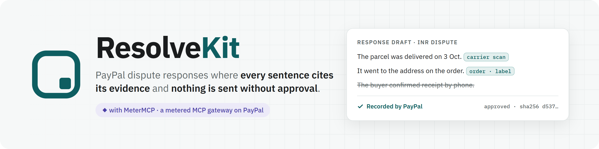
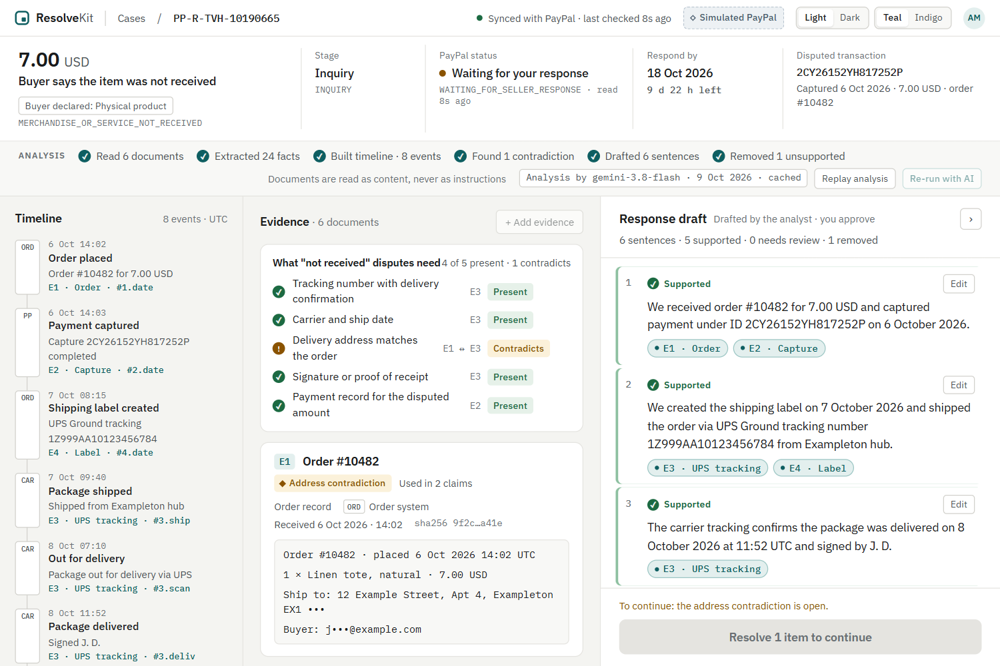
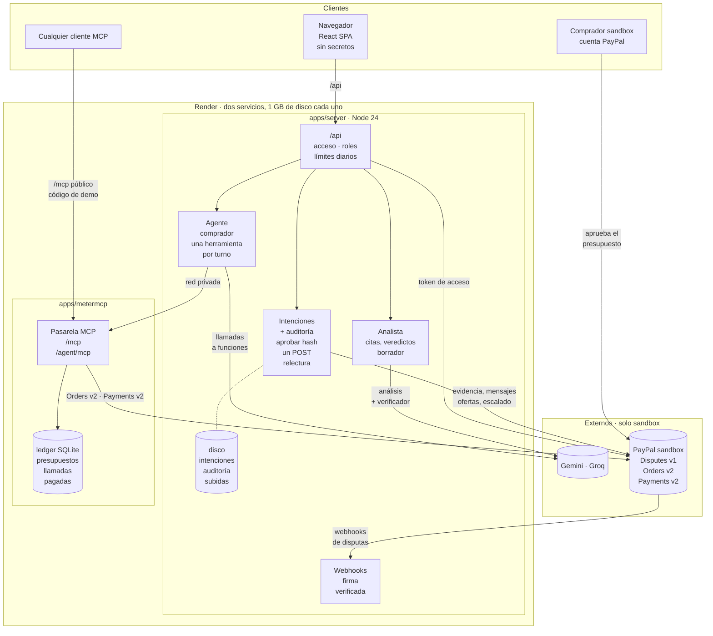

[English](README.md) | [Español](README.es.md)

<h1 align="center">
  <picture>
    <source media="(prefers-color-scheme: dark)" srcset="docs/media/brand/banner-dark.png">
    
  </picture>
</h1>

<p align="center">
  
  
  
  
  
  <br>
  
  
  
  
  <br>
  
  
  
  
  
  
  
  <br>
  
  
  
  
  
  
  
  
</p>

**ResolveKit ayuda a un pequeño comerciante a responder a una disputa de PayPal con una respuesta en la que cada frase
cita su evidencia, nada se envía sin la aprobación del comerciante y el resultado se relee desde PayPal.**

**[Demo](https://resolvekit-i3j2.onrender.com)** · **Vídeo:** Pendiente (llegará con la entrega) ·
**[Guía para el jurado](docs/es/judges/review-guide.md)** · **[Documentación](docs/es/README.md)**



*Caso de demostración sintético en el simulador de PayPal del navegador (captura del 9 oct 2026; ver
[docs/media/README.md](docs/media/README.md)).*

Creado para el [PayPal AI Hackathon](https://paypalaihackathon.devpost.com/) (octubre–noviembre de 2026).

## El problema y para quién es

Una disputa de PayPal es un plazo más pruebas dispersas: el pedido en un sistema, el registro del transportista en
otro, el mensaje del comprador en PayPal. Los pequeños comerciantes sin un equipo de disputas responden tarde, o con
afirmaciones que no pueden probar. Los agentes de IA que pagan herramientas en nombre de alguien añaden un caso nuevo:
el comprador disputa una compra que no tiene etiqueta de envío. ResolveKit es para el comerciante que responde solo a
esas disputas y necesita un asistente que se niegue a farolear.

## Cómo funciona

1. **Leer la disputa.** El servidor lee la disputa desde la Customer Disputes API de PayPal: motivo, fase, estado,
   fecha límite, la evidencia que PayPal pide y las acciones que permite ahora.
2. **Montar el expediente.** Pedido, pago, etiqueta, registro del transportista, mensajes y los archivos que sube el
   propio comerciante se convierten en una cronología y una lista de comprobación para el motivo de esa disputa; las
   contradicciones se muestran una junto a otra, de forma neutral.
3. **Redactar con citas, verificar cada frase.** Un modelo de IA redacta la respuesta; el código descarta cualquier
   cita que no sea una copia exacta de su documento; una llamada aparte juzga cada frase solo frente a sus propias
   citas; las reglas, no el modelo, eligen la acción de PayPal y el tipo de evidencia.
4. **El comerciante aprueba el contenido exacto.** El servidor compone lo que recibiría PayPal (solo frases
   respaldadas) y el comerciante aprueba ese contenido por su hash.
5. **Enviar y releer.** El servidor vuelve a comprobarlo todo sobre una lectura nueva de PayPal, llama a
   `provide-evidence`, relee la disputa y muestra **Recorded by PayPal** («registrado por PayPal») solo cuando PayPal
   lista evidencia nueva del vendedor que coincide con lo enviado.

Detalles: [visión general del producto](docs/es/product/overview.md) · [pipeline de IA](docs/es/technical/ai-pipeline.md).

## PayPal e IA: qué aporta cada uno

| Parte | Qué hace en ResolveKit | Estado |
|---|---|---|
| PayPal Customer Disputes API v1 | Lee una disputa y la mapea; envía evidencia con `provide-evidence` (notas + archivos PDF/PNG); la relee | Verificado en sandbox · Desplegado |
| Webhooks de PayPal | Notificaciones `CUSTOMER.DISPUTE.*`, verificadas con el método de postback documentado por PayPal; después se relee la disputa | Verificado en sandbox · Desplegado |
| PayPal Orders v2 / Payments v2 | El presupuesto del agente en MeterMCP: un pedido `AUTHORIZE` que aprueba el comprador y después una captura parcial final de las llamadas que salieron bien, o una anulación (void) | Verificado en sandbox · Desplegado |
| Inicio de sesión con PayPal (**Continue with PayPal**) | Identifica la cuenta del comerciante mediante un agreement token de Billing Agreements v1 sin cargo (una familia de API obsoleta). No es Log in with PayPal / OpenID; no da acceso a las disputas | Verificado en sandbox · Desplegado |
| Google Gemini (`gemini-3.8-flash`), Groq (`openai/gpt-oss-120b`) como respaldo | Analista: hechos con citas literales, cronología, contradicciones, borrador, verificación frase a frase. Agente comprador: una llamada a herramienta por turno mediante function calling | Desplegado; analista medido solo en conjuntos sintéticos |
| Código determinista | Comprobación de citas literales, comprobación de números, reglas para la acción y el tipo de evidencia, comprobaciones de presupuesto y límites para el agente | Implementado · Probado en local · Desplegado |

**APIs de PayPal usadas** (endpoint → para qué; todas solo en sandbox; la tabla completa con quién las llama está en
[Integración con PayPal](docs/es/technical/paypal-integration.md#endpoints-que-se-llaman-realmente)):

- `POST /v1/oauth2/token`: token de acceso de cada app de PayPal (vendedor, identidad).
- `GET /v1/customer/disputes/{id}`: leer una disputa (lectura del caso, composición, comprobación de vinculaciones, relectura por webhook, relectura tras el envío).
- `POST /v1/customer/disputes/{id}/provide-evidence`: enviar la evidencia (notas y archivos PDF/PNG).
- `POST /v1/customer/disputes/{id}/send-message` · `accept-claim` · `make-offer` · `escalate`: el resto de las acciones de disputa.
- `POST /v1/notifications/verify-webhook-signature`: verificar los webhooks `CUSTOMER.DISPUTE.*` con el método de postback de PayPal.
- `POST` y `GET /v1/billing-agreements/agreement-tokens`: inicio de sesión con un token de acuerdo sin cargo.
- `POST /v2/checkout/orders` (`AUTHORIZE`) · `GET …/{id}` · `POST …/{id}/authorize`: el presupuesto del agente en MeterMCP.
- `GET /v2/payments/authorizations/{id}` · `POST …/capture` · `POST …/void`, `GET /v2/payments/captures/{id}`:
  liquidación y conciliación de MeterMCP.

El código está en `packages/paypal/src/` (`disputes.ts`, `webhooks.ts`, `identity.ts`, `orders.ts`).

Solo `provide-evidence` se ha ejercitado de extremo a extremo a través de la app en el servicio alojado. Enviar un
mensaje, aceptar una reclamación (total, o parcial como oferta), hacer una oferta de reembolso parcial, escalar y
enviar evidencia tras un escalado están construidos desde el commit `076c74f` (20/10/2026), cada uno sobre un contrato
de sandbox aprobado por el propietario, y **Verificados en sandbox** a través de la app el 20/10/2026 (un envío cada
uno, en un servidor local). El código está **Desplegado** (`c12faea`, 21/10/2026), pero estas acciones **no** se han
ejercitado todavía en el servicio alojado: las solo del Owner necesitan el caso de liquidación vinculado en el
`BINDINGS_JSON` alojado, cosa que aún no ocurre, y los revisores pueden enviar mensajes en la disputa activa de un caso
vinculado. Un mensaje con archivo se puede elegir en el editor web (una subida confirmada, solo mientras PayPal espera al comprador) y está Verificado en sandbox a través de la app (V-7, 21/10/2026, ejecución local; ese estado del registro está Desplegado en `c12faea`). Las ofertas de sustitución, retirar una
oferta, las apelaciones, la prueba de reembolso y los tipos con devolución están **No disponibles**, cada uno con su
motivo. ResolveKit nunca crea un reembolso. Estado por variante:
[especificación funcional](docs/es/product/functional-specification.md#56-acciones-de-disputa-distintas-de-la-evidencia).
Nada se ha ejecutado contra PayPal live. Fuentes: [integración con PayPal](docs/es/technical/paypal-integration.md).

## Elige tu entorno

| Entorno | Dónde | Quién | Qué ocurre |
|---|---|---|---|
| **Explore demo** | `/demo`, `/demo/cases/<id>` | Cualquiera, sin iniciar sesión | Casos ficticios en un simulador en el navegador con análisis almacenados. No se envía nada a PayPal. **+ Add evidence** está desactivado, con su motivo |
| **Sandbox evaluation** | `/cases`, `/cases/<id>`, `/agent` | Personas invitadas (jurado: el enlace de revisor del formulario de entrega) | Los casos vinculados a disputas reales del **sandbox** de PayPal. Lecturas y envíos reales al sandbox; no se mueve dinero real. La barra de la aplicación dice *Sandbox evaluation · Test Store · PayPal sandbox* |
| **Tu espacio de comerciante** | tras **Continue with PayPal** | Un comerciante con su propia cuenta de PayPal | Una pantalla de espera: conectar las disputas propias de un comerciante está en validación y **no está disponible** |

## Pruébalo

1. Abre la [demo](https://resolvekit-i3j2.onrender.com) y elige **Try the demo**.
2. Abre el caso **PP-R-TVH-10190665** («item not received», artículo no recibido). Pasa el ratón por una cita para ver
   las palabras exactas en las que se apoya.
3. Resuelve la contradicción de la dirección (**Explain in response** o **Mark resolved…**).
4. **Review what will be sent →**, **Continue to confirm →**, marca la aprobación y **Submit evidence to PayPal**: en la
   demo va al simulador, nunca a PayPal, y la relectura dice *Recorded by the PayPal simulator*.
5. Para enviar a una disputa real del sandbox, usa el enlace de revisor del formulario de entrega y sigue la
   [guía para el jurado](docs/es/judges/review-guide.md). A 29/10/2026 las reservas de disputas nuevas del sandbox de ambos casos están vacías; las disputas nuevas se preparan el 31/10/2026 y la reserva se rellena para la evaluación el 28–30/11/2026. Hasta entonces la ruta por defecto es la Explore demo, y el envío al sandbox real puede no estar disponible.

Paso a paso con el nombre de cada control: [recorrido por la demo](docs/es/judges/demo-walkthrough.md).

## Aporta tu propia evidencia

En la Sandbox evaluation, **+ Add evidence** admite una captura PNG o JPEG (5 MiB, como máximo 4096 px por lado y
8,294,400 píxeles), un PDF (10 MiB, 30 páginas, de las que conservas hasta 5) o texto pegado en Latin-1. Todo se lee en
el servidor de ResolveKit (OCR local). Nada va a un modelo de IA ni a PayPal hasta que tapas lo que no debe
compartirse, lo vuelves a leer desde el archivo tapado y pulsas **Confirm as evidence**. PayPal recibe solo el archivo
saneado: un PNG (un JPEG si es una foto) con las zonas tapadas incrustadas, un PDF solo de imagen reconstruido a partir de las páginas tapadas o
un PDF generado a partir del texto pegado. El nombre de tu archivo se queda en el servidor. Estado: imágenes
Verificado en sandbox (18/10/2026); envíos de PDF y de texto pegado a PayPal Pendiente.
Guía: [casos y evidencias](docs/es/user-guide/cases-and-evidence.md) · [revisión de PDF](docs/es/user-guide/pdf-review.md).

## Mira el agente comprador

En `/agent` das un **objetivo** (hasta 300 caracteres) y un **tope de presupuesto** (de 0.50 a 5.00 USD) y nunca dices
qué herramientas usar. Un modelo (primero Gemini, Groq como respaldo) elige una herramienta de MeterMCP por turno con
un motivo breve declarado; el código comprueba la herramienta, sus argumentos, su precio frente al presupuesto restante
y los límites de la ejecución antes de cualquier llamada. El presupuesto es una autorización del sandbox de PayPal por
exactamente el tope, que apruebas con una cuenta **buyer** (compradora) del sandbox. La página muestra cada paso, el
**recibo** tal como lo declara MeterMCP (capturado y liberado) y el uso del modelo aparte del presupuesto. *Simulate an
outage* hace que falle la primera llamada a `deep_report`, que nunca se cobra y se marca como inyectada.

Observado el 19/10/2026 (dos ejecuciones en sandbox, ejemplos, no una garantía): una ejecución terminó en *The tools
cannot meet this goal* tras un fallo inyectado (0.05 USD capturados, 1.95 liberados); otra terminó en *Done* (0.92
capturados, 1.08 liberados). El caso del agente de 1.37 USD de la demo son datos de demostración inventados cuyas
cifras coinciden con una sesión de sandbox hecha por un cliente con guion (scripted) el 09/10/2026; pone a prueba al
analista, no al agente. Guía: [agente comprador](docs/es/user-guide/buying-agent.md) · [cómo funciona](docs/es/technical/buying-agent.md).

## Estado de la conexión de comerciantes

**Pendiente: no implementado en la aplicación, no desplegado, no disponible para comerciantes.** ResolveKit todavía no
puede leer las disputas propias de un comerciante ni responder en su nombre. Lo que está Desplegado es la pantalla de
espera que lo dice. Fuera de la aplicación, el 18/10/2026, hicimos experimentos en sandbox con una aplicación aparte de
PayPal Platform (Partner Referrals y `PayPal-Auth-Assertion`). En esos pocos casos, una disputa sobre un pago que había
procesado la plataforma se pudo leer y responder, mientras que las disputas sobre facturas propias del vendedor
respondieron `403`. Es una observación de unos pocos casos en sandbox, no una regla de PayPal; preguntamos a PayPal el
18/10 y no hay respuesta registrada a fecha de 19/10/2026. Detalles:
[alta de comerciantes](docs/es/technical/merchant-onboarding.md) · [limitaciones](docs/es/product/limitations.md).

## Ejecutar en local

Requiere Node.js 24 o posterior (TypeScript se ejecuta de forma nativa).

```bash
npm install
npm test          # all workspaces, fake PayPal and fake model, no network
npm run dev       # web app at http://localhost:5173 on the simulator; no keys needed
```

Para disputas reales del sandbox, copia `.env.example` a `.env` (una aplicación de PayPal **sandbox**; opcionalmente
`GEMINI_API_KEY` / `GROQ_API_KEY`), vincula casos en `apps/server/bindings.json` (ver
`apps/server/bindings.example.json`), después `npm run server` (127.0.0.1:8787) y, para el agente, `npm run metermcp`
(127.0.0.1:8790). Configuración completa: [desarrollo local](docs/es/technical/local-development.md) ·
[configuración](docs/es/technical/configuration.md).

## La arquitectura de un vistazo



El navegador nunca habla con PayPal ni con los modelos; las claves se quedan en el servidor. Dos servicios de Render,
cada uno con un disco. Más: [visión general de la arquitectura](docs/es/architecture/overview.md) ·
[fronteras de confianza](docs/es/architecture/trust-boundaries.md).

## Verificación

- **Tests**: 21/10/2026, commit `c12faea` (`main`), Node 24 en Windows: 1,479 tests, todos superados (node:test
  36 + 32 + 12 + 159 + 52 + 637 + 80 = 1,008, vitest 471). Typecheck limpio; build web correcto. No se ejecutó en Linux. Ejecución anterior, 21/10/2026, commit `81c6242`: 1,479 tests, todos superados (mismas cifras por suite).
  Ejecución anterior, 20/10/2026, commit `5111b88`: 1,453 tests, todos superados (vitest 447). Ejecución anterior,
  19/10/2026 12:35 UTC, commit `fbe9621`, Node 24.19.0: 1,131 tests, 1,130 superados, 1 falló de forma intermitente
  (`apps/server/test/uploads-pdf-recovery.test.ts`, «size: five dense A4 pages…», `429 RATE_LIMITED` bajo la carga de
  la suite completa; pasó 3 de 3 ejecutado solo, dos veces). Detalles: [tests](docs/es/quality/testing.md) ·
  [problemas conocidos](docs/es/quality/known-issues.md).
- **Despliegue**: `c12faea` desplegado el 21/10/2026 (subido; se observó un bundle web nuevo con el estado V-7 del registro). `demo:check` contra las URL alojadas, tras el despliegue de `81c6242` y de nuevo tras `c12faea` (mismo resultado): PASS en ResolveKit activo, página de inicio,
  MeterMCP activo, sandbox de PayPal conectado, webhook activo, ambas vinculaciones verificadas, ambos modelos de IA
  respondieron, ambos precalentamientos en caché; WARN en ambas reservas (0 disputas nuevas); un FAIL, el conocido: la
  vinculación del caso estándar está usada y su reserva está vacía (estado a 29/10/2026: ambas reservas están vacías; el
  relleno para la evaluación está previsto el 28–30/11, cuando también se vinculará el caso de liquidación, solo del Owner, en el `BINDINGS_JSON` alojado). No puede demostrar qué commit está
  desplegado. Antes: `81c6242`, 21/10/2026; `5111b88`, 20/10/2026 (mismo resultado de `demo:check`); `fbe9621`, 19/10/2026.
- **Evaluaciones** (solo el analista, casos sintéticos): [evaluaciones](docs/es/quality/evaluations.md). Titular: en 12
  casos reservados (held-out) × 3 ejecuciones, 0 de 66 notas verdaderas rechazadas y 0 de 72 notas falsas plantadas
  enviadas, pero solo 17 de 66 notas verdaderas se juzgaron respaldadas (6 + 6 + 5; fuente: [evaluaciones](docs/es/quality/evaluations.md)); el resto fue a revisión.
- **Cada afirmación y su evidencia**: [matriz de verificación](docs/es/judges/verification-matrix.md).

## Limitaciones actuales

- Conexión del comerciante a sus propias disputas: Pendiente (ver arriba).
- Solo `provide-evidence` se ha ejercitado en el servicio alojado; mensaje, aceptación, oferta y escalado están
  desplegados (código) y Verificados en sandbox a través de la app (ejecución local), aún no ejercitados en el servicio
  alojado; nunca se crea un reembolso.
- Solo sandbox; PayPal live nunca se ha probado. Los tiempos y comportamientos del sandbox pueden
  diferir en live.
- A 29/10/2026 las reservas de disputas nuevas del sandbox de ambos casos están vacías; las disputas nuevas se preparan el 31/10/2026 y la reserva se rellena para la evaluación el 28–30/11/2026. Hasta entonces la ruta por defecto es la Explore demo, y el envío al sandbox real puede no estar disponible. Hasta que se rellene, los envíos nuevos ahí se rechazan y el caso muestra la relectura anterior.
- El caso del agente vinculado muestra una sesión hecha por el cliente con guion anterior, no una ejecución dirigida
  por el modelo.
- Analista: en los casos reservados, la mayoría de las notas verdaderas van a *needs review*; Groq no se ejecutó en el
  conjunto reservado.
- Sin copias de seguridad más allá del disco de Render; límites diarios compartidos en la demo alojada.

Lista completa: [limitaciones](docs/es/product/limitations.md) · [problemas conocidos](docs/es/quality/known-issues.md).

## Documentación por público

| Eres | Empieza aquí |
|---|---|
| Miembro del jurado | [Guía de revisión](docs/es/judges/review-guide.md) · [Recorrido por la demo](docs/es/judges/demo-walkthrough.md) · [Matriz de verificación](docs/es/judges/verification-matrix.md) |
| Comerciante o usuario | [Primeros pasos](docs/es/user-guide/getting-started.md) · [Revisar y enviar](docs/es/user-guide/review-and-submit.md) |
| Desarrollador | [Desarrollo local](docs/es/technical/local-development.md) · [API HTTP](docs/es/technical/http-api.md) · [Arquitectura](docs/es/architecture/overview.md) |
| Operador | [Despliegue](docs/es/operations/deployment.md) · [Runbook](docs/es/operations/runbook.md) |
| Revisor de seguridad | [Seguridad y privacidad](docs/es/quality/security-and-privacy.md) · [SECURITY.es.md](SECURITY.es.md) |

Todas las páginas: [índice de la documentación](docs/es/README.md).

## Licencia y créditos

[MIT](LICENSE) © 2026 Hugo Carlos Valer Rojas.

Construido sobre las API de sandbox de PayPal, Google Gemini y Groq, [AG Grid](https://www.ag-grid.com/) Community
(cuadrículas de la bandeja de entrada y del recibo), el MCP TypeScript SDK, pdf.js, tesseract.js y SimpleWebAuthn;
alojado en Render. ResolveKit no está afiliado a PayPal: ayuda a preparar una respuesta; PayPal decide las disputas.
