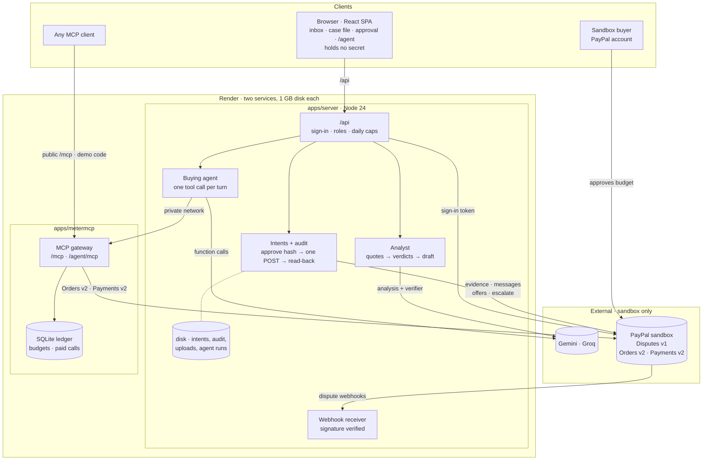

[English](README.md) | [Español](README.es.md)

# ResolveKit

**ResolveKit helps a small merchant answer a PayPal dispute with a response in which every sentence cites its
evidence, nothing is sent without the merchant's approval, and the result is read back from PayPal.**

**[Demo](https://resolvekit-i3j2.onrender.com)** · **Video:** Pending (coming with the submission) ·
**[Judge guide](docs/judges/review-guide.md)** · **[Documentation](docs/README.md)**


*Synthetic demo case on the in-browser PayPal simulator (screenshot of 9 Oct 2026; see
[docs/media/README.md](docs/media/README.md)).*

Built for the [PayPal AI Hackathon](https://paypalaihackathon.devpost.com/) (October–November 2026).

## The problem and who it is for

A PayPal dispute is a deadline plus scattered proof: the order in one system, the carrier record in another, the
buyer's message in PayPal. Small merchants without a disputes team answer late, or with claims they cannot prove.
AI agents that pay for tools on someone's behalf add a new case: the buyer disputes a purchase that has no shipping
label. ResolveKit is for the merchant who answers those disputes alone and needs an assistant that refuses to bluff.

## How it works

1. **Read the dispute.** The server reads the dispute from PayPal's Customer Disputes API: reason, stage, status, due
   date, the evidence PayPal requests and the actions it allows now.
2. **Build the case file.** Order, payment, label, carrier record, messages and the merchant's own uploads become one
   timeline and a checklist for that dispute reason; contradictions are shown side by side, neutrally.
3. **Draft with citations, verify each sentence.** An AI model drafts the response; code drops any quote that is not
   an exact copy of its document; a separate call judges each sentence against its own quotes only; rules, not the
   model, choose the PayPal action and evidence type.
4. **The merchant approves exact content.** The server composes what PayPal would receive (supported sentences only)
   and the merchant approves that content by its hash.
5. **Send and read back.** The server re-checks everything on a fresh PayPal read, calls `provide-evidence`, reads the
   dispute back and shows **Recorded by PayPal** only when PayPal lists new seller evidence that matches what was
   sent.

Details: [product overview](docs/product/overview.md) · [AI pipeline](docs/technical/ai-pipeline.md).

## PayPal and AI: what each contributes

| Part | What it does in ResolveKit | Status |
|---|---|---|
| PayPal Customer Disputes API v1 | Read a dispute and map it; send evidence with `provide-evidence` (notes + PDF/PNG files); read it back | Verified in sandbox · Deployed |
| PayPal webhooks | `CUSTOMER.DISPUTE.*` notifications, verified with PayPal's documented postback method, then the dispute is re-read | Verified in sandbox · Deployed |
| PayPal Orders v2 / Payments v2 | MeterMCP's agent budget: an `AUTHORIZE` order the buyer approves, then a final partial capture of the calls that succeeded, or a void | Verified in sandbox · Deployed |
| PayPal sign-in (**Continue with PayPal**) | Identifies the merchant's account through a no-charge Billing Agreements v1 agreement token (a deprecated API family). Not Log in with PayPal / OpenID; grants no access to disputes | Verified in sandbox · Deployed |
| Google Gemini (`gemini-3.8-flash`), Groq (`openai/gpt-oss-120b`) as fallback | Analyst: facts with verbatim quotes, timeline, contradictions, draft, per-sentence verification. Buying agent: one tool call per turn through function calling | Deployed; analyst measured on synthetic sets only |
| Deterministic code | Verbatim-quote check, numbers check, rules for action and evidence type, budget and limit checks for the agent | Implemented · Tested locally · Deployed |

Only `provide-evidence` has been exercised end to end through the app on the hosted service. Sending a message,
accepting a claim (full, or partial as an offer), making a partial-refund offer, escalating and sending evidence after
an escalation are built from commit `076c74f` (20/10/2026), each on a sandbox contract the owner approved, and
**Verified in sandbox** through the app on 20/10/2026 (one send each, on a local server). The code is **Deployed**
(`c12faea`, 21/10/2026), but these actions have **not** yet been exercised on the hosted service: the owner-only ones
need the settlement case bound in the hosted `BINDINGS_JSON`, which it is not yet, and reviewers can send messages on
a bound case's active dispute. A message with a file is selectable in the web composer (one confirmed upload, only while PayPal waits for the buyer) and is Verified in sandbox through the app (V-7, 21/10/2026, a local run; that registry status is Deployed in `c12faea`). Replacement offers, offer withdrawal, appeals, proof of refund and the return types are
**Not available**, each with its reason. ResolveKit never creates a refund. Per-variant status:
[functional specification](docs/product/functional-specification.md#56-dispute-actions-other-than-evidence). Nothing
has run against live PayPal. Sources: [PayPal integration](docs/technical/paypal-integration.md).

## Choose your environment

| Environment | Where | Who | What happens |
|---|---|---|---|
| **Explore demo** | `/demo`, `/demo/cases/<id>` | Everyone, no sign-in | Fictional cases on an in-browser simulator with stored analyses. Nothing is sent to PayPal. **+ Add evidence** is disabled, with its reason |
| **Sandbox evaluation** | `/cases`, `/cases/<id>`, `/agent` | Invited people (judges: the reviewer link from the submission form) | The cases bound to real PayPal **sandbox** disputes. Real reads and sends to the sandbox; no real money moves. The app bar reads *Sandbox evaluation · Test Store · PayPal sandbox* |
| **Your merchant space** | after **Continue with PayPal** | A merchant with their own PayPal account | A waiting screen: connecting a merchant's own disputes is in validation and **not available** |

## Try it

1. Open the [demo](https://resolvekit-i3j2.onrender.com) and choose **Try the demo**.
2. Open case **PP-R-TVH-10190665** ("item not received"). Hover a citation to see the exact words it rests on.
3. Resolve the address contradiction (**Explain in response** or **Mark resolved…**).
4. **Review what will be sent →**, **Continue to confirm →**, tick the approval and **Submit evidence to PayPal**: on
   the demo it goes to the simulator, never to PayPal, and the read-back says *Recorded by the PayPal simulator*.
5. To send to a real sandbox dispute, use the reviewer link from the submission form and follow the
   [judge guide](docs/judges/review-guide.md) (only while the case has a fresh dispute; the standard case's reserve
   was empty on 19/10/2026).

Step by step with every control name: [demo walkthrough](docs/judges/demo-walkthrough.md).

## Bring your own evidence

In the sandbox evaluation, **+ Add evidence** takes a PNG or JPEG screenshot (5 MiB, at most 4096 px a side and
8,294,400 pixels), a PDF (10 MiB, 30 pages, of which you keep up to 5) or pasted Latin-1 text. Everything is read on
the ResolveKit server (local OCR). Nothing goes to an AI model or PayPal until you cover what must not be shared, read
it again from the covered file and **Confirm as evidence**. PayPal receives only the sanitised file: a PNG (a JPEG
for a photo) with the covers burned in, an image-only PDF rebuilt from the covered pages, or a PDF made from the pasted text. Your file
name stays on the server. Status: images Verified in sandbox (18/10/2026); PDF and pasted-text sends to PayPal Pending.
Guide: [cases and evidence](docs/user-guide/cases-and-evidence.md) · [PDF review](docs/user-guide/pdf-review.md).

## See the buying agent

On `/agent` you give a **goal** (up to 300 characters) and a **budget cap** (0.50 to 5.00 USD) and never say which
tools to use. A model (Gemini first, Groq as fallback) picks one MeterMCP tool per turn with a short stated reason;
code checks the tool, its arguments, its price against the remaining budget and the run limits before any call. The
budget is a PayPal sandbox authorization for exactly the cap, which you approve with a sandbox **buyer** account. The
page shows each step, the **receipt** as MeterMCP states it (captured and released), and the model usage apart from
the budget. *Simulate an outage* makes the first `deep_report` call fail, never charged and marked injected.

Observed on 19/10/2026 (two sandbox runs, examples, not a guarantee): one run ended *The tools cannot meet this goal*
after an injected failure (0.05 USD captured, 1.95 released); one ended *Done* (0.92 captured, 1.08 released).
The 1.37 USD agent case in the demo is invented demo data whose figures match a sandbox session made by a scripted
client on 09/10/2026; it tests the analyst, not the agent. Guide: [buying agent](docs/user-guide/buying-agent.md) · [how it works](docs/technical/buying-agent.md).

## Merchant connection status

**Pending: not implemented in the app, not deployed, not available to merchants.** ResolveKit cannot yet read a
merchant's own disputes or answer on their behalf. What is Deployed is the waiting screen that says so. Outside the
app, on 18/10/2026, we ran sandbox experiments with a separate PayPal Platform app (Partner Referrals and
`PayPal-Auth-Assertion`). In those few cases, a dispute on a payment the platform processed could be read and answered,
while disputes on the seller's own invoices answered `403`. This is an observation of a few sandbox cases, not a
PayPal rule; we asked PayPal on 18/10 and have no answer as of 19/10. Details:
[merchant onboarding](docs/technical/merchant-onboarding.md) · [limitations](docs/product/limitations.md).

## Run locally

Requires Node.js 24 or later (TypeScript runs natively).

```bash
npm install
npm test          # all workspaces, fake PayPal and fake model, no network
npm run dev       # web app at http://localhost:5173 on the simulator; no keys needed
```

For real sandbox disputes, copy `.env.example` to `.env` (a PayPal **sandbox** app; optionally `GEMINI_API_KEY` /
`GROQ_API_KEY`), bind cases in `apps/server/bindings.json` (see `apps/server/bindings.example.json`), then
`npm run server` (127.0.0.1:8787) and, for the agent, `npm run metermcp` (127.0.0.1:8790). Full setup:
[local development](docs/technical/local-development.md) · [configuration](docs/technical/configuration.md).

## Architecture at a glance



The browser never talks to PayPal or the models; keys stay on the server. Two Render services, each with a disk.
More: [architecture overview](docs/architecture/overview.md) · [trust boundaries](docs/architecture/trust-boundaries.md).

## Verification

- **Tests**: 21/10/2026, commit `c12faea` (`main`), Node 24 on Windows: 1,479 tests, all passed (node:test 36 + 32 + 12 +
  159 + 52 + 637 + 80 = 1,008, vitest 471). Typecheck clean; web build OK. Not run on Linux. Earlier run, 21/10/2026, commit `81c6242`: 1,479 tests, all passed (same per-suite counts). Earlier run, 20/10/2026,
  commit `5111b88`: 1,453 tests, all passed (vitest 447). Earlier run, 19/10/2026 12:35 UTC, commit
  `fbe9621`, Node 24.19.0: 1,131 tests, 1,130 passed, 1 failed intermittently
  (`apps/server/test/uploads-pdf-recovery.test.ts`, «size: five dense A4 pages…», `429 RATE_LIMITED` under full-suite
  load; it passed 3 of 3 run alone, twice). Details: [testing](docs/quality/testing.md) ·
  [known issues](docs/quality/known-issues.md).
- **Deployment**: `c12faea` deployed on 21/10/2026 (pushed; a new web bundle with the V-7 registry status was observed). `demo:check` against the hosted URLs, after the deploy of `81c6242` and again after `c12faea` (same result): PASS on ResolveKit up, landing, MeterMCP up, PayPal sandbox
  connected, webhook on, both bindings verified, both AI models answered, both warm-ups cached; WARN on both reserves
  (0 fresh disputes); one FAIL, the known one: the standard case's binding is used and its reserve is empty (refill
  planned 25-30/11, when the owner-only settlement case will also be bound in the hosted `BINDINGS_JSON`). It cannot prove
  which commit is live. Earlier: `81c6242`, 21/10/2026; `5111b88`, 20/10/2026 (same `demo:check` result); `fbe9621`, 19/10/2026.
- **Evaluations** (analyst only, synthetic cases): [evaluations](docs/quality/evaluations.md). Headline: on 12 held-out
  cases × 3 runs, 0 of 66 true notes rejected and 0 of 72 planted false notes sent, but only 17 of 66 true notes were
  judged supported (6 + 6 + 5; source: [evaluations](docs/quality/evaluations.md)); the rest went to review.
- **Every claim and its evidence**: [verification matrix](docs/judges/verification-matrix.md).

## Current limitations

- Merchant connection to their own disputes: Pending (see above).
- Only `provide-evidence` has been exercised on the hosted service; messages, accept, offer and escalate are deployed
  (code) and Verified in sandbox through the app (local run), not yet exercised on the hosted service; no refund is ever
  created.
- Sandbox only; live PayPal never exercised. Sandbox timings and behaviours may differ in live.
- The standard evaluation case's reserve of fresh sandbox disputes was empty on 19/10/2026: until it is refilled, new
  sends there are refused and the case shows the earlier read-back.
- The bound agent case shows a session made by the earlier scripted client, not a model-driven run.
- Analyst: on held-out cases most true notes go to *needs review*; Groq was not run on the held-out set.
- No backups beyond the Render disk; shared daily caps on the hosted demo.

Full list: [limitations](docs/product/limitations.md) · [known issues](docs/quality/known-issues.md).

## Documentation by audience

| You are | Start here |
|---|---|
| A judge | [Review guide](docs/judges/review-guide.md) · [Demo walkthrough](docs/judges/demo-walkthrough.md) · [Verification matrix](docs/judges/verification-matrix.md) |
| A merchant or user | [Getting started](docs/user-guide/getting-started.md) · [Review and submit](docs/user-guide/review-and-submit.md) |
| A developer | [Local development](docs/technical/local-development.md) · [HTTP API](docs/technical/http-api.md) · [Architecture](docs/architecture/overview.md) |
| An operator | [Deployment](docs/operations/deployment.md) · [Runbook](docs/operations/runbook.md) |
| Security reviewer | [Security and privacy](docs/quality/security-and-privacy.md) · [SECURITY.md](SECURITY.md) |

All pages: [documentation index](docs/README.md).

## License and credits

[MIT](LICENSE) © 2026 Hugo Carlos Valer Rojas.

Built on PayPal's sandbox APIs, Google Gemini and Groq, [AG Grid](https://www.ag-grid.com/) Community (inbox and
receipt grids), the MCP TypeScript SDK, pdf.js, tesseract.js and SimpleWebAuthn; hosted on Render. ResolveKit is not
affiliated with PayPal: it helps prepare a response; PayPal decides disputes.
