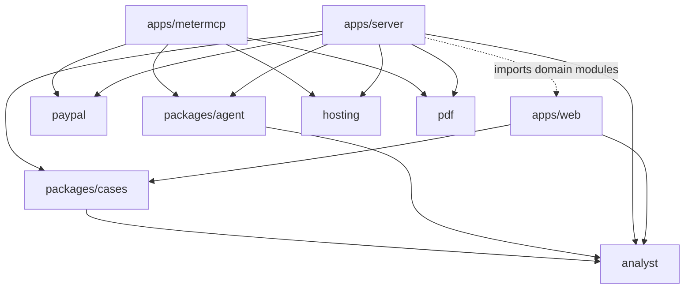

[English](components.md) | [Español](../es/architecture/components.md)

# Components

An npm workspace (`package.json`, Node `>=24`, TypeScript run natively by Node, no build step for the server or
MeterMCP). Three apps and six packages. Code at commit `fbe9621`.

`apps/server` imports several modules from `apps/web/src/domain/` directly (`intent.ts`, `draft.ts`, `recorded.ts`,
`binding.ts`, `types.ts`, `time.ts`) so the browser and the server compose and check intents with the same code.

## Apps

### `apps/web` — the merchant workspace (browser)

Vite 5 + React 18 + TypeScript + Tailwind CSS; AG Grid Community 33.3.2 for the inbox and the receipt grid.

| Area | Main files | Responsibility |
|---|---|---|
| Routing and environment | `App.tsx`, `domain/environment.ts`, `domain/copy.ts` | Explore demo, sandbox evaluation, waiting screen; decided from `/api/auth/me` |
| Case file | `pages/CasePage.tsx`, `components/Timeline.tsx`, `EvidenceCard.tsx`, `ResponseComposer.tsx`, `SentenceRow.tsx` | Timeline, evidence, draft with citations and verdicts |
| Review and send | `components/ApproveFlow.tsx`, `domain/intent.ts`, `domain/draft.ts`, `domain/recorded.ts` | Shows the server's intent, approves by hash, reads back, decides «Recorded by PayPal» |
| PayPal access | `domain/httpGateway.ts` (bound cases, through the server), `domain/gateway.ts` (simulator) | Same interface for real sandbox and simulated PayPal |
| Uploads | `components/AddEvidence.tsx`, `UploadReview.tsx`, `PdfReview.tsx`, `PdfSelect.tsx`, `app/useUploads.ts` | Upload, cover, review text, correct and transcribe, confirm |
| Agent | `pages/AgentPage.tsx`, `domain/agentRun.ts`, `domain/compare.ts`, `app/useAgentRun.ts` | Goal and cap, steps, receipt, usage, Stop, Compare, Keep |
| Accounts | `pages/AuthPages.tsx`, `components/AccountMenu.tsx`, `domain/authClient.ts` | Sign-in, invites, passkeys, members |
| Dev proxy guard | `vite.config.ts`, `src/proxyGuard.ts` | Adds the per-launch token server-side; refuses cross-site requests |

No `VITE_*` variable is read; nothing secret reaches the bundle.

### `apps/server` — the ResolveKit server

Node `http` with web-standard `Request`/`Response` handlers (`node.ts` adapts them). No framework.

| Module | Responsibility |
|---|---|
| `main.ts` | Reads the environment, builds every store and client, picks local or hosted mode, timers (upload sweep hourly, agent reconcile every 5 min, bindings file watch every 30 s), graceful stop |
| `app.ts` | The API: case reads, analysis routes, intents, evidence send, audit, health, notices, binding rotation, ops status |
| `hosted.ts` | Hosted wrapper: Host/Origin checks, per-IP limits, daily caps, seller gate, warm-up analyses, ops routes, static site |
| `auth.ts`, `accounts.ts`, `sellers.ts` | PayPal sign-in, invites, passkeys (`@simplewebauthn/server`), sessions, roles; remembered sellers of bound disputes |
| `bindings.ts` | Case → `{dispute, capture}` bindings and reserves; verification on a fresh PayPal read |
| `intents.ts` | Submission intents, approvals, send state machine, audit events and the append-only sends log |
| `mapping.ts`, `documents.ts` | PayPal dispute → case view; case documents and the PDFs sent to PayPal |
| `analysis.ts` | Analyst service: stored/live runs, progress, re-checks, hourly limits, input pins |
| `webhook.ts` | `POST /api/paypal/webhook/<key>`: checks, PayPal verification, re-read |
| `metermcp.ts` | Client of MeterMCP's admin routes and `/agent/mcp` URL |
| `uploads/*` | Upload routes, image decode, PDF child and job, OCR, text, documents (`E<n>`), permissions, store, limits |
| `agent/*` | Agent run service, run store, per-person caps, routes |
| `validate.ts` | Intent validation helpers |
| `scripts/demo-prepare*.ts`, `scripts/demo-check*.ts` | Operator scripts (see [local development](../technical/local-development.md)) |

### `apps/metermcp` — the metered MCP gateway

| Module | Responsibility |
|---|---|
| `main.ts` | Environment, ledger, meter, local/hosted mode, sweep and reconcile every 30 s |
| `app.ts` | HTTP routes and guards: `/mcp`, `/agent/mcp`, `/approved`, `/cancelled`, `/health`, `/healthz`, admin `/sessions…` |
| `mcp.ts` | MCP server (`@modelcontextprotocol/sdk` 1.32.1, Streamable HTTP, JSON responses), session caps and idle close |
| `tools.ts` | Paid synthetic tools and the price list |
| `meter.ts` | Payment sessions: budget order, approval check, reservations, settlement, reconciliation, injected failures |
| `ledger.ts` | SQLite ledger (`node:sqlite`): sessions and calls |
| `receipt.ts` | Receipt JSON and PDF (`@resolvekit/pdf`) with `receipt_sha256` |
| `scripts/demo-agent.ts` | CLI agent against public `/mcp` |

## Packages

| Package | Responsibility | Used by |
|---|---|---|
| `@resolvekit/paypal` | Typed PayPal REST client: OAuth token cache, retries, `PayPal-Request-Id`; disputes, webhooks verification, identity token, orders/payments | server, MeterMCP, scripts |
| `@resolvekit/analyst` | Prompts, schemas, providers (Gemini, Groq over `fetch`), pipeline, deterministic checks, injection scan, cache key, golden analyses, evals | server, web (key and types), agent, cases |
| `@resolvekit/agent` | Model-driven buying agent engine, model adapters with function calling, run limits | server, MeterMCP CLI, `demo:prepare` |
| `@resolvekit/cases` | Demo case fixtures and the assembly of case documents and analyst input, shared by web and server | web, server |
| `@resolvekit/hosting` | Hosted-mode helpers: daily counters, rate limiter, client address behind proxies, security headers, static site, `PAYPAL_ENV` guard | server, MeterMCP |
| `@resolvekit/pdf` | Minimal PDF writer: text PDFs (Helvetica, WinAnsi) and image-only PDFs | server, MeterMCP |

## Internal interfaces

All HTTP routes and MCP tools are **internal interfaces of this demo, not stable public APIs**: they change with the
code, without versioning or deprecation. Reference: [HTTP API](../technical/http-api.md),
[MCP tools](../technical/mcp-tools.md).

## Shared contracts and states

| Contract | Defined in | Shared by |
|---|---|---|
| `SubmissionIntent`, `IntentRequest`, `IntentStatus`, `parseIntentRequest` | `apps/web/src/domain/intent.ts` | web, server |
| Draft rules (`NOTES_LIMIT` 2 000, blockers) | `apps/web/src/domain/draft.ts` | web, server |
| «Recorded by PayPal» comparison | `apps/web/src/domain/recorded.ts` | web, server |
| `DisputeSnapshot`, `ActionCode` | `apps/web/src/domain/types.ts` | web, server |
| Analysis input, `analysisKey` (sha256 of canonical `{input, model, promptVersion}`) | `packages/analyst/src/key.ts`, `types.ts` | server, web (Web Crypto), evals |
| Case fixtures and documents | `packages/cases` | web, server, evals |
| Agent `RunLimits`, `Outcome`, `Settlement`, `Step` | `packages/agent/src/engine.ts` | server, CLI, `demo:prepare`, web (via API) |
| MeterMCP receipt | `apps/metermcp/src/receipt.ts` | server (`metermcp.ts`), web |

### State machines

**Submission intent** (`IntentStatus`):

| State | Meaning |
|---|---|
| `proposed` | Composed by the server; waiting for approval |
| `approved` | Approved by its owner with the content hash; can be sent |
| `sending` | Send in progress (one per dispute at a time) |
| `sent` | PayPal accepted the send; whether it is recorded is read back |
| `failed` | The send failed; the same intent (same `PayPal-Request-Id`) may be retried for 30 min |
| `invalidated` | Replaced by an edit, a newer intent, changed documents or bindings; never sendable |
| `expired` | Not approved or sent within 30 min |

A restart finds a `sending` intent and marks it `failed` («the server restarted during the send»); the web app then
reads PayPal back before any retry.

**Upload** (`UploadStatus`): `pending` → `reviewing` → `confirmed`, or `discarded` (by the merchant or after 24 h),
`deleted`, `archived` (case rotated to its next dispute; record kept, files and text removed).

**MeterMCP payment session** (`SessionStatus`): `pending_approval` → `active` → `closing` → `settled` |
`voided` | `capture_pending` (→ `settled` or `capture_declined`) | `settlement_failed` (retry with close);
`cancelled` when the buyer cancels or the funding source is declined. Calls: `PENDING` → `OK` | `FAILED`.

**Agent run**: outcome `done`, `cannot_do`, `out_of_budget`, `stopped` (with a stop reason), `model_unavailable`,
`not_approved`, `interrupted`; settlement, read from the receipt only, `none`, `unverified`, `open`, `captured`,
`capture_pending`, `capture_declined`, `voided`, `failed`, `not_approved`. Outcome and settlement are separate.

**Binding check**: `verified`, `invalid`, `unavailable`, `unchecked` (reported by `/api/health`).

**Workspace connection**: `evaluation`, `not_connected`, `checking`. A `connected` state is reserved in the three-environments design spec; it does not exist in the code (`apps/server/src/sellers.ts`).
