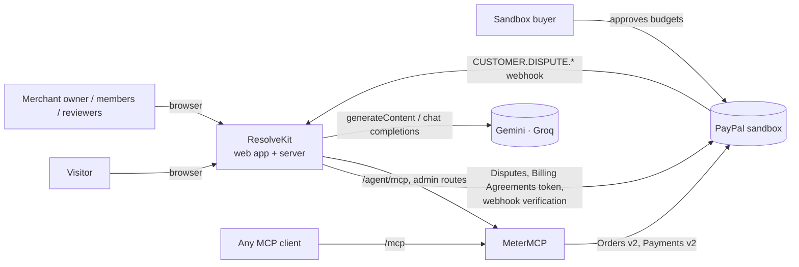
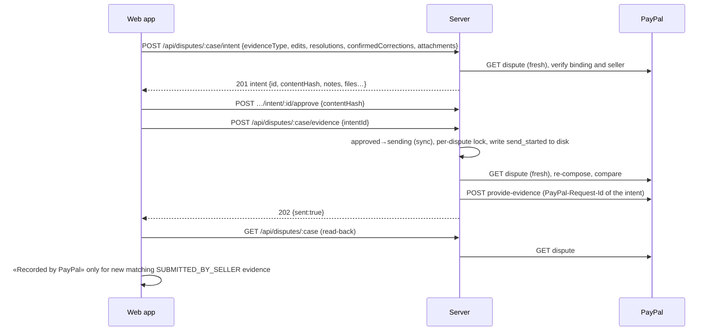
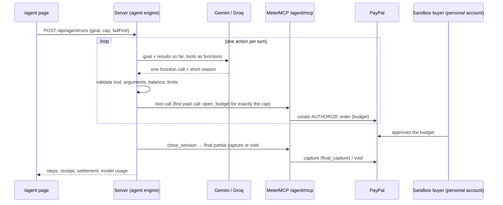
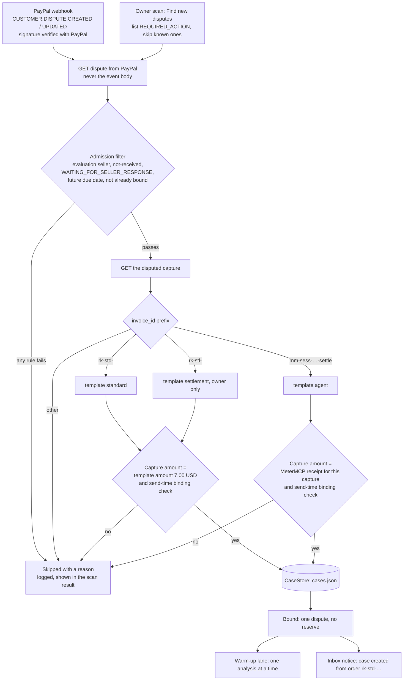
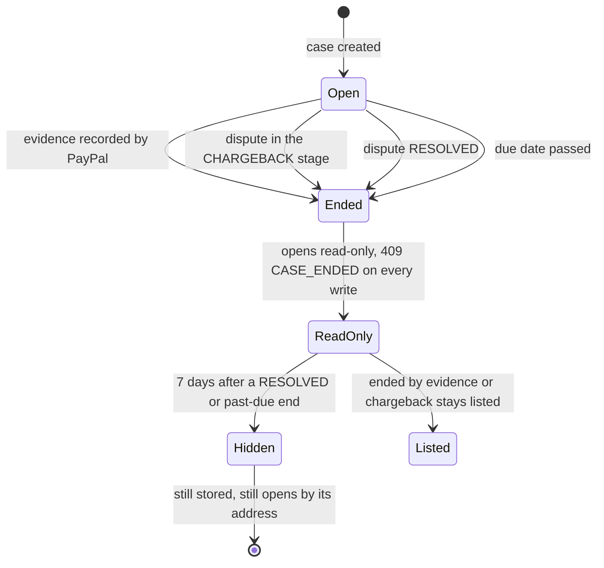

[English](overview.md) | [Español](../es/architecture/overview.md)

# Architecture overview

ResolveKit is a PayPal dispute workspace: it builds a case file for a dispute, an AI analyst drafts a response in
which every sentence cites its evidence, unsupported sentences are rejected, and the merchant approves the exact
content before anything is sent to PayPal. A second, smaller system, **MeterMCP**, is a metered MCP gateway that a
**buying agent** pays through PayPal; its receipts become evidence in one of the cases.

This page describes the architecture as it is in the code at commit `334eeb3` (deployed 1/11/2026). Status words follow the
project vocabulary: Designed · Implemented · Tested locally · Verified in sandbox · Deployed · Available to users ·
Pending.

- Components and shared contracts: [components.md](components.md)
- Data, storage, consistency and recovery: [data-and-storage.md](data-and-storage.md)
- Identity, authorization, isolation and trust boundaries: [trust-boundaries.md](trust-boundaries.md)

## Context

| Actor | What it does with ResolveKit |
|---|---|
| Visitor (signed out or any workspace) | Uses the **Explore demo**: fictional cases on an in-browser simulator; nothing is sent anywhere. |
| Merchant of the evaluation workspace (Owner) | Signs in with **Continue with PayPal**; reads the bound sandbox disputes, uploads evidence, approves and sends responses, runs the agent, invites members. |
| Members and reviewers | Join through an invite link; act inside that workspace with their role's permissions. |
| Any other merchant who signs in | Sees a waiting screen: connecting their own disputes is **in validation and not available** (see [merchant onboarding](../technical/merchant-onboarding.md)). |
| Sandbox buyer | Approves MeterMCP budgets in PayPal and opens the sandbox disputes used for evaluation. |
| MCP clients | Call MeterMCP's public `/mcp`; creating a budget on the hosted service needs the demo code. |
| PayPal (sandbox) | Source of truth for disputes, evidence records, orders, authorizations and captures. Nothing has run against live PayPal. |
| Google Gemini, Groq | Language models for the analyst and the agent. Keys stay on the server. |

## Three environments

| Environment | Routes | Data | Sends to PayPal | Status |
|---|---|---|---|---|
| Explore demo | `/demo`, `/demo/cases/:id` | Fictional cases, committed golden analyses, in-browser simulator | Never | Implemented · Tested locally · Deployed · Available to users |
| Sandbox evaluation (UI: «Sandbox evaluation · <workspace> · PayPal sandbox») | `/cases`, `/cases/:id` | Cases bound to real PayPal **sandbox** disputes; synthetic documents plus merchant uploads | Yes, to the sandbox only (as of 31/10/2026 the standard case has no reserve: new real-sandbox evidence sends on it are Pending until the refill for judging on 28–30/11/2026) | Implemented · Tested locally · Verified in sandbox · Deployed · Available to invited reviewers |
| Merchant workspace | waiting screen | — | No | Waiting screen Implemented · Deployed. Connecting a merchant's own disputes: **Pending** (no app code) |

The environment is decided on the server: `/api/auth/me` reports the workspace connection as `evaluation`,
`not_connected` or `checking`; a `connected` state is reserved in the three-environments design spec and does not exist in the code. The web app routes on that value.

## Containers

| Container | Code | Runs as | Responsibility |
|---|---|---|---|
| Web app (SPA) | `apps/web` | Static build served by the server (hosted) or Vite (local) | Inbox, case file, review and approval, uploads review, `/agent` page, simulator for demo cases. Holds no secret. |
| ResolveKit server | `apps/server` | Node 24 process, no framework | All PayPal dispute calls, the analyst, uploads, intents and audit, accounts and sign-in, agent runs, webhooks, caps. |
| PDF reader child | `apps/server/src/uploads/pdf-child.ts` | Forked Node child per PDF session, heap 160 MB | Opens and renders an untrusted PDF with pdf.js; killed at deadline or (Linux) above 200 MiB resident. |
| OCR worker | `apps/server/src/uploads/ocr.ts` | tesseract.js worker (WASM) in the server's process tree | Reads text from sanitised images and pages; stopped after 60 s idle. |
| MeterMCP | `apps/metermcp` | Separate Node 24 process / service | Public `/mcp` with paid synthetic tools, PayPal budget (authorize, partial capture, void), SQLite ledger, receipts. |
| Language models | external | Gemini API, Groq API | Analyst stages and agent turns, called with plain `fetch`. |
| PayPal | external | REST APIs (sandbox) | Disputes, webhooks, identity token, orders and payments. |

Shared packages (`packages/*`) are libraries inside those processes, not services: `paypal`, `analyst`, `agent`,
`cases`, `hosting`, `pdf`. See [components.md](components.md).

## Deployment (current)

| Item | Value (source: `render.yaml`) |
|---|---|
| Platform | Render, two `web` services, region `oregon`, plan `starter` (0.5 CPU / 512 MB), `NODE_VERSION` 24.19.0 |
| `resolvekit` | `npm ci && npm run build`, start `node apps/server/src/main.ts`, `RESOLVEKIT_MODE=hosted`, 1 GB disk at `/var/data`, health `/healthz` |
| `resolvekit-metermcp` | `npm ci`, start `node apps/metermcp/src/main.ts`, `METERMCP_MODE=hosted`, 1 GB disk at `/var/data`, health `/healthz` |
| Link between them | `METERMCP_URL` (private-network `host:port`) and `METERMCP_ADMIN_TOKEN` passed with `fromService` |
| PayPal environment | `PAYPAL_ENV=sandbox`; hosted mode refuses to start otherwise unless `live` plus `RESOLVEKIT_ALLOW_LIVE_PAYPAL=yes-real-money`, which the blueprint never sets |
| Auto-deploy | `commit` on both services (the agent follow-up recommends turning it off for `resolvekit`: Pending, operational) |

`334eeb3` is treated as Deployed: on 1/11/2026 the owner approved and pushed it; ResolveKit restarted at about 11:54 Madrid time. Since `667abb3`: `0d417f9` (31/10/2026, night: docs after the shoot and the appeal reason string «Not implemented yet: appeal was not verified with PayPal») and `334eeb3` (1/11/2026: the landing page is shown at `/` to everyone on the hosted service, signed in or not, with «Open your cases →» when signed in; its screenshots are real captures of 31/10/2026 and open full size in a lightbox; the in-app logo leads to the cases; returns from sign-in open the cases). `demo:check` after it: all PASS except the known FAIL (the standard case binding is used and no dispute is left in reserve; refill for judging 28–30/11/2026). Bindings as of 1/11/2026, unchanged: the standard case used (no reserve), the settlement case bound, the agent case bound with 1 in reserve.

Before it, `667abb3` was treated as Deployed: on 31/10/2026 the owner approved it, pushed it and Render redeployed (ResolveKit restarted at about 21:07 Madrid time), and `demo:check` against the hosted URLs passed all lines (ResolveKit up, landing, MeterMCP up, PayPal sandbox connected, webhook on, all three bindings verified, both AI models answered, warm-up cached) except one known FAIL: the standard case's binding is used and no dispute is left in reserve (refill for judging 28–30/11/2026); bindings as of 31/10/2026: the standard case used (no reserve), the settlement case bound, the agent case bound with 1 in reserve. Earlier the same day `d654478` was deployed (about 20:00; `main` fast-forwarded from `23728e2`, 12 commits). Earlier, `f1b7236` was deployed on 29/10/2026, `c12faea` and `81c6242` were deployed on 21/10/2026, `5111b88` on 20/10/2026 (the owner fast-forwarded `main` to it and pushed; the same `demo:check` result) and `fbe9621` on 19/10/2026 (owner's confirmation; the
same one empty reserve). `demo:check` cannot prove which commit is live. A persistent disk rules out
zero-downtime deploys; one to two minutes of 502 per deploy were observed (private evidence). Details:
[deployment](../operations/deployment.md).

Local mode runs the same server on `127.0.0.1:8787` and MeterMCP on `127.0.0.1:8790`, with per-launch tokens and the
Vite proxy instead of sign-in: [local development](../technical/local-development.md).

## Main flows

### Documents (merchant upload)

1. The browser uploads a PNG/JPEG, a PDF, or pasted text to `POST /api/cases/:id/uploads`.
2. The server decodes it (images by magic bytes; PDFs in the forked child), the merchant covers areas, the server
   burns the covers into new pixels and runs OCR on the **covered** image only.
3. The merchant reviews the text, corrects or transcribes lines, and confirms; the confirm is bound to the `sha256`
   of the sanitised file reviewed.
4. The confirmed upload becomes document `E<n>` of the case. Nothing leaves the server before this point.

Details: [evidence processing](../technical/evidence-processing.md).

### Analysis

1. The browser asks `POST /api/cases/:id/analysis` with the case id only.
2. The server builds the input itself: case fixtures, its own PayPal read of the bound dispute (reused 60 s), the
   MeterMCP receipt for the agent case, confirmed uploads.
3. A stored analysis for the same key (`sha256` of input, prompt version, model) answers `200`; otherwise, within the
   hourly and daily limits, a live run starts (`202`) and the browser polls `/progress`.
4. Pipeline: extract verbatim quotes → screen for instructions → timeline, contradictions, checklist, draft → verify
   each sentence → rules choose the action. Details: [AI pipeline](../technical/ai-pipeline.md).

### Submission

On the hosted service, `provide-evidence` and make an offer (31/10/2026) have been exercised end to end. Since commit `5111b88` (deployed
20/10/2026; now `334eeb3`, 1/11/2026) the server also sends messages, accepts, offers and escalations through the same chain (compose, approve by hash, a
second confirmation for the Owner's actions, a fresh read, `send_started` on disk, one POST, an attributable
read-back), only for the variants whose contract is recorded; status: Deployed (code), Verified in sandbox through the app (20/10/2026, local
server), exercised on the hosted service only for make an offer, 31/10/2026 ([functional specification](../product/functional-specification.md#56-dispute-actions-other-than-evidence)). There is
no refund-creating code. Details: [PayPal integration](../technical/paypal-integration.md),
[HTTP API](../technical/http-api.md).

### Buying agent

Details: [buying agent](../technical/buying-agent.md), [MCP tools](../technical/mcp-tools.md).

### Discovered cases

A dispute made from a ResolveKit order becomes its own case, without editing `BINDINGS_JSON` or Render. Status (7/11/2026): Implemented · Tested locally · Verified in sandbox (7/11/2026, worked example below) · Deployed (no Render configuration change). An ended case keeping its last analysis and running no new one, and a citation chip bringing the cited document into view, are Implemented · Tested locally. The three
fixed cases bound by `BINDINGS_JSON` (with their reserve and rotation) are unchanged and are the fallback.

Lifecycle of a discovered case (item 6 below). The end is judged from each read of the dispute and stored in
`cases.json` the first time it is seen.

Worked example (real sandbox, 7/11/2026; private evidence, not reproducible by readers). Dispute `PP-R-PKN-10196947`,
on order `rk-std-8e26ab6396a6` (capture `07270070E3494640A`), arrived through `CUSTOMER.DISPUTE.CREATED` while it was
`UNDER_REVIEW`: the notice read «not linked to a case yet» and no case was made. On the next `CUSTOMER.DISPUTE.UPDATED`
it was `WAITING_FOR_SELLER_RESPONSE` and became a case; the lane warmed its analysis up; evidence was sent and shown as
«Recorded by PayPal»; then the case ended and opened read-only.

1. **Two ways in.** The signature-verified `CUSTOMER.DISPUTE.CREATED` or `.UPDATED` webhook: after the usual re-read, if
   no binding or reserve lists the dispute, the dispute **as PayPal returns it** (never the event body) goes to
   discovery. Or the owner's **Find new disputes** button (`POST /api/discovery/scan`; owner of the evaluation
   workspace only; one scan a minute): it lists the disputes that need the seller (`dispute_state=REQUIRED_ACTION`),
   reads in full each one not already known (bound, in a reserve, a discovered case: skipped `already bound` with no
   read) and submits it to the same discovery. Both can run at once: discovery handles one dispute at a
   time, so a dispute makes one case.
2. **Admission rules**, checked in this order. The seller must be the evaluation seller, `EVALUATION_MERCHANT_ID` (or,
   hosted and without it, the one seller already confirmed by `SellerMemory`; with several or none, nothing is
   discovered). The reason must be `MERCHANDISE_OR_SERVICE_NOT_RECEIVED`, the status `WAITING_FOR_SELLER_RESPONSE`
   (a dispute that arrives in `UNDER_REVIEW` waits for a later `.UPDATED` event or a scan), the due date in the future,
   and there must be exactly one disputed capture. A dispute whose id is a fixed case’s id is `already bound` (a case id
   is its dispute id, so it would shadow that case). The capture is read from PayPal and its `invoice_id` gives the
   template: `rk-std-…` (standard), `rk-stl-…` (owner settlement) or MeterMCP's `mm-sess-…-settle` (agent). The amounts must
   match the order: 7.00 USD for the first two, the MeterMCP receipt found for that capture for the agent. This uses the
   same binding check as every send (`verifyBinding`), so a case is never created that the send would then refuse.
   A dispute that fails a rule is skipped with one of these reasons, shown in the scan result and logged: `no evaluation
   seller configured`, `another seller's dispute`, `already bound`, `not a not-received dispute`, `not waiting for the
   seller (<status>)`, `past its response date`, `no disputed capture`, `capture could not be read`, `not from a
   ResolveKit order`, `amount does not match the order`, `no MeterMCP receipt for this capture`, `dispute could not be
   checked`, `case could not be stored`; the scan adds `dispute could not be read`.
3. **Stored per merchant.** The case is written to `cases.json` in the data directory (case id, merchant id, dispute id,
   capture id, template, order reference, source `webhook` or `scan`, creation time, and when and why it ended), so it
   survives restarts. The **case id is the dispute id**. There is one dispute per case: no reserve, no rotation. At start
   (and after a bindings reload) each stored case is added to the same `bindings` map as a fixed one, so reads, the
   send-time check and the read-back are the same code; a fixed binding of the same dispute wins. A corrupt `cases.json`
   is not overwritten: no case is added until it is fixed, and the problem shows with the storage problems.
4. **Case file from the order.** One resolver (`caseFileOf`, shared by server and web) returns the fixed case file or,
   for a discovered case, a clone of its template with the id changed; the real dispute is laid over it as for any
   bound case. The expected payment comes from the order or the receipt, never from the dispute itself. The Explore demo
   never lists a discovered case.
5. **Visibility** is that of a fixed bound case, using the seller stored at discovery (no PayPal read per case):
   owner, members and reviewers of the evaluation workspace see standard and agent cases; settlement cases only the
   owner; nobody else, and nobody without a session.
6. **Lifecycle.** A case is *ended* when PayPal has recorded the seller's evidence, the dispute is `RESOLVED` or in the
   `CHARGEBACK` stage, or its due date has passed. Escalation to a claim alone does not end it: after it PayPal may still ask the seller for evidence; the case ends at `CHARGEBACK`. Ended cases are listed after the open ones, marked, and open
   read-only (server-enforced: `409 CASE_ENDED` on every compose, approval, send and new upload; the read-back of the send that ended it still works), keeps its last analysis and runs no new one (no live run, refresh or not; no re-check), and the case page says *This case has ended · read-only*, with no action, re-run or review control. A `RESOLVED` or past-due case is hidden from
   the inbox 7 days after it ended (it stays in the store and can still be opened by its address); one that ended by
   evidence or chargeback stays listed. The end is judged from a read of the dispute, so a due date that passes with
   no read is noticed at the next one.
7. **Warm-up lane.** A new case has no stored analysis. A separate lane analyses discovered cases in the background:
   one analysis at a time, at least 10 minutes apart, outside the per-person hourly limit (each one counts in the
   daily cap), skipping cases that are ended or already analysed, with at most 3 attempts per case (a refusal because the shared daily cap is used up is not one: it resets the next day) until the next
   start. If no model answers, the case shows *Analysis pending* and the lane tries again in its next slot.
8. **Seen by the operator.** `/api/health` has `cases` (template, order reference, source, created time and ended flag
   of each visible bound discovered case, under the same viewer rule as `bound`). `/api/ops/status` marks those
   bindings `discovered` and gives them `used`; no reserve warning is raised for them. The inbox notice reads
   «… case created from order rk-std-…», and the case page has a provenance line (how it was found, dispute, capture,
   order, time).

`npm run demo:prepare` writes the order reference into each order's `invoice_id` (`--settlement` also creates the
settlement kind). Refilling for judging is then: create orders and disputes, and let the webhook (or **Find new
disputes**) do the rest; see the [runbook](../operations/runbook.md#refill-without-editing-render).

Sources: `apps/server/src/discovery.ts`, `caseStore.ts`, `app.ts`, `hosted.ts`; `packages/cases/src/discovered.ts`.

## Key decisions

The decisions that shape the current architecture, with the reason and where to see them in the code:

| Decision | Why / trade-off | Source |
|---|---|---|
| The browser never talks to PayPal or a model; the server builds every analyst input and every submission itself | Request bodies cannot inject notes, files or documents; costs one server round-trip per action | `apps/server/src/app.ts` (analyst input built on the server), `apps/web/src/domain/intent.ts` (`parseIntentRequest`, refused fields) |
| The merchant approves a server-composed intent by its content hash; the send re-composes from a fresh PayPal read and refuses any difference | Approval binds exact content; a changed dispute, document or binding forces a new review | `apps/server/src/app.ts` (send route), [trust boundaries](trust-boundaries.md) |
| Three environments, decided on the server; the demo never touches the send path | Judges and visitors cannot reach real PayPal by accident; a third "connected" source stays possible | [trust boundaries](trust-boundaries.md), [configuration](../technical/configuration.md) |
| Uploads are read on our own server; redaction by the merchant before any model or PayPal sees the file; one sanitised version for the AI and for PayPal | No external service sees unredacted files; OCR quality is limited to local tesseract | [evidence processing](../technical/evidence-processing.md), [data and storage](data-and-storage.md) |
| PDFs are rasterised in a child process, covered, OCR'd from pixels, and rebuilt as image-only PDFs | Covered content cannot survive in text layers, metadata or attachments; the PDF sent has no selectable text | `packages/pdf`, [evidence processing](../technical/evidence-processing.md) |
| The buying agent is model-driven (function calling, one action per turn) and code validates every action; settlement is code's | Real decisions with hard limits; no scripted fallback, so without a model the run stops | [buying agent](../technical/buying-agent.md) |
| MeterMCP budget = Orders v2 `AUTHORIZE` for exactly the cap; settlement = one final partial capture or a void | The buyer approves once; failed calls are never charged; an authorization is valid for a limited time | `apps/metermcp/src/meter.ts`, [PayPal integration](../technical/paypal-integration.md) |
| Sign-in uses a no-charge Billing Agreements token of a second PayPal app | Log in with PayPal answered 400 in our sandbox and a seller cannot approve its own app; the API family is deprecated | `packages/paypal/src/identity.ts`, [trust boundaries](trust-boundaries.md) |
| Files on a persistent disk (JSON, JSONL, SQLite), one instance per service | Simple and inspectable; no horizontal scaling, no zero-downtime deploy, no backups in code | [data and storage](data-and-storage.md) |
| Evaluations: fixed sets, figures quoted only from the committed summary | Rates are never compared across different sets | [evaluations](../quality/evaluations.md) |

There is no `docs/architecture/decisions/` folder: the table above is the decision record.

## Current architecture and future evolution

| Area | Today (code at `334eeb3`) | Not built (future, not promised) |
|---|---|---|
| Merchants | One evaluation workspace: the seller of the bound sandbox disputes | Connecting any merchant's own disputes through PayPal Platform (Partner Referrals, `PayPal-Auth-Assertion`): external sandbox tests only, no app code |
| Dispute actions | `provide-evidence`; send message, make offer, accept claim, escalate (Deployed; Verified in sandbox on a local run; on the hosted service only make an offer has been exercised, 31/10/2026) | refund |
| PayPal environment | Sandbox | Live (never run; hosted mode refuses it without an explicit opt-in) |
| Scale | One instance per service, files on a disk | Database, several instances, backups |
| Agent tools | Three synthetic MeterMCP tools | Real data sources |

Known limits are collected in [limitations](../product/limitations.md) and [known issues](../quality/known-issues.md).
