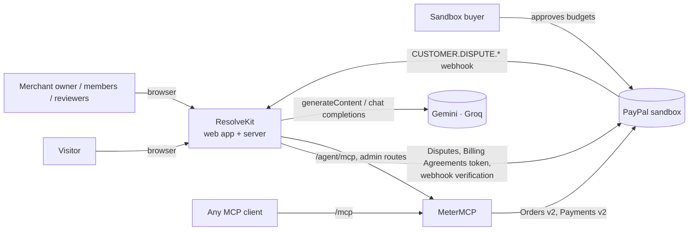
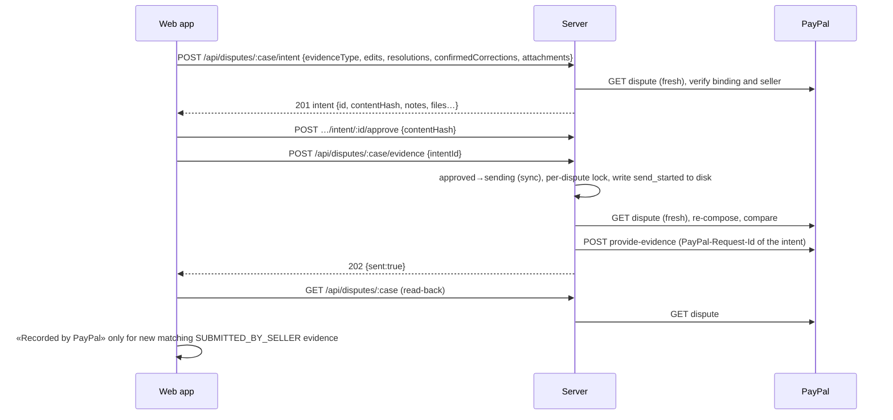
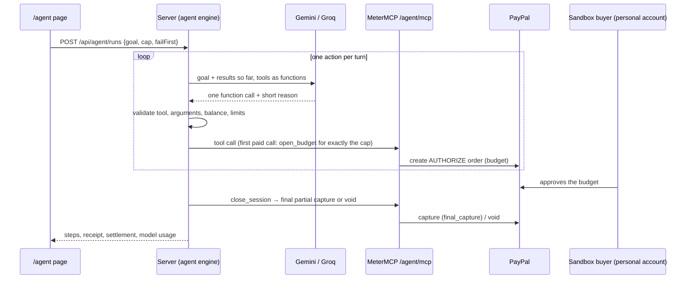

[English](overview.md) | [Español](../es/architecture/overview.md)

# Architecture overview

ResolveKit is a PayPal dispute workspace: it builds a case file for a dispute, an AI analyst drafts a response in
which every sentence cites its evidence, unsupported sentences are rejected, and the merchant approves the exact
content before anything is sent to PayPal. A second, smaller system, **MeterMCP**, is a metered MCP gateway that a
**buying agent** pays through PayPal; its receipts become evidence in one of the cases.

This page describes the architecture as it is in the code at commit `c12faea` (deployed 21/10/2026). Status words follow the
project vocabulary: Designed · Implemented · Tested locally · Verified in sandbox · Deployed · Available to users ·
Pending.

- Components and shared contracts: [components.md](components.md)
- Data, storage, consistency and recovery: [data-and-storage.md](data-and-storage.md)
- Identity, authorization, isolation and trust boundaries: [trust-boundaries.md](trust-boundaries.md)

## Context

| Actor | What it does with ResolveKit |
|---|---|
| Visitor (signed out or any workspace) | Uses the **Explore demo**: fictional cases on an in-browser simulator; nothing is sent anywhere. |
| Merchant of the evaluation workspace (Owner) | Signs in with **Continue with PayPal**; reads the bound sandbox disputes, uploads evidence, approves and sends responses, runs the agent, invites members. |
| Members and reviewers | Join through an invite link; act inside that workspace with their role's permissions. |
| Any other merchant who signs in | Sees a waiting screen: connecting their own disputes is **in validation and not available** (see [merchant onboarding](../technical/merchant-onboarding.md)). |
| Sandbox buyer | Approves MeterMCP budgets in PayPal and opens the sandbox disputes used for evaluation. |
| MCP clients | Call MeterMCP's public `/mcp`; creating a budget on the hosted service needs the demo code. |
| PayPal (sandbox) | Source of truth for disputes, evidence records, orders, authorizations and captures. Nothing has run against live PayPal. |
| Google Gemini, Groq | Language models for the analyst and the agent. Keys stay on the server. |

## Three environments

| Environment | Routes | Data | Sends to PayPal | Status |
|---|---|---|---|---|
| Explore demo | `/demo`, `/demo/cases/:id` | Fictional cases, committed golden analyses, in-browser simulator | Never | Implemented · Tested locally · Deployed · Available to users |
| Sandbox evaluation (UI: «Sandbox evaluation · <workspace> · PayPal sandbox») | `/cases`, `/cases/:id` | Cases bound to real PayPal **sandbox** disputes; synthetic documents plus merchant uploads | Yes, to the sandbox only (as of 29/10/2026 both reserves are empty: new real-sandbox sends are Pending until the refill for judging on 28–30/11/2026) | Implemented · Tested locally · Verified in sandbox · Deployed · Available to invited reviewers |
| Merchant workspace | waiting screen | — | No | Waiting screen Implemented · Deployed. Connecting a merchant's own disputes: **Pending** (no app code) |

The environment is decided on the server: `/api/auth/me` reports the workspace connection as `evaluation`,
`not_connected` or `checking`; a `connected` state is reserved in the three-environments design spec and does not exist in the code. The web app routes on that value.

## Containers

| Container | Code | Runs as | Responsibility |
|---|---|---|---|
| Web app (SPA) | `apps/web` | Static build served by the server (hosted) or Vite (local) | Inbox, case file, review and approval, uploads review, `/agent` page, simulator for demo cases. Holds no secret. |
| ResolveKit server | `apps/server` | Node 24 process, no framework | All PayPal dispute calls, the analyst, uploads, intents and audit, accounts and sign-in, agent runs, webhooks, caps. |
| PDF reader child | `apps/server/src/uploads/pdf-child.ts` | Forked Node child per PDF session, heap 160 MB | Opens and renders an untrusted PDF with pdf.js; killed at deadline or (Linux) above 200 MiB resident. |
| OCR worker | `apps/server/src/uploads/ocr.ts` | tesseract.js worker (WASM) in the server's process tree | Reads text from sanitised images and pages; stopped after 60 s idle. |
| MeterMCP | `apps/metermcp` | Separate Node 24 process / service | Public `/mcp` with paid synthetic tools, PayPal budget (authorize, partial capture, void), SQLite ledger, receipts. |
| Language models | external | Gemini API, Groq API | Analyst stages and agent turns, called with plain `fetch`. |
| PayPal | external | REST APIs (sandbox) | Disputes, webhooks, identity token, orders and payments. |

Shared packages (`packages/*`) are libraries inside those processes, not services: `paypal`, `analyst`, `agent`,
`cases`, `hosting`, `pdf`. See [components.md](components.md).

## Deployment (current)

| Item | Value (source: `render.yaml`) |
|---|---|
| Platform | Render, two `web` services, region `oregon`, plan `starter` (0.5 CPU / 512 MB), `NODE_VERSION` 24.19.0 |
| `resolvekit` | `npm ci && npm run build`, start `node apps/server/src/main.ts`, `RESOLVEKIT_MODE=hosted`, 1 GB disk at `/var/data`, health `/healthz` |
| `resolvekit-metermcp` | `npm ci`, start `node apps/metermcp/src/main.ts`, `METERMCP_MODE=hosted`, 1 GB disk at `/var/data`, health `/healthz` |
| Link between them | `METERMCP_URL` (private-network `host:port`) and `METERMCP_ADMIN_TOKEN` passed with `fromService` |
| PayPal environment | `PAYPAL_ENV=sandbox`; hosted mode refuses to start otherwise unless `live` plus `RESOLVEKIT_ALLOW_LIVE_PAYPAL=yes-real-money`, which the blueprint never sets |
| Auto-deploy | `commit` on both services (the agent follow-up recommends turning it off for `resolvekit`: Pending, operational) |

`c12faea` is treated as Deployed (earlier the same day `81c6242`): on 21/10/2026 it was pushed, Render auto-deployed
it (a new web bundle was observed), and `demo:check` against the hosted URLs (after `81c6242` and again after `c12faea`, same result) passed ResolveKit up, landing, MeterMCP up,
PayPal sandbox connected, webhook on, both bindings verified, both AI models answered and both warm-ups cached; it
warned on both reserves (0 fresh disputes) and failed on one known line: the standard case's binding is used and its
reserve is empty (status as of 29/10/2026: both reserves empty, refill for judging 28–30/11/2026). Earlier, `5111b88` was deployed on 20/10/2026 (the owner fast-forwarded `main` to it and pushed; the same `demo:check` result) and `fbe9621` on 19/10/2026 (owner's confirmation; the
same one empty reserve). `demo:check` cannot prove which commit is live. A persistent disk rules out
zero-downtime deploys; one to two minutes of 502 per deploy were observed (private evidence). Details:
[deployment](../operations/deployment.md).

Local mode runs the same server on `127.0.0.1:8787` and MeterMCP on `127.0.0.1:8790`, with per-launch tokens and the
Vite proxy instead of sign-in: [local development](../technical/local-development.md).

## Main flows

### Documents (merchant upload)

1. The browser uploads a PNG/JPEG, a PDF, or pasted text to `POST /api/cases/:id/uploads`.
2. The server decodes it (images by magic bytes; PDFs in the forked child), the merchant covers areas, the server
   burns the covers into new pixels and runs OCR on the **covered** image only.
3. The merchant reviews the text, corrects or transcribes lines, and confirms; the confirm is bound to the `sha256`
   of the sanitised file reviewed.
4. The confirmed upload becomes document `E<n>` of the case. Nothing leaves the server before this point.

Details: [evidence processing](../technical/evidence-processing.md).

### Analysis

1. The browser asks `POST /api/cases/:id/analysis` with the case id only.
2. The server builds the input itself: case fixtures, its own PayPal read of the bound dispute (reused 60 s), the
   MeterMCP receipt for the agent case, confirmed uploads.
3. A stored analysis for the same key (`sha256` of input, prompt version, model) answers `200`; otherwise, within the
   hourly and daily limits, a live run starts (`202`) and the browser polls `/progress`.
4. Pipeline: extract verbatim quotes → screen for instructions → timeline, contradictions, checklist, draft → verify
   each sentence → rules choose the action. Details: [AI pipeline](../technical/ai-pipeline.md).

### Submission

Only `provide-evidence` has been exercised end to end on the hosted service. Since commit `5111b88` (deployed
20/10/2026; now `c12faea`, 21/10/2026) the server also sends messages, accepts, offers and escalations through the same chain (compose, approve by hash, a
second confirmation for the Owner's actions, a fresh read, `send_started` on disk, one POST, an attributable
read-back), only for the variants whose contract is recorded; status: Deployed (code), Verified in sandbox through the app (20/10/2026, local
server), not yet exercised on the hosted service
([functional specification](../product/functional-specification.md#56-dispute-actions-other-than-evidence)). There is
no refund-creating code. Details: [PayPal integration](../technical/paypal-integration.md),
[HTTP API](../technical/http-api.md).

### Buying agent

Details: [buying agent](../technical/buying-agent.md), [MCP tools](../technical/mcp-tools.md).

## Key decisions

The decisions that shape the current architecture, with the reason and where to see them in the code:

| Decision | Why / trade-off | Source |
|---|---|---|
| The browser never talks to PayPal or a model; the server builds every analyst input and every submission itself | Request bodies cannot inject notes, files or documents; costs one server round-trip per action | `apps/server/src/app.ts` (analyst input built on the server), `apps/web/src/domain/intent.ts` (`parseIntentRequest`, refused fields) |
| The merchant approves a server-composed intent by its content hash; the send re-composes from a fresh PayPal read and refuses any difference | Approval binds exact content; a changed dispute, document or binding forces a new review | `apps/server/src/app.ts` (send route), [trust boundaries](trust-boundaries.md) |
| Three environments, decided on the server; the demo never touches the send path | Judges and visitors cannot reach real PayPal by accident; a third "connected" source stays possible | [trust boundaries](trust-boundaries.md), [configuration](../technical/configuration.md) |
| Uploads are read on our own server; redaction by the merchant before any model or PayPal sees the file; one sanitised version for the AI and for PayPal | No external service sees unredacted files; OCR quality is limited to local tesseract | [evidence processing](../technical/evidence-processing.md), [data and storage](data-and-storage.md) |
| PDFs are rasterised in a child process, covered, OCR'd from pixels, and rebuilt as image-only PDFs | Covered content cannot survive in text layers, metadata or attachments; the PDF sent has no selectable text | `packages/pdf`, [evidence processing](../technical/evidence-processing.md) |
| The buying agent is model-driven (function calling, one action per turn) and code validates every action; settlement is code's | Real decisions with hard limits; no scripted fallback, so without a model the run stops | [buying agent](../technical/buying-agent.md) |
| MeterMCP budget = Orders v2 `AUTHORIZE` for exactly the cap; settlement = one final partial capture or a void | The buyer approves once; failed calls are never charged; an authorization is valid for a limited time | `apps/metermcp/src/meter.ts`, [PayPal integration](../technical/paypal-integration.md) |
| Sign-in uses a no-charge Billing Agreements token of a second PayPal app | Log in with PayPal answered 400 in our sandbox and a seller cannot approve its own app; the API family is deprecated | `packages/paypal/src/identity.ts`, [trust boundaries](trust-boundaries.md) |
| Files on a persistent disk (JSON, JSONL, SQLite), one instance per service | Simple and inspectable; no horizontal scaling, no zero-downtime deploy, no backups in code | [data and storage](data-and-storage.md) |
| Evaluations: fixed sets, figures quoted only from the committed summary | Rates are never compared across different sets | [evaluations](../quality/evaluations.md) |

There is no `docs/architecture/decisions/` folder: the table above is the decision record.

## Current architecture and future evolution

| Area | Today (code at `c12faea`) | Not built (future, not promised) |
|---|---|---|
| Merchants | One evaluation workspace: the seller of the bound sandbox disputes | Connecting any merchant's own disputes through PayPal Platform (Partner Referrals, `PayPal-Auth-Assertion`): external sandbox tests only, no app code |
| Dispute actions | `provide-evidence`; send message, make offer, accept claim, escalate (Deployed; Verified in sandbox on a local run; not yet exercised on the hosted service) | refund |
| PayPal environment | Sandbox | Live (never run; hosted mode refuses it without an explicit opt-in) |
| Scale | One instance per service, files on a disk | Database, several instances, backups |
| Agent tools | Three synthetic MeterMCP tools | Real data sources |

Known limits are collected in [limitations](../product/limitations.md) and [known issues](../quality/known-issues.md).
