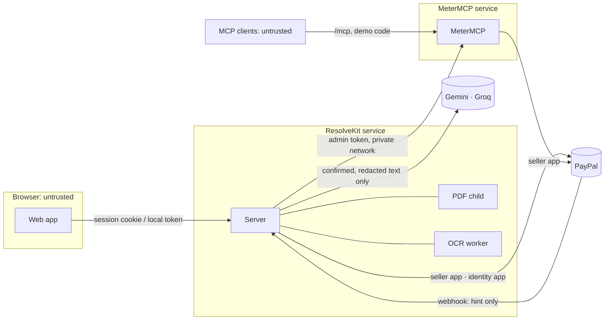

[English](trust-boundaries.md) | [Español](../es/architecture/trust-boundaries.md)

# Trust boundaries, identity and isolation

What each part of the system trusts, how people are identified, what they may do, and how one workspace, person
or run is kept from another. Code at commit `fbe9621`. These measures reduce risk; none is an absolute guarantee.
The broader privacy view is in [security and privacy](../quality/security-and-privacy.md).

## Boundaries

| Boundary | What crosses it | What is trusted | Control |
|---|---|---|---|
| Browser → server | Case ids, edits, upload bytes, approvals | Nothing in a body beyond its documented fields | Server composes every analyst input and every intent; notes, files, tracking in a body are refused (`INVALID_INTENT_REQUEST`); local token or signed session; Host/Origin checks; JSON-only POST |
| Server → PDF child | The uploaded PDF bytes | Nothing the child returns beyond pixels and counts | Forked process, V8 heap 160 MB, killed at its deadline and (Linux) above 200 MiB resident; pdf.js with no scripting, no XFA, no system fonts, no font-face, no fetch (replaced by throwing functions, attempts counted) |
| Server → OCR worker | Sanitised pixels only | Recognised text, reviewed by the merchant before use | tesseract.js with language data from a local package, `cacheMethod: 'none'`, no download; time limits; one job at a time |
| Server → models | Synthetic case documents, sandbox PayPal data, **confirmed and redacted** uploads, an edited sentence for a re-check | Model output is checked, never believed | Documents wrapped in delimiters with a random per-call tag and marked as data; quotes must be exact substrings; rules choose the action and the evidence type; see [AI pipeline](../technical/ai-pipeline.md) |
| Server → MeterMCP | Agent tool calls, receipt lookups, admin close | Receipts and settlement state | Admin token (`x-metermcp-token`); hosted admin paths answer only requests that did not come through the public proxy (no `X-Forwarded-For`, not the public Host) |
| MCP clients → MeterMCP | Tool calls, budget requests | Nothing | Each MCP session reaches only its own payment session; hosted budget creation needs `x-demo-code` and a daily unit; session caps; per-IP limits |
| Server / MeterMCP → PayPal | Dispute reads, evidence, orders, captures | PayPal's answers, read back | OAuth client credentials per app; `PayPal-Request-Id` on every POST; timeouts and bounded retries |
| PayPal → server (webhook) | `CUSTOMER.DISPUTE.*` events | The event only as a hint | Secret URL key, transmission-header checks, body ≤ 64 KiB, verification with PayPal's documented postback method on the raw body; then the dispute is re-read from PayPal |
| Browser → PayPal | Buyer approvals, sign-in approval | — | Return pages re-read the order or token from PayPal; the query string proves nothing |

## Identity

### Continue with PayPal (Owner sign-in, hosted)

Not Log in with PayPal and not an OpenID sign-in. The server asks PayPal for a **no-charge Billing Agreements v1
agreement token** created by a second PayPal app, the platform's identity app (`PAYPAL_IDENTITY_*`). The merchant
approves it on PayPal; the server reads the approved token and takes `payer_info.payer_id`, which for a business
account matched the seller's merchant id on its disputes in our sandbox test (10/10/2026). No agreement is created
and nothing is charged. The Billing Agreements API is listed by PayPal under a deprecated path; no current reference
page for agreement tokens was found (19/10/2026), so this may stop working.

Why a second app: a seller cannot approve a request of its own app, and Log in with PayPal userinfo answered 400 in
our sandbox (experimental, 10/10/2026). The server refuses to start if `PAYPAL_IDENTITY_CLIENT_ID` equals
`PAYPAL_CLIENT_ID`.

Binding to the browser that started:

1. `POST /api/auth/paypal/start` creates the token and sets a short-lived signed cookie holding the token id, a
   nonce and an expiry (15 min, path `/api/auth/paypal`).
2. PayPal returns the approver to `/api/auth/paypal/return/<k>?ba_token=…`, where `k` is derived from the nonce.
3. The sign-in completes only with the matching cookie, key and token. Each token gets one attempt: an arrival
   without the cookie, or before approval, burns it. A forwarded approval link therefore signs nobody in.

Status: Implemented · Tested locally · Verified in sandbox · Deployed. Signing in grants ResolveKit **no** access to
the merchant's disputes.

### Invites, passkeys and sessions

| Mechanism | Rules |
|---|---|
| Invite link | Made by the Owner: one-time or reviewer; 1–300 uses, expiry ≤ 120 days (default 7), reviewer access end ≤ 180 days; the token travels in the link's fragment (`/join#<token>`); only its hash is stored |
| Join | With a passkey (WebAuthn, `@simplewebauthn/server`) or **Join for this browser only** |
| Session cookie | `HttpOnly; Secure; SameSite=Strict`, HMAC-signed with `RESOLVEKIT_SESSION_SECRET`, 12 h, carries a session epoch |
| Ending sessions | Revoking a member, **Sign out of all devices**, or a reviewer's access end bumps the epoch: every session ends at once |
| Without `RESOLVEKIT_SESSION_SECRET` (≥ 32 chars) | A per-launch secret is used: sign-ins end on restart |

Passkey creation on the deployed sandbox service: Pending (no evidence).

### Local mode

No accounts. The person at the machine is the operator and acts as an Owner. The API listens on `127.0.0.1`,
requires Host `127.0.0.1:<port>` or `localhost:<port>` (403 `FORBIDDEN_HOST`, against DNS rebinding), a present
Origin from the allowlist (403 `FORBIDDEN_ORIGIN`), and the per-launch token in `x-resolvekit-token` (401
`MISSING_OR_BAD_TOKEN`), which only the Vite proxy reads from disk and adds server-side. POST takes JSON only, except
the upload route.

## Authorization

| Who | Can |
|---|---|
| Owner (the PayPal account's person) | Everything in the workspace; create and revoke invites and members; read members; see the workspace's agent runs with `?scope=workspace` (logged; approval link, order and session ids hidden); keep runs; cannot be revoked |
| Full member | Read cases, upload, redact/correct/confirm any upload, delete uploads, compose/approve/send **their own** intents, run the agent |
| Reviewer (joined by a reviewer link) | As a member, but redact/correct/confirm **only their own** uploads and never delete; access ends on its date |
| Signed-out visitor | Explore demo only; the server's case routes answer 404 |
| Operator with `RESOLVEKIT_OPS_TOKEN` | `GET /api/ops/status`, `GET /api/ops/agent-run/<id>` (Bearer); without the variable these routes do not exist |
| Holder of the MeterMCP admin token | `/sessions…` admin routes, `/agent/mcp` (hosted, with `x-agent-run`) |

## Isolation

| Boundary | Rule | Status |
|---|---|---|
| Evaluation cases vs other workspaces | Every case route (`/api/disputes/:case…`, `/api/cases/:id/analysis…`, `/api/cases/:id/uploads…`) answers only the **seller's workspace**, the one whose PayPal payer id is the seller of the bound disputes; anyone else gets `404 UNKNOWN_CASE` before any work. `/api/health` hides the bindings from them | Implemented · Tested locally · Deployed |
| Seller check at send time | On the fresh read before composing and before sending, the workspace's merchant id must be the dispute's `seller.merchant_id` (403 `NOT_THE_SELLER`) | Implemented · Tested locally · Verified in sandbox |
| Binding check | The dispute must be the bound one, about exactly the bound capture, for the case's amount and currency (409 `BINDING_INVALID` / `BINDING_UNAVAILABLE`) | Implemented · Tested locally |
| Intents | Belong to the person who composed them; for anyone else, a teammate included, they do not exist (404) | Implemented · Tested locally |
| Uploads before confirmation | Files and text visible only to people who can edit them; others see `restricted: true` metadata; files 404 | Implemented · Tested locally |
| Agent runs | The author sees their runs; another person's run answers 404 whatever exists; the Owner sees others only with `?scope=workspace`; a run of another workspace is never visible | Implemented · Tested locally |
| Agent run ↔ MeterMCP session | `/agent/mcp` sessions are bound to the run key (`x-agent-run: run-<32 hex>`); 10 sessions and 600 requests per 5 min per run | Implemented · Tested locally · Deployed |
| MCP session ↔ payment session | An MCP session reaches only its own payment session | Implemented · Tested locally |
| Webhook notices | Shown only to the dispute's seller workspace | Implemented · Tested locally |
| Several connected merchants | Not built: there is one evaluation workspace. Isolation between connected merchants: **Pending** | Pending |

## Hosted request guards

- Host must be a public host of the service (`/healthz` excepted); state-changing `/api` requests must carry the
  service's own Origin, and any Origin present must be ours (403). POST is JSON only (415), except uploads.
- Per-IP fixed-window limits (429 `RATE_LIMITED` with `Retry-After`): 300 `/api` requests / 5 min; 60 PayPal reads
  and PDF hints / 5 min; 40 auth and ops requests / 15 min; 10 PayPal sign-ins started / 15 min; 20 intents / 10
  min; 20 uploads, redactions and PDF page reads / 10 min; 120 webhook deliveries / 15 min. IPv6 is keyed per /64.
- The client address comes from `X-Forwarded-For`, walked back `TRUSTED_PROXY_HOPS` (2 on Render), believed only
  from a private peer address (`TRUSTED_PROXY_PEERS`). Per-IP limits are a courtesy, not the security boundary:
  requests spread over many addresses get through them. The boundary is the signed-in person and workspace, the
  per-person caps and the global daily caps.
- Security headers on every answer: CSP, HSTS (hosted https), `X-Content-Type-Options: nosniff`,
  `X-Frame-Options: DENY`, `frame-ancestors 'none'`, `Referrer-Policy: no-referrer`.
- PayPal environment guard: hosted services refuse to start unless `PAYPAL_ENV=sandbox` (or `live` with
  `RESOLVEKIT_ALLOW_LIVE_PAYPAL=yes-real-money`, never set in the blueprint).

## Secrets

| Secret | Held by | Never |
|---|---|---|
| PayPal seller app (`PAYPAL_CLIENT_ID/SECRET`) | server, MeterMCP, `demo:prepare` | in the browser, logs or the bundle |
| PayPal identity app (`PAYPAL_IDENTITY_*`) | server (hosted) | — |
| Model keys (`GEMINI_API_KEY`, `GROQ_API_KEY`) | server, CLI scripts | sent anywhere but the provider's auth header |
| `RESOLVEKIT_SESSION_SECRET`, `PAYPAL_WEBHOOK_KEY`, `RESOLVEKIT_OPS_TOKEN`, `METERMCP_ADMIN_TOKEN`, `DEMO_CODE` | services and operator `.env` | committed (`.env` and `.env.*` are git-ignored except `.env.example`) |

Logs and audit details carry ids, codes and hashes; not file names, upload text or document text.

## What is not guaranteed

- Prompt-injection detection is a warning, not the defence; an undetected instruction is meant to be unable to change
  the action, the evidence type or what counts as supported, but this is a design goal tested on synthetic sets,
  not a proof. See [evaluations](../quality/evaluations.md).
- The RSS kill of the PDF child works on Linux only; on Windows and macOS (development) only the deadline applies. It
  has not been measured on Linux against a real decompression bomb (follow-up).
- A covered barcode's neighbouring text does not hide what the code encodes; the review says so.
- The identity approach rests on a deprecated PayPal API family.
- Nothing has run against live PayPal.
