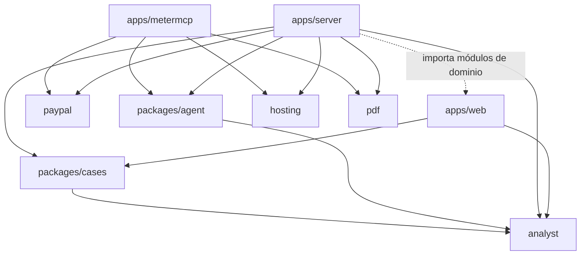

[English](../../architecture/components.md) | [Español](components.md)

# Componentes

Un workspace de npm (`package.json`, Node `>=24`, TypeScript ejecutado de forma nativa por Node, sin paso de build
para el servidor ni para MeterMCP). Tres apps y seis paquetes. Código en el commit `81c6242`.

`apps/server` importa directamente varios módulos de `apps/web/src/domain/` (`intent.ts`, `draft.ts`, `recorded.ts`,
`binding.ts`, `types.ts`, `time.ts`), de modo que el navegador y el servidor componen y comprueban los intents con el
mismo código.

## Apps

### `apps/web` — el espacio de trabajo del comerciante (navegador)

Vite 8 + React 18 + TypeScript + Tailwind CSS; AG Grid Community 33.3.2 para la bandeja de entrada y la tabla de
recibos.

| Área | Archivos principales | Responsabilidad |
|---|---|---|
| Enrutado y entorno | `App.tsx`, `domain/environment.ts`, `domain/copy.ts` | Explore demo, evaluación en sandbox, pantalla de espera; se decide a partir de `/api/auth/me` |
| Expediente del caso | `pages/CasePage.tsx`, `components/Timeline.tsx`, `EvidenceCard.tsx`, `ResponseComposer.tsx`, `SentenceRow.tsx` | Cronología, evidencia, borrador con citas y veredictos |
| Revisión y envío | `components/ApproveFlow.tsx`, `domain/intent.ts`, `domain/draft.ts`, `domain/recorded.ts` | Muestra el intent del servidor, aprueba por hash, relee, decide «Recorded by PayPal» |
| Acceso a PayPal | `domain/httpGateway.ts` (casos vinculados, a través del servidor), `domain/gateway.ts` (simulador) | La misma interfaz para el sandbox real y para PayPal simulado |
| Subidas | `components/AddEvidence.tsx`, `UploadReview.tsx`, `PdfReview.tsx`, `PdfSelect.tsx`, `app/useUploads.ts` | Subir, tapar, revisar el texto, corregir y transcribir, confirmar |
| Agente | `pages/AgentPage.tsx`, `domain/agentRun.ts`, `domain/compare.ts`, `app/useAgentRun.ts` | Objetivo y tope, pasos, recibo, uso, Stop, Compare, Keep |
| Cuentas | `pages/AuthPages.tsx`, `components/AccountMenu.tsx`, `domain/authClient.ts` | Inicio de sesión, invitaciones, passkeys, miembros |
| Guarda del proxy de desarrollo | `vite.config.ts`, `src/proxyGuard.ts` | Añade el token por arranque en el lado del servidor; rechaza peticiones entre sitios |

No se lee ninguna variable `VITE_*`; nada secreto llega al bundle.

### `apps/server` — el servidor de ResolveKit

`http` de Node con manejadores `Request`/`Response` estándar de la web (`node.ts` los adapta). Sin framework.

| Módulo | Responsabilidad |
|---|---|
| `main.ts` | Lee el entorno, construye cada almacén y cliente, elige el modo local o alojado, temporizadores (barrido de subidas cada hora, conciliación del agente cada 5 min, vigilancia del archivo de vinculaciones cada 30 s), parada ordenada |
| `app.ts` | La API: lecturas de casos, rutas de análisis, intents, envío de evidencia, auditoría, salud, avisos, rotación de vinculaciones, estado de operaciones |
| `hosted.ts` | Envoltorio del modo alojado: comprobaciones de Host/Origin, límites por IP, topes diarios, filtro de vendedor, análisis de precalentamiento, rutas de operaciones, sitio estático |
| `auth.ts`, `accounts.ts`, `sellers.ts` | Inicio de sesión con PayPal, invitaciones, passkeys (`@simplewebauthn/server`), sesiones, roles; vendedores recordados de las disputas vinculadas |
| `bindings.ts` | Vinculaciones caso → `{dispute, capture}` y reservas; verificación con una lectura fresca de PayPal |
| `intents.ts` | Intents de envío, aprobaciones, máquina de estados del envío, eventos de auditoría y el registro de envíos de solo anexado |
| `mapping.ts`, `documents.ts` | Disputa de PayPal → vista del caso; documentos del caso y los PDF enviados a PayPal |
| `analysis.ts` | Servicio del analista: ejecuciones guardadas/en directo, progreso, recomprobaciones, límites por hora, fijación de la entrada |
| `webhook.ts` | `POST /api/paypal/webhook/<key>`: comprobaciones, verificación con PayPal, relectura |
| `metermcp.ts` | Cliente de las rutas de administración de MeterMCP y de la URL `/agent/mcp` |
| `uploads/*` | Rutas de subida, decodificación de imágenes, proceso hijo y trabajo de PDF, OCR, texto, documentos (`E<n>`), permisos, almacén, límites |
| `agent/*` | Servicio de ejecuciones del agente, almacén de ejecuciones, topes por persona, rutas |
| `validate.ts` | Utilidades de validación de intents |
| `scripts/demo-prepare*.ts`, `scripts/demo-check*.ts` | Scripts del operador (ver [desarrollo local](../technical/local-development.md)) |

### `apps/metermcp` — la pasarela MCP de pago por uso

| Módulo | Responsabilidad |
|---|---|
| `main.ts` | Entorno, ledger (libro contable), medidor, modo local/alojado, barrido y conciliación cada 30 s |
| `app.ts` | Rutas HTTP y guardas: `/mcp`, `/agent/mcp`, `/approved`, `/cancelled`, `/health`, `/healthz`, administración `/sessions…` |
| `mcp.ts` | Servidor MCP (`@modelcontextprotocol/sdk` 1.32.1, Streamable HTTP, respuestas JSON), topes de sesión y cierre por inactividad |
| `tools.ts` | Herramientas sintéticas de pago y la lista de precios |
| `meter.ts` | Sesiones de pago: pedido de presupuesto, comprobación de aprobación, reservas, liquidación, conciliación, fallos inyectados |
| `ledger.ts` | Ledger SQLite (`node:sqlite`): sesiones y llamadas |
| `receipt.ts` | Recibo en JSON y PDF (`@resolvekit/pdf`) con `receipt_sha256` |
| `scripts/demo-agent.ts` | Agente de línea de comandos contra el `/mcp` público |

## Paquetes

| Paquete | Responsabilidad | Lo usan |
|---|---|---|
| `@resolvekit/paypal` | Cliente REST de PayPal tipado: caché del token OAuth, reintentos, `PayPal-Request-Id`; disputas, verificación de webhooks, token de identidad, pedidos/pagos | servidor, MeterMCP, scripts |
| `@resolvekit/analyst` | Prompts, esquemas, proveedores (Gemini, Groq sobre `fetch`), pipeline, comprobaciones deterministas, detección de inyección, clave de caché, análisis de referencia (golden), evaluaciones | servidor, web (clave y tipos), agente, casos |
| `@resolvekit/agent` | Motor del agente comprador dirigido por el modelo, adaptadores de modelo con function calling, límites de ejecución | servidor, CLI de MeterMCP, `demo:prepare` |
| `@resolvekit/cases` | Fixtures de los casos de demo y el montaje de los documentos del caso y de la entrada del analista, compartidos por la web y el servidor | web, servidor |
| `@resolvekit/hosting` | Utilidades del modo alojado: contadores diarios, limitador de tasa, dirección del cliente detrás de proxies, cabeceras de seguridad, sitio estático, guarda de `PAYPAL_ENV` | servidor, MeterMCP |
| `@resolvekit/pdf` | Escritor de PDF mínimo: PDF de texto (Helvetica, WinAnsi) y PDF solo de imagen | servidor, MeterMCP |

## Interfaces internas

Todas las rutas HTTP y las herramientas MCP son **interfaces internas de esta demo, no API públicas estables**:
cambian con el código, sin versionado ni periodo de obsolescencia. Referencia: [API HTTP](../technical/http-api.md),
[herramientas MCP](../technical/mcp-tools.md).

## Contratos y estados compartidos

| Contrato | Definido en | Compartido por |
|---|---|---|
| `SubmissionIntent`, `IntentRequest`, `IntentStatus`, `parseIntentRequest` | `apps/web/src/domain/intent.ts` | web, servidor |
| Reglas del borrador (`NOTES_LIMIT` 2 000, bloqueos) | `apps/web/src/domain/draft.ts` | web, servidor |
| Comparación «Recorded by PayPal» | `apps/web/src/domain/recorded.ts` | web, servidor |
| `DisputeSnapshot`, `ActionCode` | `apps/web/src/domain/types.ts` | web, servidor |
| Entrada del análisis, `analysisKey` (sha256 del `{input, model, promptVersion}` canónico) | `packages/analyst/src/key.ts`, `types.ts` | servidor, web (Web Crypto), evaluaciones |
| Fixtures y documentos de los casos | `packages/cases` | web, servidor, evaluaciones |
| `RunLimits`, `Outcome`, `Settlement`, `Step` del agente | `packages/agent/src/engine.ts` | servidor, CLI, `demo:prepare`, web (vía API) |
| Recibo de MeterMCP | `apps/metermcp/src/receipt.ts` | servidor (`metermcp.ts`), web |

### Máquinas de estados

**Intent de envío** (`IntentStatus`):

| Estado | Significado |
|---|---|
| `proposed` | Compuesto por el servidor; esperando aprobación |
| `approved` | Aprobado por su propietario con el hash de contenido; se puede enviar |
| `sending` | Envío en curso (uno por disputa a la vez) |
| `sent` | PayPal aceptó el envío; si ha quedado registrado se comprueba releyendo |
| `failed` | El envío falló; el mismo intent (mismo `PayPal-Request-Id`) puede reintentarse durante 30 min |
| `invalidated` | Sustituido por una edición, un intent más reciente, documentos o vinculaciones cambiados; nunca se puede enviar |
| `expired` | No aprobado o no enviado en 30 min |

Un reinicio encuentra un intent en `sending` y lo marca como `failed` («the server restarted during the send»); la
app web vuelve a leer PayPal antes de cualquier reintento.

**Subida** (`UploadStatus`): `pending` → `reviewing` → `confirmed`, o `discarded` (por el comerciante o pasadas
24 h), `deleted`, `archived` (el caso rotó a su siguiente disputa; se conserva el registro y se eliminan archivos y
texto).

**Sesión de pago de MeterMCP** (`SessionStatus`): `pending_approval` → `active` → `closing` → `settled` |
`voided` | `capture_pending` (→ `settled` o `capture_declined`) | `settlement_failed` (reintentar con close);
`cancelled` cuando el comprador cancela o se rechaza la fuente de fondos. Llamadas: `PENDING` → `OK` | `FAILED`.

**Ejecución del agente**: resultado `done`, `cannot_do`, `out_of_budget`, `stopped` (con un motivo de parada),
`model_unavailable`, `not_approved`, `interrupted`; liquidación, leída solo del recibo, `none`, `unverified`, `open`,
`captured`, `capture_pending`, `capture_declined`, `voided`, `failed`, `not_approved`. Resultado y liquidación son
independientes.

**Comprobación de vinculaciones**: `verified`, `invalid`, `unavailable`, `unchecked` (lo informa `/api/health`).

**Conexión del espacio de trabajo**: `evaluation`, `not_connected`, `checking`. Un estado `connected` está reservado
en la especificación de diseño de los tres entornos; no existe en el código (`apps/server/src/sellers.ts`).
