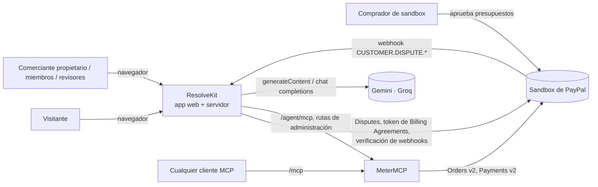
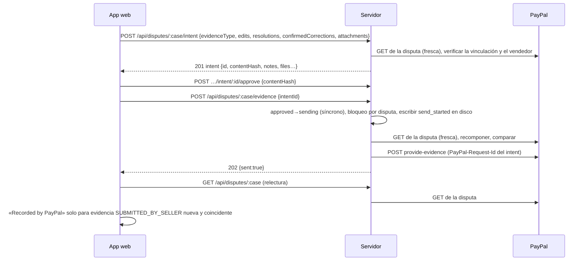
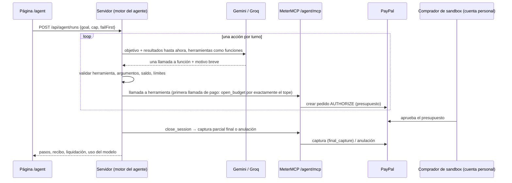

[English](../../architecture/overview.md) | [Español](overview.md)

# Visión general de la arquitectura

ResolveKit es un espacio de trabajo para disputas de PayPal: arma el expediente de una disputa, un analista de IA
redacta una respuesta en la que cada frase cita su evidencia, las frases sin respaldo se rechazan y el comerciante
aprueba el contenido exacto antes de que se envíe nada a PayPal. Un segundo sistema, más pequeño, **MeterMCP**, es una
pasarela MCP de pago por uso que un **agente comprador** paga a través de PayPal; sus recibos se convierten en
evidencia de uno de los casos.

Esta página describe la arquitectura tal como está en el código en el commit `fbe9621` (19/10/2026). Los términos de
estado siguen el vocabulario del proyecto: Diseñado · Implementado · Probado en local · Verificado en sandbox ·
Desplegado · Disponible para usuarios · Pendiente.

- Componentes y contratos compartidos: [components.md](components.md)
- Datos, almacenamiento, consistencia y recuperación: [data-and-storage.md](data-and-storage.md)
- Identidad, autorización, aislamiento y fronteras de confianza: [trust-boundaries.md](trust-boundaries.md)

## Contexto

| Actor | Qué hace con ResolveKit |
|---|---|
| Visitante (sin sesión o en cualquier espacio de trabajo) | Usa **Explore demo**: casos ficticios sobre un simulador en el navegador; no se envía nada a ningún sitio. |
| Comerciante del espacio de trabajo de evaluación (Owner) | Inicia sesión con **Continue with PayPal**; lee las disputas de sandbox vinculadas, sube evidencia, aprueba y envía respuestas, ejecuta el agente, invita a miembros. |
| Miembros y revisores | Se unen mediante un enlace de invitación; actúan dentro de ese espacio de trabajo con los permisos de su rol. |
| Cualquier otro comerciante que inicie sesión | Ve una pantalla de espera: conectar sus propias disputas está **en validación y no disponible** (ver [alta de comerciantes](../technical/merchant-onboarding.md)). |
| Comprador de sandbox | Aprueba los presupuestos de MeterMCP en PayPal y abre las disputas de sandbox que se usan para la evaluación. |
| Clientes MCP | Llaman al `/mcp` público de MeterMCP; crear un presupuesto en el servicio alojado requiere el código de la demo. |
| PayPal (sandbox) | Fuente de verdad de disputas, registros de evidencia, pedidos, autorizaciones y capturas. Nada se ha ejecutado contra PayPal live. |
| Google Gemini, Groq | Modelos de lenguaje para el analista y el agente. Las claves se quedan en el servidor. |

## Tres entornos

| Entorno | Rutas | Datos | Envía a PayPal | Estado |
|---|---|---|---|---|
| Explore demo | `/demo`, `/demo/cases/:id` | Casos ficticios, análisis de referencia (golden) confirmados en el repositorio, simulador en el navegador | Nunca | Implementado · Probado en local · Desplegado · Disponible para usuarios |
| Evaluación en sandbox (UI: «Sandbox evaluation · <workspace> · PayPal sandbox») | `/cases`, `/cases/:id` | Casos vinculados a disputas reales del **sandbox** de PayPal; documentos sintéticos más subidas del comerciante | Sí, solo al sandbox (caso estándar: los envíos nuevos quedan Pendientes hasta que se reponga su reserva de disputas, 19/10/2026) | Implementado · Probado en local · Verificado en sandbox · Desplegado · Disponible para revisores invitados |
| Espacio de trabajo del comerciante | pantalla de espera | — | No | Pantalla de espera Implementada · Desplegada. Conectar las disputas propias de un comerciante: **Pendiente** (sin código en la app) |

El entorno se decide en el servidor: `/api/auth/me` informa de la conexión del espacio de trabajo como `evaluation`,
`not_connected` o `checking`; un estado `connected` está reservado en la especificación de diseño de los tres entornos y no existe en el código. La app web enruta según ese valor.

## Contenedores

| Contenedor | Código | Se ejecuta como | Responsabilidad |
|---|---|---|---|
| App web (SPA) | `apps/web` | Build estático servido por el servidor (alojado) o por Vite (local) | Bandeja de entrada, expediente del caso, revisión y aprobación, revisión de subidas, página `/agent`, simulador para los casos de demo. No guarda ningún secreto. |
| Servidor de ResolveKit | `apps/server` | Proceso Node 24, sin framework | Todas las llamadas de disputas a PayPal, el analista, subidas, intents y auditoría, cuentas e inicio de sesión, ejecuciones del agente, webhooks, límites. |
| Proceso hijo lector de PDF | `apps/server/src/uploads/pdf-child.ts` | Proceso hijo de Node bifurcado por sesión de PDF, heap de 160 MB | Abre y renderiza un PDF no fiable con pdf.js; se mata al llegar al plazo o (en Linux) por encima de 200 MiB residentes. |
| Worker de OCR | `apps/server/src/uploads/ocr.ts` | Worker de tesseract.js (WASM) en el árbol de procesos del servidor | Lee texto de imágenes y páginas saneadas; se detiene tras 60 s inactivo. |
| MeterMCP | `apps/metermcp` | Proceso / servicio Node 24 aparte | `/mcp` público con herramientas sintéticas de pago, presupuesto de PayPal (autorizar, captura parcial, anular), ledger (libro contable) SQLite, recibos. |
| Modelos de lenguaje | externo | API de Gemini, API de Groq | Etapas del analista y turnos del agente, llamados con `fetch` simple. |
| PayPal | externo | API REST (sandbox) | Disputas, webhooks, token de identidad, pedidos y pagos. |

Los paquetes compartidos (`packages/*`) son bibliotecas dentro de esos procesos, no servicios: `paypal`, `analyst`,
`agent`, `cases`, `hosting`, `pdf`. Ver [components.md](components.md).

## Despliegue (actual)

| Elemento | Valor (fuente: `render.yaml`) |
|---|---|
| Plataforma | Render, dos servicios `web`, región `oregon`, plan `starter` (0.5 CPU / 512 MB), `NODE_VERSION` 24.19.0 |
| `resolvekit` | `npm ci && npm run build`, arranque `node apps/server/src/main.ts`, `RESOLVEKIT_MODE=hosted`, disco de 1 GB en `/var/data`, salud `/healthz` |
| `resolvekit-metermcp` | `npm ci`, arranque `node apps/metermcp/src/main.ts`, `METERMCP_MODE=hosted`, disco de 1 GB en `/var/data`, salud `/healthz` |
| Enlace entre ambos | `METERMCP_URL` (`host:port` de la red privada) y `METERMCP_ADMIN_TOKEN` pasados con `fromService` |
| Entorno de PayPal | `PAYPAL_ENV=sandbox`; el modo alojado se niega a arrancar con otro valor salvo `live` más `RESOLVEKIT_ALLOW_LIVE_PAYPAL=yes-real-money`, que el blueprint nunca establece |
| Despliegue automático | `commit` en ambos servicios (el seguimiento del agente recomienda desactivarlo para `resolvekit`: Pendiente, operativo) |

`fbe9621` se considera Desplegado: el propietario confirmó el despliegue el 19/10/2026 y `demo:check` pasó todas las
líneas salvo una reserva de disputas vacía. `demo:check` no puede demostrar qué commit está desplegado. Un disco
persistente impide los despliegues sin tiempo de inactividad; se observaron de uno a dos minutos de 502 por despliegue
(evidencia privada). Detalles: [despliegue](../operations/deployment.md).

El modo local ejecuta el mismo servidor en `127.0.0.1:8787` y MeterMCP en `127.0.0.1:8790`, con tokens por arranque
y el proxy de Vite en lugar del inicio de sesión: [desarrollo local](../technical/local-development.md).

## Flujos principales

### Documentos (subida del comerciante)

1. El navegador sube un PNG/JPEG, un PDF o texto pegado a `POST /api/cases/:id/uploads`.
2. El servidor lo decodifica (imágenes por sus bytes mágicos; PDF en el proceso hijo), el comerciante tapa zonas, el
   servidor incrusta las tapas en píxeles nuevos y ejecuta OCR **solo** sobre la imagen tapada.
3. El comerciante revisa el texto, corrige o transcribe líneas y confirma; la confirmación queda ligada al `sha256`
   del archivo saneado que se revisó.
4. La subida confirmada pasa a ser el documento `E<n>` del caso. Nada sale del servidor antes de este punto.

Detalles: [procesamiento de evidencia](../technical/evidence-processing.md).

### Análisis

1. El navegador pide `POST /api/cases/:id/analysis` solo con el id del caso.
2. El servidor construye la entrada él mismo: fixtures del caso, su propia lectura en PayPal de la disputa vinculada
   (reutilizada 60 s), el recibo de MeterMCP para el caso del agente, las subidas confirmadas.
3. Un análisis guardado para la misma clave (`sha256` de la entrada, versión del prompt, modelo) responde `200`; si no,
   dentro de los límites por hora y por día, arranca una ejecución en directo (`202`) y el navegador consulta `/progress`.
4. Pipeline: extraer citas literales → filtrar instrucciones → cronología, contradicciones, lista de comprobación,
   borrador → verificar cada frase → las reglas eligen la acción. Detalles: [pipeline de IA](../technical/ai-pipeline.md).

### Envío

Solo `provide-evidence` se envía de extremo a extremo. El paquete cliente también tiene los métodos `send-message` y
`accept-claim`, pero ninguna ruta los llama; no hay código para hacer una oferta, escalar ni reembolsar. En la pantalla
de revisión se listan las demás acciones que PayPal permite, y elegir una bloquea el envío con «only "Provide evidence"
can be sent from this screen for now». Detalles: [integración con PayPal](../technical/paypal-integration.md),
[API HTTP](../technical/http-api.md).

### Agente comprador

Detalles: [agente comprador](../technical/buying-agent.md), [herramientas MCP](../technical/mcp-tools.md).

## Decisiones clave

Las decisiones de diseño registradas viven en las especificaciones y planes de [`docs/superpowers/`](../../superpowers/specs/)
(historial; no se reescribe). Las decisiones que dan forma a la arquitectura actual:

| Decisión | Por qué / contrapartida | Fuente |
|---|---|---|
| El navegador nunca habla con PayPal ni con un modelo; el servidor construye él mismo cada entrada del analista y cada envío | Los cuerpos de las peticiones no pueden inyectar notas, archivos ni documentos; cuesta un viaje de ida y vuelta al servidor por acción | `apps/server/src/app.ts` (entrada del analista construida en el servidor), `apps/web/src/domain/intent.ts` (`parseIntentRequest`, campos rechazados) |
| El comerciante aprueba un intent compuesto por el servidor mediante su hash de contenido; el envío recompone a partir de una lectura fresca de PayPal y rechaza cualquier diferencia | La aprobación queda ligada al contenido exacto; una disputa, un documento o una vinculación que cambie obliga a una nueva revisión | [especificación de los tres entornos](../../superpowers/specs/2026-10-18-three-environments-design.md) («Evaluation keeps today's guarantees») |
| Tres entornos, decididos en el servidor; la demo nunca toca la ruta de envío | Jueces y visitantes no pueden llegar a PayPal real por accidente; una tercera fuente «connected» sigue siendo posible | [especificación de los tres entornos](../../superpowers/specs/2026-10-18-three-environments-design.md), [plan](../../superpowers/plans/2026-10-18-three-environments.md) |
| Las subidas se leen en nuestro propio servidor; el comerciante tapa lo que quiera antes de que ningún modelo ni PayPal vea el archivo; una sola versión saneada para la IA y para PayPal | Ningún servicio externo ve archivos sin tapar; la calidad del OCR queda limitada al tesseract local | [especificación de evidencia del comerciante](../../superpowers/specs/2026-10-17-merchant-evidence-design.md), [plan](../../superpowers/plans/2026-10-17-merchant-evidence-phase1.md) |
| Los PDF se rasterizan en un proceso hijo, se tapan, se pasan por OCR desde los píxeles y se reconstruyen como PDF solo de imagen | El contenido tapado no puede sobrevivir en capas de texto, metadatos ni adjuntos; el PDF enviado no tiene texto seleccionable | [especificación de PDF](../../superpowers/specs/2026-10-18-merchant-evidence-pdf-design.md), [plan](../../superpowers/plans/2026-10-18-merchant-evidence-pdf.md) |
| El agente comprador lo dirige el modelo (function calling, una acción por turno) y el código valida cada acción; la liquidación es del código | Decisiones reales con límites estrictos; sin respaldo con guion, así que sin modelo la ejecución se detiene | [especificación del agente](../../superpowers/specs/2026-10-18-model-driven-agent-design.md), [plan](../../superpowers/plans/2026-10-18-model-driven-agent.md) |
| Presupuesto de MeterMCP = `AUTHORIZE` de Orders v2 por exactamente el tope; liquidación = una captura parcial final o una anulación | El comprador aprueba una vez; las llamadas fallidas nunca se cobran; una autorización es válida durante un tiempo limitado | `apps/metermcp/src/meter.ts`, [integración con PayPal](../technical/paypal-integration.md) |
| El inicio de sesión usa un token de Billing Agreements sin cargo de una segunda app de PayPal | Log in with PayPal respondió 400 en nuestro sandbox y un vendedor no puede aprobar su propia app; la familia de API está obsoleta | `packages/paypal/src/identity.ts`, [fronteras de confianza](trust-boundaries.md) |
| Archivos en un disco persistente (JSON, JSONL, SQLite), una instancia por servicio | Simple e inspeccionable; sin escalado horizontal, sin despliegue sin tiempo de inactividad, sin copias de seguridad en el código | [datos y almacenamiento](data-and-storage.md) |
| Evaluaciones: conjuntos fijos, cifras citadas solo del resumen confirmado en el repositorio | Las tasas nunca se comparan entre conjuntos distintos | [especificación H-04](../../superpowers/specs/2026-10-19-analyst-evals-h04-design.md), [evaluaciones](../quality/evaluations.md) |

No hay carpeta `docs/architecture/decisions/`: las especificaciones anteriores son el registro de decisiones.

## Arquitectura actual y evolución futura

| Área | Hoy (código en `fbe9621`) | No construido (futuro, no prometido) |
|---|---|---|
| Comerciantes | Un espacio de trabajo de evaluación: el vendedor de las disputas de sandbox vinculadas | Conectar las disputas propias de cualquier comerciante mediante PayPal Platform (Partner Referrals, `PayPal-Auth-Assertion`): solo pruebas externas en sandbox, sin código en la app |
| Acciones sobre disputas | `provide-evidence` | enviar mensaje, hacer oferta, aceptar reclamación, escalar, reembolsar |
| Entorno de PayPal | Sandbox | Producción (nunca ejecutado; el modo alojado lo rechaza sin una activación explícita) |
| Escala | Una instancia por servicio, archivos en un disco | Base de datos, varias instancias, copias de seguridad |
| Herramientas del agente | Tres herramientas sintéticas de MeterMCP | Fuentes de datos reales |

Los límites conocidos están recogidos en [limitaciones](../product/limitations.md) y [problemas conocidos](../quality/known-issues.md).
