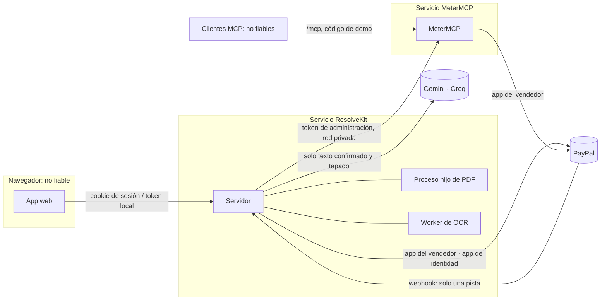

[English](../../architecture/trust-boundaries.md) | [Español](trust-boundaries.md)

# Fronteras de confianza, identidad y aislamiento

En qué confía cada parte del sistema, cómo se identifica a las personas, qué pueden hacer y cómo se separa un espacio
de trabajo, una persona o una ejecución de otra. Código en el commit `f1b7236`. Estas medidas reducen el riesgo;
ninguna es una garantía absoluta. La visión más amplia de privacidad está en
[seguridad y privacidad](../quality/security-and-privacy.md).

## Fronteras

| Frontera | Qué la cruza | En qué se confía | Control |
|---|---|---|---|
| Navegador → servidor | Ids de caso, ediciones, bytes de subidas, aprobaciones | En nada de un cuerpo más allá de sus campos documentados | El servidor compone cada entrada del analista y cada intent; se rechazan notas, archivos o seguimiento en un cuerpo (`INVALID_INTENT_REQUEST`); token local o sesión firmada; comprobaciones de Host/Origin; POST solo JSON |
| Servidor → proceso hijo de PDF | Los bytes del PDF subido | En nada de lo que devuelve el proceso hijo más allá de píxeles y recuentos | Proceso bifurcado, heap de V8 de 160 MB, se mata al llegar a su plazo y (en Linux) por encima de 200 MiB residentes; pdf.js sin scripting, sin XFA, sin fuentes del sistema, sin font-face, sin fetch (sustituido por funciones que lanzan error, con los intentos contados) |
| Servidor → worker de OCR | Solo píxeles saneados | El texto reconocido, revisado por el comerciante antes de usarlo | tesseract.js con datos de idioma de un paquete local, `cacheMethod: 'none'`, sin descargas; límites de tiempo; un trabajo a la vez |
| Servidor → modelos | Documentos sintéticos de los casos, datos de PayPal en sandbox, subidas **confirmadas y tapadas**, una frase editada para una recomprobación | La salida del modelo se comprueba, nunca se da por buena | Documentos envueltos en delimitadores con una etiqueta aleatoria por llamada y marcados como datos; las citas deben ser subcadenas exactas; las reglas eligen la acción y el tipo de evidencia; ver [pipeline de IA](../technical/ai-pipeline.md) |
| Servidor → MeterMCP | Llamadas a herramientas del agente, consultas de recibos, cierre de administración | Los recibos y el estado de liquidación | Token de administración (`x-metermcp-token`); en el modo alojado, las rutas de administración solo responden a peticiones que no han pasado por el proxy público (sin `X-Forwarded-For`, sin el Host público) |
| Clientes MCP → MeterMCP | Llamadas a herramientas, peticiones de presupuesto | En nada | Cada sesión MCP solo alcanza su propia sesión de pago; en el modo alojado, crear un presupuesto requiere `x-demo-code` y una unidad diaria; topes de sesión; límites por IP |
| Servidor / MeterMCP → PayPal | Lecturas de disputas, evidencia, pedidos, capturas | Las respuestas de PayPal, releídas | Credenciales de cliente OAuth por app; `PayPal-Request-Id` en cada POST; timeouts y reintentos acotados |
| PayPal → servidor (webhook) | Eventos `CUSTOMER.DISPUTE.*` | El evento, solo como pista | Clave secreta en la URL, comprobación de las cabeceras de transmisión, cuerpo ≤ 64 KiB, verificación con el método de postback documentado por PayPal sobre el cuerpo en bruto; después la disputa se vuelve a leer de PayPal |
| Navegador → PayPal | Aprobaciones del comprador, aprobación del inicio de sesión | — | Las páginas de retorno vuelven a leer el pedido o el token en PayPal; la query string no demuestra nada |

## Identidad

### Continue with PayPal (inicio de sesión del Owner, alojado)

No es Log in with PayPal ni un inicio de sesión OpenID. El servidor pide a PayPal un **token de acuerdo de Billing
Agreements v1 sin cargo** creado por una segunda app de PayPal, la app de identidad de la plataforma
(`PAYPAL_IDENTITY_*`). El comerciante lo aprueba en PayPal; el servidor lee el token aprobado y toma
`payer_info.payer_id`, que para una cuenta business coincidió con el merchant id del vendedor en sus disputas en
nuestra prueba en sandbox (10/10/2026). No se crea ningún acuerdo y no se cobra nada. PayPal lista la API de Billing
Agreements bajo una ruta obsoleta; no se encontró ninguna página de referencia actual para los tokens de acuerdo
(19/10/2026), así que esto podría dejar de funcionar.

Por qué una segunda app: un vendedor no puede aprobar una petición de su propia app, y el userinfo de Log in with
PayPal respondió 400 en nuestro sandbox (experimental, 10/10/2026). El servidor se niega a arrancar si
`PAYPAL_IDENTITY_CLIENT_ID` es igual a `PAYPAL_CLIENT_ID`.

Vinculación con el navegador que lo inició:

1. `POST /api/auth/paypal/start` crea el token y establece una cookie firmada de vida corta con el id del token, un
   nonce y una caducidad (15 min, ruta `/api/auth/paypal`).
2. PayPal devuelve a quien aprueba a `/api/auth/paypal/return/<k>?ba_token=…`, donde `k` se deriva del nonce.
3. El inicio de sesión solo se completa con la cookie, la clave y el token coincidentes. Cada token tiene un único
   intento: una llegada sin la cookie, o antes de la aprobación, lo quema. Por tanto, un enlace de aprobación
   reenviado no inicia sesión a nadie.

Estado: Implementado · Probado en local · Verificado en sandbox · Desplegado. Iniciar sesión **no** concede a
ResolveKit acceso a las disputas del comerciante.

### Invitaciones, passkeys y sesiones

| Mecanismo | Reglas |
|---|---|
| Enlace de invitación | Lo crea el Owner: de un solo uso o de revisor; 1–300 usos, caducidad ≤ 120 días (por defecto 7), fin del acceso del revisor ≤ 180 días; el token viaja en el fragmento del enlace (`/join#<token>`); solo se guarda su hash |
| Unirse | Con una passkey (WebAuthn, `@simplewebauthn/server`) o con **Join for this browser only** (unirse solo en este navegador) |
| Cookie de sesión | `HttpOnly; Secure; SameSite=Strict`, firmada con HMAC con `RESOLVEKIT_SESSION_SECRET`, 12 h, lleva una época de sesión |
| Fin de las sesiones | Revocar a un miembro, **Sign out of all devices** (cerrar sesión en todos los dispositivos) o el fin del acceso de un revisor incrementa la época: todas las sesiones terminan a la vez |
| Sin `RESOLVEKIT_SESSION_SECRET` (≥ 32 caracteres) | Se usa un secreto por arranque: las sesiones terminan al reiniciar |

Creación de passkeys en el servicio de sandbox desplegado: Pendiente (sin evidencia).

### Modo local

Sin cuentas. La persona que está ante la máquina es el operador y actúa como Owner. La API escucha en `127.0.0.1`,
exige el Host `127.0.0.1:<port>` o `localhost:<port>` (403 `FORBIDDEN_HOST`, contra el DNS rebinding), un Origin
presente de la lista permitida (403 `FORBIDDEN_ORIGIN`) y el token por arranque en `x-resolvekit-token` (401
`MISSING_OR_BAD_TOKEN`), que solo el proxy de Vite lee del disco y añade en el lado del servidor. POST solo acepta
JSON, salvo la ruta de subida.

## Autorización

| Quién | Puede |
|---|---|
| Owner (la persona de la cuenta de PayPal) | Todo en el espacio de trabajo; crear y revocar invitaciones y miembros; leer los miembros; ver las ejecuciones del agente del espacio de trabajo con `?scope=workspace` (queda registrado; se ocultan el enlace de aprobación y los ids de pedido y sesión); conservar ejecuciones; no puede ser revocado |
| Miembro completo | Leer casos, subir, tapar/corregir/confirmar cualquier subida, borrar subidas, componer/aprobar/enviar **sus propios** intents, ejecutar el agente |
| Revisor (unido mediante un enlace de revisor) | Como un miembro, pero tapa/corrige/confirma **solo sus propias** subidas y nunca borra; el acceso termina en su fecha |
| Visitante sin sesión | Solo Explore demo; las rutas de casos del servidor responden 404 |
| Operador con `RESOLVEKIT_OPS_TOKEN` | `GET /api/ops/status`, `GET /api/ops/agent-run/<id>` (Bearer); sin la variable, estas rutas no existen |
| Poseedor del token de administración de MeterMCP | Rutas de administración `/sessions…`, `/agent/mcp` (alojado, con `x-agent-run`) |

## Aislamiento

| Frontera | Regla | Estado |
|---|---|---|
| Casos de evaluación frente a otros espacios de trabajo | Cada ruta de caso (`/api/disputes/:case…`, `/api/cases/:id/analysis…`, `/api/cases/:id/uploads…`) solo responde al **espacio de trabajo del vendedor**, aquel cuyo payer id de PayPal es el vendedor de las disputas vinculadas; cualquier otro recibe `404 UNKNOWN_CASE` antes de hacer ningún trabajo. `/api/health` les oculta las vinculaciones | Implementado · Probado en local · Desplegado |
| Comprobación del vendedor al enviar | En la lectura fresca antes de componer y antes de enviar, el merchant id del espacio de trabajo debe ser el `seller.merchant_id` de la disputa (403 `NOT_THE_SELLER`) | Implementado · Probado en local · Verificado en sandbox |
| Comprobación de la vinculación | La disputa debe ser la vinculada, sobre exactamente la captura vinculada, por el importe y la moneda del caso (409 `BINDING_INVALID` / `BINDING_UNAVAILABLE`) | Implementado · Probado en local |
| Intents | Pertenecen a la persona que los compuso; para cualquier otra, incluido un compañero, no existen (404) | Implementado · Probado en local |
| Subidas antes de la confirmación | Archivos y texto visibles solo para quienes pueden editarlos; los demás ven metadatos con `restricted: true`; los archivos dan 404 | Implementado · Probado en local |
| Ejecuciones del agente | El autor ve sus ejecuciones; la ejecución de otra persona responde 404 exista o no; el Owner ve las de otros solo con `?scope=workspace`; una ejecución de otro espacio de trabajo nunca es visible | Implementado · Probado en local |
| Ejecución del agente ↔ sesión de MeterMCP | Las sesiones de `/agent/mcp` quedan ligadas a la clave de la ejecución (`x-agent-run: run-<32 hex>`); 10 sesiones y 600 peticiones cada 5 min por ejecución | Implementado · Probado en local · Desplegado |
| Sesión MCP ↔ sesión de pago | Una sesión MCP solo alcanza su propia sesión de pago | Implementado · Probado en local |
| Avisos de webhook | Se muestran solo al espacio de trabajo del vendedor de la disputa | Implementado · Probado en local |
| Varios comerciantes conectados | No construido: hay un único espacio de trabajo de evaluación. Aislamiento entre comerciantes conectados: **Pendiente** | Pendiente |

## Guardas de las peticiones en el modo alojado

- El Host debe ser un host público del servicio (salvo `/healthz`); las peticiones `/api` que cambian estado deben
  llevar el Origin propio del servicio, y cualquier Origin presente debe ser el nuestro (403). POST solo acepta JSON
  (415), salvo las subidas.
- Límites por IP de ventana fija (429 `RATE_LIMITED` con `Retry-After`): 300 peticiones `/api` / 5 min; 60 lecturas
  de PayPal y pistas de PDF / 5 min; 40 peticiones de autenticación y operaciones / 15 min; 10 inicios de sesión con
  PayPal iniciados / 15 min; 20 intents / 10 min; 20 subidas, tapados y lecturas de páginas de PDF / 10 min; 120
  entregas de webhook / 15 min. IPv6 se agrupa por /64.
- La dirección del cliente sale de `X-Forwarded-For`, recorrida hacia atrás `TRUSTED_PROXY_HOPS` saltos (2 en Render),
  y solo se cree si viene de una dirección de par privada (`TRUSTED_PROXY_PEERS`). Los límites por IP son una
  cortesía, no la frontera de seguridad: las peticiones repartidas entre muchas direcciones los atraviesan. La
  frontera es la persona y el espacio de trabajo con sesión iniciada, los topes por persona y los topes diarios
  globales.
- Cabeceras de seguridad en cada respuesta: CSP, HSTS (https en el modo alojado), `X-Content-Type-Options: nosniff`,
  `X-Frame-Options: DENY`, `frame-ancestors 'none'`, `Referrer-Policy: no-referrer`.
- Guarda del entorno de PayPal: los servicios alojados se niegan a arrancar salvo con `PAYPAL_ENV=sandbox` (o `live`
  con `RESOLVEKIT_ALLOW_LIVE_PAYPAL=yes-real-money`, que nunca se establece en el blueprint).

## Secretos

| Secreto | Lo tiene | Nunca |
|---|---|---|
| App de PayPal del vendedor (`PAYPAL_CLIENT_ID/SECRET`) | servidor, MeterMCP, `demo:prepare` | en el navegador, los logs ni el bundle |
| App de identidad de PayPal (`PAYPAL_IDENTITY_*`) | servidor (alojado) | — |
| Claves de los modelos (`GEMINI_API_KEY`, `GROQ_API_KEY`) | servidor, scripts de línea de comandos | enviadas a otro sitio que no sea la cabecera de autenticación del proveedor |
| `RESOLVEKIT_SESSION_SECRET`, `PAYPAL_WEBHOOK_KEY`, `RESOLVEKIT_OPS_TOKEN`, `METERMCP_ADMIN_TOKEN`, `DEMO_CODE` | servicios y `.env` del operador | confirmados en el repositorio (`.env` y `.env.*` están ignorados por git salvo `.env.example`) |

Los logs y los detalles de auditoría llevan ids, códigos y hashes; no nombres de archivo, texto de subidas ni texto de
documentos.

## Lo que no está garantizado

- La detección de inyección de prompts es un aviso, no la defensa; la intención es que una instrucción no detectada no
  pueda cambiar la acción, el tipo de evidencia ni lo que cuenta como respaldado, pero es un objetivo de diseño
  probado con conjuntos sintéticos, no una demostración. Ver [evaluaciones](../quality/evaluations.md).
- La muerte del proceso hijo de PDF por RSS solo funciona en Linux; en Windows y macOS (desarrollo) solo se aplica el
  plazo. No se ha medido en Linux contra una bomba de descompresión real (seguimiento).
- El texto vecino de un código de barras tapado no oculta lo que el código codifica; la revisión lo advierte.
- El enfoque de identidad se apoya en una familia de API de PayPal obsoleta.
- Nada se ha ejecutado contra PayPal live.
