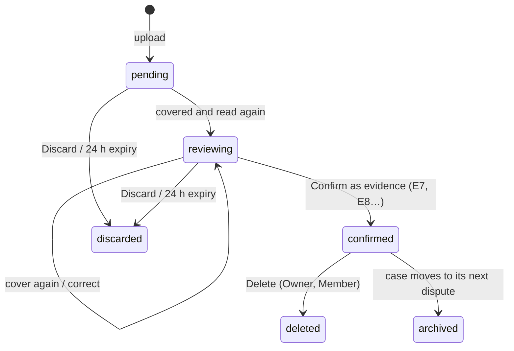

[English](../../product/functional-specification.md) | [Español](functional-specification.md)

# Especificación funcional

Qué hace ResolveKit, para quién y con qué reglas, tal como está construido en el commit `fbe9621` (19/10/2026). El
código es la fuente de verdad; cuando un comportamiento solo se ha observado en el sandbox de PayPal, esta página lo
dice. Palabras de estado: Diseñado · Implementado · Probado en local · Verificado en sandbox · Desplegado · Disponible
para usuarios · Pendiente.

Relacionado: [Visión general](overview.md) · [Limitaciones](limitations.md) · [API HTTP](../technical/http-api.md) ·
[Fronteras de confianza](../architecture/trust-boundaries.md).

## 1. Perfiles

| Perfil | Objetivo | Entorno hoy |
|---|---|---|
| **Visitante** | Ver qué hace ResolveKit sin cuenta | Explore demo |
| **Comerciante (Owner)** | Responder a sus propias disputas de PayPal con evidencia | Pantalla de espera: la conexión de sus disputas está **Pendiente** |
| **Owner del vendedor de sandbox** | Ejecutar la evaluación en sandbox; invitar a revisores | Evaluación en sandbox |
| **Miembro** | Trabajar los casos del negocio: evidencia, revisión, envío | Evaluación en sandbox (cuando le invita el Owner del vendedor de sandbox) |
| **Revisor / jurado** | Evaluar el flujo completo sobre disputas reales del sandbox, con un acceso limitado en el tiempo | Evaluación en sandbox, mediante el enlace de revisor del formulario de entrega |
| **Operador local** | Desarrollar o hacer demos en una máquina | Modo local |
| **Comprador que aprueba un presupuesto del agente** | Aprobar (o rechazar) un presupuesto en PayPal | Checkout del sandbox de PayPal, con una cuenta **personal (compradora)** de sandbox (PayPal rechazó la cuenta business del vendedor en la ejecución en sandbox del 19/10/2026; observado, no documentado) |

## 2. Roles

| Rol (tal como lo muestra la UI) | Cómo se obtiene | Límites |
|---|---|---|
| **Owner** | **Continue with PayPal**: la cuenta de PayPal que inicia sesión es dueña del espacio de trabajo de esa cuenta | Un Owner por espacio de trabajo; no se puede revocar |
| **Member** | Abre un enlace de invitación de miembro y se une (passkey o «Join for this browser only») | Revocable por el Owner |
| **Reviewer** | Abre un enlace de invitación de revisor y se une | Como un Member, más una fecha de fin de acceso (`accessUntil`, como máximo 180 días); edita y descarta solo sus propias subidas pendientes; no puede borrar subidas |
| **Operador local** | Ejecuta el servidor en local | Actúa como Owner; sin inicio de sesión, sin límites diarios (`apps/server/src/app.ts:155`) |
| Visitante sin sesión | — | Solo Explore demo; las rutas del espacio de trabajo redirigen a **Sign in** |

Un espacio de trabajo está **conectado para la evaluación en sandbox** cuando su cuenta de PayPal es el vendedor de una
disputa de sandbox vinculada, según se lee de PayPal (`apps/server/src/hosted.ts:174-196`). Cualquier otro espacio de
trabajo está «no conectado» y ve la pantalla de espera. Los miembros y revisores pertenecen al espacio de trabajo cuya
invitación usaron.

## 3. Permisos

Modo alojado. «Espacio del vendedor» = sesión iniciada en el espacio de trabajo conectado para la evaluación en
sandbox. Las comprobaciones del servidor están en `apps/server/src/hosted.ts` (control de acceso),
`apps/server/src/app.ts`, `apps/server/src/uploads/permissions.ts`, `apps/server/src/agent/routes.ts` y
`apps/server/src/auth.ts`.

| Acción | Owner | Member | Reviewer | Otro espacio con sesión | Sin sesión | Operador local |
|---|---|---|---|---|---|---|
| Explore demo | sí | sí | sí | sí | sí | sí (`/demo`) |
| Ver los casos de sandbox vinculados | sí | sí | sí | no (`UNKNOWN_CASE`) | no | fixtures + casos vinculados |
| Análisis de IA en directo (**Re-run with AI**) | sí | sí | sí | no (`SELLER_WORKSPACE_ONLY`) | no (`SIGN_IN_REQUIRED`) | sí |
| Volver a comprobar una frase editada | sí | sí | sí | no | no | sí |
| Añadir evidencia (subida) | sí | sí | sí | no | no | sí |
| Revisar, tapar, corregir, confirmar una subida | cualquiera | cualquiera | solo las propias | — | — | sí |
| Descartar una subida pendiente | cualquiera | cualquiera | solo las propias | — | — | sí |
| Borrar una subida confirmada | sí | sí | no | — | — | sí |
| Componer, aprobar, enviar una respuesta | sí | sí | sí | rechazado (`NOT_THE_SELLER` / `SELLER_WORKSPACE_ONLY`) | no | sí |
| Leer o aprobar el intent de otra persona | no (un intent pertenece a la sesión que lo compuso; los demás reciben 404) | no | no | no | no | — |
| Miembros e invitaciones (`/workspace`) | sí | no (`OWNER_ONLY`) | no | solo su propio Owner | no | no aplica (el modo local no tiene cuentas) |
| Iniciar una ejecución del agente comprador | sí | sí | sí | no (`SELLER_WORKSPACE_ONLY`) | redirigido al inicio de sesión | sí |
| Ver las ejecuciones propias, Stop de una ejecución propia en curso | sí | sí | sí | — | — | sí |
| **Workspace runs** (ejecuciones de todos, solo lectura) | sí (registrado; enlace de aprobación, pedido y sesión ocultos) | no | no | — | — | sin interruptor |
| **Keep** de una ejecución | sí | no | no | — | — | sí |
| Notificaciones de PayPal en la bandeja | solo el espacio del vendedor | igual | igual | no | no | sí |
| Rutas de operación (`/api/ops/*`) | no — solo con token de operador, no es un rol | | | | | |

Notas:
- La ruta de Stop también acepta al Owner con `?scope=workspace`; la página muestra **Stop** solo al autor de la
  ejecución.
- Las subidas aún no confirmadas solo se ven completas para quienes pueden editarlas; los demás ven «pending · <name> ·
  uploaded by <person>» y reciben 404 para sus archivos.

## 4. Casos de uso

| ID | Caso de uso | Actor principal | Estado |
|---|---|---|---|
| UC-01 | Explorar la bandeja y los expedientes de la demo | Visitante | Implementado · Desplegado · Disponible para usuarios |
| UC-02 | Iniciar sesión con **Continue with PayPal** | Comerciante | Implementado · Verificado en sandbox · Desplegado |
| UC-03 | Invitar a un miembro o revisor; revocar | Owner | Implementado · Probado en local · Desplegado |
| UC-04 | Unirse con un enlace de invitación (passkey o solo este navegador) | Member, Reviewer | Implementado · Desplegado; «Join for this browser only» usado por revisores (17–18/10/2026); passkey en el servicio desplegado **Pendiente** |
| UC-05 | Leer de PayPal un caso vinculado y su análisis | Espacio del vendedor | Implementado · Verificado en sandbox · Desplegado |
| UC-06 | Resolver una contradicción (**Explain in response** o **Mark resolved…**) | Espacio del vendedor | Implementado · Probado en local |
| UC-07 | Editar una frase y que se vuelva a comprobar | Espacio del vendedor | Implementado · Verificado en sandbox |
| UC-08 | Añadir una imagen, un PDF o texto pegado; tapar; confirmar | Espacio del vendedor | Implementado · Probado en local · Desplegado; imagen Verificado en sandbox |
| UC-09 | Revisar lo que se enviará, aprobar, enviar, releer | Espacio del vendedor | Implementado · Verificado en sandbox · Desplegado |
| UC-10 | Ejecutar el agente comprador; aprobar el presupuesto; leer los pasos y el recibo | Espacio del vendedor + comprador | Implementado · Verificado en sandbox (dos ejecuciones, 19/10/2026) · Desplegado |
| UC-11 | Comparar dos ejecuciones; Keep de una ejecución; ver Workspace runs | Autor / Owner | Implementado · Probado en local · Verificado en sandbox (Compare y Keep, 19/10/2026) |
| UC-12 | Detener una ejecución del agente en curso | Autor | Implementado · Probado en local; en sandbox **Pendiente** |
| UC-13 | Conectar las disputas de PayPal propias de un comerciante | Comerciante | **Pendiente** (no está en la app) |

## 5. Estados y reglas de negocio

### 5.1 Disputa (tal como se lee de PayPal)

ResolveKit muestra el estado y la fase de PayPal tal como PayPal los devuelve; no predice transiciones.

| Estado en PayPal | Se muestra como | Significado mostrado |
|---|---|---|
| `WAITING_FOR_SELLER_RESPONSE` | Waiting for your response | PayPal espera tu respuesta |
| `UNDER_REVIEW` | Under review by PayPal | PayPal está revisando; no hace falta actuar ahora |
| `WAITING_FOR_BUYER_RESPONSE` | Waiting for buyer | PayPal espera al comprador |
| `RESOLVED` | Resolved | PayPal ha cerrado esta disputa; el expediente es de solo lectura |
| `OPEN`, `OTHER` | Open / Other (see PayPal) | — |

Fases: `INQUIRY` «Inquiry», `CHARGEBACK` «Claim» (una fase de PayPal, no un contracargo de tarjeta),
`PRE_ARBITRATION`, `ARBITRATION`. La acción **Provide evidence** solo se ofrece cuando la disputa de PayPal la incluye.

Reglas:
- Un caso vinculado lee PayPal a través del servidor; la entrada del analista reutiliza una lectura de PayPal durante
  hasta 60 s.
- En modo alojado, solo el espacio del vendedor ve un caso vinculado; cualquier otro id de caso abre su gemelo ficticio
  en `/demo/cases/:id`.
- **Rotación de reserva**: cuando se usa una disputa vinculada (resuelta, o con evidencia del vendedor de más de 15
  min), la siguiente lectura pasa el caso a la siguiente disputa de su reserva, si queda alguna
  (`apps/server/src/app.ts:591-630`). A 19/10/2026 la reserva del caso estándar está vacía, así que muestra la
  evidencia registrada y los nuevos envíos sobre él están **Pendiente**.

### 5.2 Análisis

- Primero se muestran los análisis guardados (en caché o «golden» incluidos en el código); solo se hace una ejecución en
  directo tras el arranque o un cambio de vinculación (precalentamiento, modo alojado) o con **Re-run with AI**.
- Una frase es **Supported**, **Needs review** o **Removed: no supporting evidence**. Las frases eliminadas nunca se
  envían. Una cita debe ser una subcadena exacta de su documento; los números que no están en las citas mandan la frase
  a revisión.
- Una contradicción está en **Needs review** hasta que se elige **Explain in response** (la frase neutral del analista
  pasa al borrador) o **Mark resolved…** con una nota (guardada en el registro de auditoría).
- Una frase editada (1–600 caracteres, sin saltos de línea) la vuelve a comprobar el modelo en el servidor; si la
  comprobación no es posible, pasa a **Needs review** con «this edit was not re-checked».
- Límites: 6 análisis en directo y 30 recomprobaciones por hora por servidor; 60 análisis en directo y 200
  recomprobaciones al día (modo alojado).

### 5.3 Subida

Reglas: nada de una subida se usa, ni se envía a un modelo ni a PayPal, antes de confirmarla; confirmar exige que el
archivo saneado revisado sea el guardado (SHA-256); 10 subidas por caso; Delete se rechaza mientras hay en curso un
envío que la usa, y elimina los análisis que la leyeron. Las subidas descartadas, borradas y archivadas conservan un
registro sin archivos ni texto. Detalles: [Casos y evidencias](../user-guide/cases-and-evidence.md),
[Revisión de PDF](../user-guide/pdf-review.md).

### 5.4 Intent de envío

`proposed → approved → sending → sent | failed`. Lo compone el servidor a partir de sus propios documentos y análisis
(solo frases con respaldo, todas las contradicciones resueltas, un tipo de evidencia que PayPal ofrece, notas ≤ 2,000
caracteres). Una aprobación vincula el contenido exacto por hash y queda invalidada por una edición, un intent más
reciente, un cambio de vinculación o 30 minutos. Solo la sesión que lo compuso puede aprobarlo, enviarlo o cancelarlo.
Un envío por disputa a la vez; una vez que PayPal ha aceptado uno (persistido), no se envía ningún otro intent para esa
disputa. Un envío fallido puede reintentarse durante 30 minutos.

### 5.5 Ejecución del agente comprador

| Estado mientras se ejecuta | Se muestra como |
|---|---|
| `running` | Running |
| `awaiting_approval` | Waiting for approval in PayPal |

| Resultado | Se muestra como |
|---|---|
| `done` | Done |
| `cannot_do` | The tools cannot meet this goal |
| `out_of_budget` | Out of budget |
| `stopped` | Stopped: action limit (8) · time limit · model call limit · model token budget · the model gave invalid actions · PayPal approval timed out · the run could not be saved · MeterMCP did not open a budget · MeterMCP unreachable · internal error |
| `model_unavailable` | Model unavailable |
| `not_approved` | Not approved in PayPal |
| `interrupted` | Interrupted (stopped or server restart) |

La liquidación es un campo aparte, tomado solo del recibo de MeterMCP: «Captured X USD · Y released», «Capture pending
at PayPal (not final)», «Voided: nothing charged», «Capture declined by PayPal: nothing charged», «Not approved in
PayPal: nothing charged», «Settlement failed: …; will be retried», «Not verified yet», «Budget open in PayPal (not
settled yet)», «Nothing opened in PayPal». Una ejecución detenida o interrumpida nunca se da por terminada (done).

Reglas: objetivo de 1–300 caracteres; tope de 0.50–5.00 USD; una acción por turno, comprobada por código; como máximo
8 acciones, 12 llamadas al modelo, 180 s de tiempo del agente (sin contar la espera de aprobación), 15 min para aprobar;
una ejecución en curso por persona, 3 por servidor; 5 ejecuciones por persona y 20 por servidor por día UTC. Las
ejecuciones se conservan 30 días salvo que se marquen con Keep, estén sin liquidar, sin guardar o vinculadas como
evidencia. Detalles: [Agente comprador](../user-guide/buying-agent.md).

## 6. Flujos

### 6.1 Flujo normal: responder a una disputa vinculada

1. Un revisor abre el enlace de revisor, escribe un nombre y se une; la bandeja muestra los casos vinculados.
2. Abre un caso; la cabecera muestra el importe, el motivo, la fase, el estado, la fecha límite y la transacción
   disputada según PayPal.
3. La barra de análisis muestra el análisis guardado («cached» o «live») con el modelo y la hora.
4. Resuelve las contradicciones y las frases en **Needs review**; opcionalmente añade evidencia y pulsa
   **Re-run with AI**.
5. **Review what will be sent →**: el servidor compone el intent; lo revisa y pulsa **Continue to confirm →**.
6. Marca «I'm <name> … and I approve submitting this evidence for the …» y pulsa **Submit evidence to PayPal**.
7. El servidor registra la aprobación, vuelve a leer PayPal, recompone y compara, escribe el evento de auditoría en
   disco y luego envía `provide-evidence`.
8. La página relee la disputa y muestra **Recorded by PayPal** con «Sent versus recorded».

### 6.2 Flujos alternativos

| Situación | Qué ocurre |
|---|---|
| Explore demo | Las mismas pantallas sobre el simulador; la aprobación se compone en el navegador («Composed in this browser (simulator only)»); «Recorded» procede del simulador |
| Evidencia ya registrada (por otro revisor) | **Evidence recorded by PayPal**, borrador de solo lectura; «Sent · read-only» |
| PayPal muestra nueva evidencia del vendedor que no coincide | «New seller evidence that doesn't match what we sent»; nunca se presenta como nuestra; sin reintento automático |
| La petición agota el tiempo | Ni éxito ni fracaso: se relee la disputa; la evidencia solo se reenvía si PayPal no muestra ninguna registrada |
| Hay una disputa más reciente en la reserva | El caso pasa a ella en su siguiente lectura (la barra superior muestra el id de la disputa) |

### 6.3 Flujos de error

| Error (código) | Qué se muestra / significa | Recuperación |
|---|---|---|
| `SIGN_IN_REQUIRED` | Inicia sesión para componer y aprobar respuestas | Iniciar sesión (PayPal o enlace de invitación) |
| `SELLER_WORKSPACE_ONLY` | La acción es solo para el espacio del vendedor | Usar el espacio del vendedor, o la Explore demo |
| `NOT_THE_SELLER` | «Only the seller's workspace can send this» | — |
| `INTENT_STALE`, `DOCUMENTS_CHANGED`, `UPLOAD_CHANGED`, `BINDING_CHANGED` | Lo que se enviaría difiere de lo aprobado | Revisar de nuevo y aprobar el nuevo contenido |
| `SELLER_EVIDENCE_EXISTS` | PayPal ya tiene evidencia del vendedor; no se puede enviar más | Leer la evidencia registrada |
| `DISPUTE_BUSY` | Hay otro envío en curso para esta disputa | Esperar y releer |
| `AUDIT_UNAVAILABLE` (503) | El envío no pudo registrarse de forma duradera, así que no se envió nada | Volver a intentarlo más tarde |
| `DAILY_CAP` / `PERSON_CAP` (429) | Se ha agotado un límite de la demo; la respuesta dice cuándo se restablece | Esperar al restablecimiento |
| `RATE_LIMITED` (429) | Demasiadas peticiones desde esta dirección | Esperar lo que indique `Retry-After` |
| `CAPS_UNAVAILABLE` (503) | La demo no puede registrar el uso, así que no se hace | Volver a intentarlo más tarde |

Más: [Solución de problemas](../user-guide/troubleshooting.md).

## 7. Diferencias entre los entornos

| Aspecto | Explore demo | Evaluación en sandbox | Espacio de comerciante | Modo local |
|---|---|---|---|---|
| Inicio de sesión | ninguno | enlace de invitación (revisor/miembro) o el PayPal del vendedor de sandbox | **Continue with PayPal** | ninguno |
| Casos | todos los casos ficticios | solo los casos de sandbox vinculados | ninguno (pantalla de espera) | fixtures; casos vinculados si hay `bindings.json` |
| PayPal | simulador en el navegador | sandbox real a través del servidor | no conectado | sandbox si hay credenciales; si no, simulador |
| Análisis de IA | análisis golden incluidos en el código, sin llamada al modelo | guardados + en directo (con límites) | — | en directo con una clave de modelo |
| **+ Add evidence** | desactivado con su motivo | sí | — | sí, con el servidor |
| Envío | solo simulador | `provide-evidence` al sandbox | — | sandbox para los casos vinculados |
| Agente comprador | no está en la zona de demo | `/agent` (espacio del vendedor) | inicio rechazado | `/agent` como operador |
| Límites diarios | — | sí | — | ninguno |

## 8. Límites y funciones no disponibles

- Límites: ver las constantes en [Limitaciones](limitations.md) y [Configuración](../technical/configuration.md).
- No disponible: conectar las disputas propias de un comerciante; enviar mensaje, aceptar la reclamación, hacer una
  oferta, escalar, reembolsos desde el producto; el entorno live (producción) de PayPal; borrado de la cuenta o del
  espacio de trabajo por el propio usuario. Ver [Limitaciones](limitations.md).
