[English](../../product/overview.md) | [Español](overview.md)

# Visión general del producto

ResolveKit es un espacio de trabajo centrado en la evidencia para responder disputas de PayPal. Para cada disputa
construye un expediente (cronología y evidencias); un analista de IA redacta una respuesta en la que cada frase cita
las palabras exactas de su evidencia, las frases sin respaldo se eliminan y una persona aprueba el contenido exacto
antes de que se envíe nada a PayPal. Tras el envío, ResolveKit vuelve a leer la disputa en PayPal y solo dice
**Recorded by PayPal** («registrado por PayPal») cuando PayPal muestra nueva evidencia del vendedor que coincide con
lo enviado.

También incluye **MeterMCP**, un servidor MCP de pago por uso cuyos presupuestos son autorizaciones de PayPal, y un **agente
comprador** que gasta ese presupuesto, de modo que una compra de un agente que se disputa llega con un recibo por
llamada como evidencia.

ResolveKit prepara la respuesta; PayPal decide la disputa. No está afiliado a PayPal.

Los datos de esta página proceden del código en el commit `fbe9621` (19/10/2026) salvo que una fecha diga otra cosa.
Las palabras de estado siguen un único vocabulario: Diseñado · Implementado · Probado en local · Verificado en sandbox ·
Desplegado · Disponible para usuarios · Pendiente.

## Para quién es

| Persona | Qué quiere de ResolveKit |
|---|---|
| Un pequeño comerciante con disputas de PayPal | Un solo lugar donde ver qué pide PayPal, la evidencia que lo responde y una respuesta en la que pueda confiar antes de enviarla |
| Un miembro del equipo de un comerciante | Revisar casos, añadir evidencias y enviar respuestas aprobadas en nombre del negocio |
| Un jurado del hackathon o un revisor invitado | Probar el flujo completo sobre disputas reales del sandbox de PayPal sin tocar dinero real |
| Un comerciante que vende a agentes de IA | Evidencia de lo que compró un agente, llamada a llamada, cuando su comprador disputa el cargo |

Hoy ResolveKit solo atiende a jurados y revisores invitados, en el espacio de trabajo del vendedor de sandbox
(incluidos los miembros de ese espacio). Un comerciante, el equipo de un comerciante o un comerciante que vende a
agentes de IA todavía no puede usarlo con sus propias disputas, porque conectar las disputas de un comerciante está
**Pendiente** (ver [Limitaciones](limitations.md)). El flujo de compra por un agente puede verse en el caso de agente de
la evaluación en sandbox y en la Explore demo.

## Los tres entornos

| Entorno | Dónde | Quién | Qué ocurre | Estado |
|---|---|---|---|---|
| **Explore demo** | `/demo`, `/demo/cases/:id` | Cualquiera, sin iniciar sesión | Casos ficticios sobre un simulador de PayPal en el navegador, con análisis incluidos en el código. No se envía nada a PayPal y no se llama a ningún modelo. **+ Add evidence** está desactivado, con su motivo | Implementado · Probado en local · Desplegado · Disponible para usuarios |
| **Sandbox evaluation** (evaluación en sandbox) | `/cases`, `/cases/:id` | Personas invitadas al espacio de trabajo del vendedor de sandbox de PayPal (revisores, jurados) | Solo los casos vinculados a disputas reales del **sandbox** de PayPal. Lecturas reales, análisis de IA real, llamadas reales a `provide-evidence` en el sandbox. No se mueve dinero real | Implementado · Probado en local · Verificado en sandbox · Desplegado · Disponible para usuarios (solo revisores invitados) |
| **Tu espacio de comerciante** | `/cases` tras **Continue with PayPal** | Un comerciante que inicia sesión con su propia cuenta de PayPal | Una pantalla de espera: «Connecting disputes for new merchants is being validated and isn't available yet.» ResolveKit no puede leer las disputas de ese comerciante ni enviar respuestas por él | Pantalla de espera: Implementado · Desplegado. Conexión de disputas: **Pendiente** (sin código en la app) |

Existe un cuarto modo para desarrolladores: el **modo local** (`npm run server` + `npm run dev` en una máquina), sin
inicio de sesión; quien está ante la máquina es el comerciante y actúa como Owner. Ver
[Primeros pasos](../user-guide/getting-started.md) y [Desarrollo local](../technical/local-development.md).

La barra de la app siempre indica qué entorno y qué PayPal hay detrás de una pantalla: «Explore demo · fictional cases,
nothing is sent», «Sandbox evaluation · <workspace> · PayPal sandbox», y por caso **Simulated PayPal** o
**PayPal sandbox · live**. «live» significa que el caso se acaba de leer en directo de una disputa del **sandbox** de
PayPal; ResolveKit nunca se ha ejecutado contra el entorno live (producción) de PayPal.

## Qué hace

| Capacidad | Qué ve la persona | Estado |
|---|---|---|
| Bandeja de disputas | Una cuadrícula de disputas con fecha límite, motivo, tipo de artículo declarado por el comprador, fase, estado en PayPal, grado de preparación y siguiente paso; filtros guardados, búsqueda, ordenación múltiple y una fila fija «Totals at risk» | Implementado · Probado en local · Desplegado |
| Expediente | Cronología, cada documento con su procedencia, contradicciones mostradas lado a lado, la evidencia que pide PayPal y las acciones que PayPal permite ahora | Implementado · Probado en local · Verificado en sandbox · Desplegado |
| Análisis de IA | Hechos citados literalmente, un borrador cuyas frases citan cada una su evidencia, un verificador por frase y una recomendación basada en reglas; la barra de análisis indica qué modelo lo hizo y si está en caché o es en directo | Implementado · Probado en local · Desplegado; evaluado solo con conjuntos sintéticos ([Evaluaciones](../quality/evaluations.md)) |
| Evidencia del comerciante | Subir una captura (PNG/JPEG), un PDF (se usan hasta 5 páginas) o texto pegado; tapar lo que no debe compartirse; lectura en el servidor (OCR local); confirmarla como el siguiente número de evidencia | Implementado · Probado en local · Desplegado. Imagen enviada al sandbox de PayPal: Verificado en sandbox. PDF y texto pegado enviados a PayPal: **Pendiente** |
| Revisar y enviar | El servidor compone exactamente lo que recibirá PayPal; la persona aprueba ese contenido; el servidor vuelve a comprobarlo con una lectura nueva de PayPal y envía `provide-evidence` | Implementado · Probado en local · Verificado en sandbox · Desplegado |
| Relectura | **Recorded by PayPal** solo para nueva evidencia del vendedor que coincide; lo que PayPal guardó junto a lo que se envió | Implementado · Probado en local · Verificado en sandbox |
| Cuentas | **Continue with PayPal** para el Owner; enlaces de invitación (miembro o revisor) con passkey o «this browser only»; revocar; cerrar sesión en todos los dispositivos | Implementado · Probado en local · Desplegado. Creación de passkey en el servicio de sandbox desplegado: **Pendiente** (sin evidencia) |
| Agente comprador (`/agent`) | Un modelo elige las herramientas de pago de MeterMCP, una acción cada vez, dentro de un presupuesto aprobado en el sandbox de PayPal; pasos, recibo, liquidación, uso del modelo | Implementado · Probado en local · Desplegado · Verificado en sandbox (dos ejecuciones el 19/10/2026, solo ejemplos) |
| MeterMCP | Un servidor MCP de pago por uso: presupuestos como autorizaciones de PayPal Orders v2, solo se capturan las llamadas con éxito, recibos por llamada | Implementado · Probado en local · Verificado en sandbox · Desplegado |

Solo una acción de disputa de PayPal está conectada de extremo a extremo: **Provide evidence**. El expediente muestra
las acciones que PayPal permite (por ejemplo «Send message», «Accept claim»), pero elegir cualquier otra acción solo
muestra «only "Provide evidence" can be sent from this screen for now». No hay función de reembolso, oferta,
escalado ni mensajería.

## Qué es real y qué es sintético

| Real | Sintético |
|---|---|
| Disputas, pedidos, autorizaciones y capturas del sandbox de PayPal | Los documentos del caso del comerciante (pedidos, etiquetas, registros del transportista, notas) |
| Envíos de `provide-evidence` al sandbox, releídos después | Las salidas de las herramientas de MeterMCP (cotizaciones, informes, exportaciones) |
| El análisis de IA (Google Gemini, con Groq como respaldo) y su verificador | Los casos de la Explore demo, su simulador y sus registros de PayPal |
| El inicio de sesión mediante PayPal y las invitaciones (creación de passkey en el servicio desplegado: **Pendiente**) | El ejemplo de compra de agente de 1.37 de 5.00 USD (datos de demo, etiquetados **Demo data**) |
| Las decisiones del modelo del agente comprador y sus presupuestos de sandbox | — |
| Lo que sube una persona (leído, tapado, citado y enviado al sandbox) | — |

El ejemplo de agente de 1.37 USD y los casos de evaluación EV-11/EV-12 ponen a prueba al **analista** ante una compra
de agente disputada; no prueban el agente. La cifra de 1.37 coincide con una sesión de sandbox hecha el 09/10/2026 por
un cliente MCP **con guion** (scripted), no por el agente dirigido por el modelo.

## Cómo avanza una disputa por ResolveKit

```mermaid
flowchart LR
  A[PayPal dispute<br/>read from the API] --> B[Case file<br/>timeline + evidence]
  B --> C[AI analyst<br/>cited draft]
  C --> D[Verifier<br/>per sentence]
  D --> E[Person reviews<br/>and edits]
  E --> F[Server composes<br/>exact content]
  F --> G[Person approves<br/>content hash]
  G --> H[Fresh PayPal read<br/>and checks]
  H --> I[provide-evidence]
  I --> J[Read back:<br/>Recorded by PayPal?]
```

Detalles: [Especificación funcional](functional-specification.md), [Revisar y enviar](../user-guide/review-and-submit.md),
[Visión general de la arquitectura](../architecture/overview.md).

## Adónde ir después

- Pruébalo: [Primeros pasos](../user-guide/getting-started.md).
- Jurados: [Guía de revisión](../judges/review-guide.md) y [Recorrido por la demo](../judges/demo-walkthrough.md).
- Lo que aún no funciona: [Limitaciones](limitations.md).
- Cómo está construido: [Arquitectura](../architecture/overview.md), [Pipeline de IA](../technical/ai-pipeline.md),
  [Integración con PayPal](../technical/paypal-integration.md).
