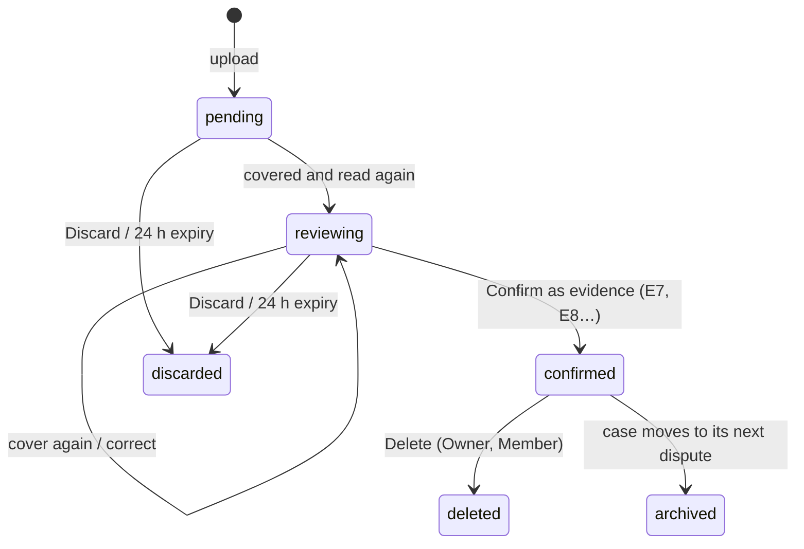

[English](functional-specification.md) | [Español](../es/product/functional-specification.md)

# Functional specification

What ResolveKit does, for whom, under which rules, as built at commit `c12faea` (deployed 21/10/2026). The code is the
source of truth; where behaviour was only observed in the PayPal sandbox, this page says so. Status words: Designed ·
Implemented · Tested locally · Verified in sandbox · Deployed · Available to users · Pending.

Section 5.6 (dispute actions) was checked against commit `076c74f` (20/10/2026); that code is in `c12faea`, deployed on 21/10/2026.

Related: [Overview](overview.md) · [Limitations](limitations.md) · [HTTP API](../technical/http-api.md) ·
[Trust boundaries](../architecture/trust-boundaries.md).

## 1. Personas

| Persona | Goal | Environment today |
|---|---|---|
| **Visitor** | See what ResolveKit does without an account | Explore demo |
| **Merchant (Owner)** | Answer their own PayPal disputes with evidence | Waiting screen: their dispute connection is **Pending** |
| **Sandbox seller's Owner** | Run the sandbox evaluation; invite reviewers | Sandbox evaluation |
| **Member** | Work cases for the business: evidence, review, send | Sandbox evaluation (when invited by the sandbox seller's Owner) |
| **Reviewer / judge** | Evaluate the full flow on real sandbox disputes, within a time-limited access | Sandbox evaluation, through the reviewer link from the submission form |
| **Local operator** | Develop or demo on one machine | Local mode |
| **Buyer approving an agent budget** | Approve (or refuse) a budget in PayPal | PayPal sandbox checkout, with a sandbox **personal (buyer)** account (PayPal refused the seller's business account in the 19/10/2026 sandbox run; observed, not documented) |

## 2. Roles

| Role (as the UI shows it) | How one gets it | Limits |
|---|---|---|
| **Owner** | **Continue with PayPal**: the PayPal account that signs in owns the workspace of that account | One Owner per workspace; cannot be revoked |
| **Member** | Opens a member invite link and joins (passkey, or «Join for this browser only») | Revocable by the Owner |
| **Reviewer** | Opens a reviewer invite link and joins | As a Member, plus an access end date (`accessUntil`, at most 180 days); edits and discards only their own pending uploads; cannot delete uploads |
| **Local operator** | Runs the server locally | Acts as an Owner; no sign-in, no daily caps (`apps/server/src/app.ts:155`) |
| Signed-out visitor | — | Explore demo only; workspace routes redirect to **Sign in** |

A workspace is **connected for the sandbox evaluation** when its PayPal account is the seller on a bound sandbox
dispute, as read from PayPal (`apps/server/src/hosted.ts:174-196`). Every other workspace is «not connected» and
sees the waiting screen. Members and reviewers belong to the workspace whose invite they used.

## 3. Permissions

Hosted mode. «Seller workspace» = signed in to the workspace connected for the sandbox evaluation. Server checks are
in `apps/server/src/hosted.ts` (gate), `apps/server/src/app.ts`, `apps/server/src/uploads/permissions.ts`,
`apps/server/src/agent/routes.ts` and `apps/server/src/auth.ts`.

| Action | Owner | Member | Reviewer | Other signed-in workspace | Signed out | Local operator |
|---|---|---|---|---|---|---|
| Explore demo | yes | yes | yes | yes | yes | yes (`/demo`) |
| See the bound sandbox cases | yes | yes | yes | no (`UNKNOWN_CASE`) | no | fixtures + bound cases |
| Live AI analysis (**Re-run with AI**) | yes | yes | yes | no (`SELLER_WORKSPACE_ONLY`) | no (`SIGN_IN_REQUIRED`) | yes |
| Re-check an edited sentence | yes | yes | yes | no | no | yes |
| Add evidence (upload) | yes | yes | yes | no | no | yes |
| Review, cover, correct, confirm an upload | any | any | own only | — | — | yes |
| Discard a pending upload | any | any | own only | — | — | yes |
| Delete a confirmed upload | yes | yes | no | — | — | yes |
| Compose, approve, send a response | yes | yes | yes | refused (`NOT_THE_SELLER` / `SELLER_WORKSPACE_ONLY`) | no | yes |
| Send a message to the buyer ([5.6](#56-dispute-actions-other-than-evidence)) | yes | yes | yes | refused | no | yes |
| Accept claim, make offer, escalate ([5.6](#56-dispute-actions-other-than-evidence)) | yes, with a second confirmation | preview only (`OWNER_ONLY`) | preview only (`OWNER_ONLY`) | refused | no | yes |
| See the owner settlement case `PP-R-STL-10190667` | yes | no | no | no | no | yes, when bound |
| Read or approve someone else's intent | no (an intent belongs to the session that composed it; others get 404) | no | no | no | no | — |
| Members and invites (`/workspace`) | yes | no (`OWNER_ONLY`) | no | its own Owner only | no | not applicable (local mode has no accounts) |
| Start a buying-agent run | yes | yes | yes | no (`SELLER_WORKSPACE_ONLY`) | redirected to sign-in | yes |
| See own runs, Stop own running run | yes | yes | yes | — | — | yes |
| **Workspace runs** (everyone's runs, read-only) | yes (logged; approval link, order and session hidden) | no | no | — | — | no toggle |
| **Keep** a run | yes | no | no | — | — | yes |
| PayPal notifications in the inbox | seller workspace only | same | same | no | no | yes |
| Ops routes (`/api/ops/*`) | no — operator token only, not a role | | | | | |

Notes:
- The Stop route also accepts the Owner with `?scope=workspace`; the page shows **Stop** to the run's author only.
- Uploads not yet confirmed are visible in full only to those who can edit them; others see «pending · <name> ·
  uploaded by <person>» and get 404 for its files.

## 4. Use cases

| ID | Use case | Primary actor | Status |
|---|---|---|---|
| UC-01 | Explore the demo inbox and case files | Visitor | Implemented · Deployed · Available to users |
| UC-02 | Sign in with **Continue with PayPal** | Merchant | Implemented · Verified in sandbox · Deployed |
| UC-03 | Invite a member or reviewer; revoke | Owner | Implemented · Tested locally · Deployed |
| UC-04 | Join with an invite link (passkey or this browser only) | Member, Reviewer | Implemented · Deployed; «Join for this browser only» used by reviewers (17–18/10/2026); passkey on the deployed service **Pending** |
| UC-05 | Read a bound case from PayPal and its analysis | Seller workspace | Implemented · Verified in sandbox · Deployed |
| UC-06 | Resolve a contradiction (**Explain in response** or **Mark resolved…**) | Seller workspace | Implemented · Tested locally |
| UC-07 | Edit a sentence and have it re-checked | Seller workspace | Implemented · Verified in sandbox |
| UC-08 | Add an image, PDF or pasted text; cover; confirm | Seller workspace | Implemented · Tested locally · Deployed; image Verified in sandbox |
| UC-09 | Review what will be sent, approve, submit, read back | Seller workspace | Implemented · Verified in sandbox · Deployed |
| UC-10 | Run the buying agent; approve the budget; read steps and receipt | Seller workspace + buyer | Implemented · Verified in sandbox (two runs, 19/10/2026) · Deployed |
| UC-11 | Compare two runs; Keep a run; view Workspace runs | Author / Owner | Implemented · Tested locally · Verified in sandbox (Compare and Keep, 19/10/2026) |
| UC-12 | Stop a running agent run | Author | Implemented · Tested locally; in sandbox **Pending** |
| UC-13 | Connect a merchant's own PayPal disputes | Merchant | **Pending** (not in the app) |
| UC-14 | Send a message to the buyer | Seller workspace | Tested locally · Verified in sandbox through the app (20/10/2026) · Deployed; not yet exercised on the hosted service |
| UC-15 | Accept a claim (full or partial), make an offer, escalate | Owner | Tested locally · Verified in sandbox through the app (20/10/2026) · Deployed; not yet exercised on the hosted service |

## 5. States and business rules

### 5.1 Dispute (as read from PayPal)

ResolveKit shows PayPal's status and stage as PayPal returns them; it does not predict transitions.

| PayPal status | Shown as | Meaning shown |
|---|---|---|
| `WAITING_FOR_SELLER_RESPONSE` | Waiting for your response | PayPal is waiting for your response |
| `UNDER_REVIEW` | Under review by PayPal | PayPal is reviewing; no action needed now |
| `WAITING_FOR_BUYER_RESPONSE` | Waiting for buyer | PayPal waits for the buyer |
| `RESOLVED` | Resolved | PayPal has closed this dispute; the case file is read-only |
| `OPEN`, `OTHER` | Open / Other (see PayPal) | — |

Stages: `INQUIRY` «Inquiry», `CHARGEBACK` «Claim» (a PayPal stage, not a card chargeback), `PRE_ARBITRATION`,
`ARBITRATION`. The **Provide evidence** action is offered only when PayPal's dispute carries it.

Rules:
- A bound case reads PayPal through the server; the analyst's input reuses a PayPal read for up to 60 s.
- Hosted, only the seller workspace sees a bound case; any other case id opens its fictional twin under
  `/demo/cases/:id`.
- **Reserve rotation**: when a bound dispute is used (resolved, or seller evidence older than 15 min), the next read
  moves the case to the next dispute of its reserve, if one is left (`apps/server/src/app.ts:591-630`). As of
  29/10/2026 the reserves of both cases are empty (refill for judging on 28–30/11/2026), so they show the recorded
  evidence and new real-sandbox sends are **Pending**.

### 5.2 Analysis

- Stored (cached or committed «golden») analyses are shown first; a live run happens only after boot or a binding
  change (warm-up, hosted) or on **Re-run with AI**.
- A sentence is **Supported**, **Needs review** or **Removed: no supporting evidence**. Removed sentences are never
  sent. A quote must be an exact substring of its document; numbers not in the quotes send the sentence to review.
- A contradiction is **Needs review** until **Explain in response** (the analyst's neutral sentence goes into the
  draft) or **Mark resolved…** with a note (saved to the audit log).
- An edited sentence (1–600 characters, no line breaks) is re-checked by the model on the server; if the re-check is
  impossible it becomes **Needs review** with «this edit was not re-checked».
- Limits: 6 live analyses and 30 re-checks per hour per server; 60 live analyses and 200 re-checks per day (hosted).

### 5.3 Upload

Rules: nothing of an upload is used, sent to a model or to PayPal before it is confirmed; confirm requires that the
sanitised file reviewed is the one stored (SHA-256); 10 uploads per case; Delete is refused while a send that uses
it is in flight and removes the analyses that read it. Discarded, deleted and archived uploads keep a record without
files or text. Details: [Cases and evidence](../user-guide/cases-and-evidence.md), [PDF review](../user-guide/pdf-review.md).

### 5.4 Submission intent

`proposed → approved → sending → sent | failed`. Composed by the server from its own documents and analysis
(supported sentences only, every contradiction resolved, an evidence type PayPal offers, notes ≤ 2,000 characters).
An approval binds the exact content by hash and is invalidated by an edit, a newer intent, a binding change or 30
minutes. Only the session that composed it can approve, send or cancel it. One send per dispute at a time; once PayPal
accepted one (persisted), no other intent for that dispute is sent. A failed send can be retried for 30 minutes.

### 5.5 Buying-agent run

| State while running | Shown as |
|---|---|
| `running` | Running |
| `awaiting_approval` | Waiting for approval in PayPal |

| Outcome | Shown as |
|---|---|
| `done` | Done |
| `cannot_do` | The tools cannot meet this goal |
| `out_of_budget` | Out of budget |
| `stopped` | Stopped: action limit (8) · time limit · model call limit · model token budget · the model gave invalid actions · PayPal approval timed out · the run could not be saved · MeterMCP did not open a budget · MeterMCP unreachable · internal error |
| `model_unavailable` | Model unavailable |
| `not_approved` | Not approved in PayPal |
| `interrupted` | Interrupted (stopped or server restart) |

Settlement is a separate field, taken only from MeterMCP's receipt: «Captured X USD · Y released», «Capture pending
at PayPal (not final)», «Voided: nothing charged», «Capture declined by PayPal: nothing charged», «Not approved in
PayPal: nothing charged», «Settlement failed: …; will be retried», «Not verified yet», «Budget open in PayPal (not
settled yet)», «Nothing opened in PayPal». A stopped or interrupted run is never called done.

Rules: goal 1–300 characters; cap 0.50–5.00 USD; one action per turn, checked by code; at most 8 actions, 12 model
calls, 180 s of agent time (approval wait excluded), 15 min to approve; one running run per person, 3 per server; 5
runs per person and 20 per server per UTC day. Runs are kept 30 days unless kept, unsettled, unsaved or bound as evidence.
Details: [Buying agent](../user-guide/buying-agent.md).

### 5.6 Dispute actions other than evidence

Checked against commit `076c74f` (20/10/2026), the code now in the deployed `c12faea`; statuses updated after the runs through the app in the sandbox on
20/10/2026 (V-1 to V-7). Each action variant has one status, taken from the contract registry
(`apps/web/src/domain/actionContracts.ts`, `CONTRACTS`); the product shows the same label next to each variant. A
variant is available only when its contract is recorded: PayPal's documentation, read-only sandbox reads, and one write
the owner approved request by request, with its response and read-back (`packages/paypal/contracts/`).

| Variant | What it is | Status | Contract write (sandbox, 20/10/2026) | Through the app (sandbox, 20/10/2026) |
|---|---|---|---|---|
| `send_message` | A text message to the buyer (1–2,000 characters) | Verified in sandbox | Recorded (W-1, W-2) | Recorded (V-1) |
| `send_message:file` | A message with one confirmed upload attached | Verified in sandbox (V-7, 21/10/2026; also Tested locally: the server path and the web composer with one confirmed upload of the case, shown in the review and the confirmation; only from `WAITING_FOR_BUYER_RESPONSE`, as W-3, live and on the simulator; the code with this status is Deployed, `c12faea`) | Recorded (W-3) | Recorded (V-7): «Recorded by PayPal»; one seller message with the exact text and 1 document; no money moved |
| `accept_claim:REFUND` | Accept the claim with a full refund | Verified in sandbox | Recorded (W-10) | Recorded (V-4): resolved in the buyer's favour, 7.00 USD refunded |
| `accept_claim:PARTIAL_REFUND` | Accept the claim with a partial refund, which PayPal records as an offer to the buyer | Verified in sandbox | Recorded (W-9) | Recorded as a pending offer (V-3); no money moved |
| `escalate` | Escalate an inquiry to a claim | Verified in sandbox | Recorded (W-5) | Recorded (V-5); a claim about 10 min later |
| `evidence:after_escalation` | Evidence in the claim stage after an escalation | Verified in sandbox | Recorded (W-6) | Recorded in the claim stage (V-6) |
| `make_offer:REFUND` | Offer the buyer a partial refund | Verified in sandbox | Recorded (W-4) | Recorded (V-2); no money moved |
| `make_offer:REPLACEMENT_WITHOUT_REFUND` | — | Not available: Not verified with PayPal: never offered on a sandbox dispute | Not sent (W-12) | — |
| `make_offer:withdraw` | — | Not available: PayPal documents no route to withdraw an offer | — | — |
| `appeal` | — | Not available: Not verified with PayPal: the sandbox could not produce an appealable dispute | Set-up refused (W-7); not sent (W-8) | — |
| `evidence:PROOF_OF_REFUND` | — | Not available: Not verified with PayPal: pending sandbox test (W-11) | Not sent (W-11, owner decision) | — |
| `return_address` | The accept and offer types with a return (`REFUND_WITH_RETURN`, `REFUND_WITH_RETURN_SHIPMENT_LABEL`) | Not available: Not in this delivery (owner decision) | — | — |

Seven variants are **Verified in sandbox**: on 20/10/2026 (V-1 to V-6) and 21/10/2026 (V-7, the message with a file) each was sent once through the app's own flow (compose, approve
by hash, a second confirmation when the action has terms, one send, an attributable read-back), by the server of the
unmerged branch running locally against the sandbox (V-1 to V-7, see
[PayPal integration](../technical/paypal-integration.md#dispute-action-contracts)). Only V-4, the full accept, moved
money (a 7.00 USD sandbox refund). Separately, the contract writes of 20/10/2026 (W-1 to W-12) were prepared requests
that the owner approved one by one, sent outside the app's own flow; they show what PayPal does and are what each
contract rests on. The code of all of them is **Deployed** (`c12faea`, 21/10/2026), but these actions have **not** yet been exercised on
the hosted service: the six runs above were made on a local server, so each variant keeps «Verified in sandbox» and
nothing more. The owner-only actions need the settlement case bound in the hosted `BINDINGS_JSON`, which it is not
yet; reviewers can send messages on a bound case's active dispute.

**Who may do what.** Accept claim, make offer, escalate and appeal are **owner-only**: only the workspace's Owner (not a
reviewer) composes, approves, confirms and sends them. Members and reviewers may send **messages only** (and evidence,
as before); for an owner-only action they see a preview with its consequence, and the server refuses compose, approve,
confirm and send with `403 OWNER_ONLY`. Hidden buttons are not the control: the role is checked at every step. The
local operator acts as an Owner.

**Second confirmation.** After approving the exact content, an owner-only action needs a confirmation the server
issues, bound to the intent id, the content hash, the action, the canonical amount, the currency and a consequence
code: `REFUNDS_BUYER` (full accept), `OFFERS_PARTIAL_REFUND` (partial accept), `OFFERS_SETTLEMENT` (offer),
`MOVES_TO_CLAIM` (escalate). A message needs it only when it repeats a message PayPal already recorded on that dispute
and stage (`REPEATS_MESSAGE`). Other terms are refused (`CONFIRMATION_MISMATCH`); a send without them is refused
(`CONFIRMATION_REQUIRED`). Changing any of them means a new intent.

**Rules, as the contracts recorded them.**

- Every recorded write started in the `INQUIRY` stage, so message, accept, offer and escalate are composed only there
  (another stage: `ACTION_STAGE`). Each is also composed only from the dispute status its writes were sent from: accept,
  offer and escalate from `WAITING_FOR_SELLER_RESPONSE` (W-4, W-5, W-9, W-10); a message from it (W-1) and from
  `WAITING_FOR_BUYER_RESPONSE` (W-2, W-3). Another status is «Not available: not verified with PayPal from this dispute
  status» (`VARIANT_NOT_AVAILABLE`) in the availability, at compose and when composing again at send, live and on the
  simulator alike. What is possible is always rebuilt from a fresh PayPal read (its links and allowed types), before
  composing, at send time and after every action.
- **Message:** text required, at most 2,000 characters, no amount. The buyer sees exactly that text.
- **Accept:** only on `MERCHANDISE_OR_SERVICE_NOT_RECEIVED` disputes, with a note. A **full** accept needs PayPal's
  refundable amount to equal the dispute amount (otherwise «PayPal's refundable amount differs from the dispute
  amount»); PayPal refunds the dispute amount and closes the dispute in the buyer's favour (observed: about 2 minutes,
  `UNDER_REVIEW` first). A **partial** accept takes an amount above 0 and strictly below the refundable amount and the
  dispute amount; PayPal records it as a pending **offer**: the buyer must agree, nothing closes and no money moves
  until then, and the note is echoed as a seller message. The two are confirmed and reported apart.
- **Offer:** a partial refund only (type `REFUND`), with a note and an amount below the dispute amount and at most
  PayPal's refundable amount. An offer of the full amount was not verified and is refused (`VARIANT_NOT_AVAILABLE`).
  The note is echoed as a seller message. An offer is refused while one of the seller's offers is pending with the
  buyer. No money moves unless the buyer accepts. After an offer or a seller message PayPal stopped offering
  `make_offer`.
- **Escalate:** not-received disputes only, a note, no amount. PayPal records an attributable `ESCALATE` entry; the
  claim stage came about 3 minutes later, with `UNDER_REVIEW` and flickering actions in between, which the case shows as
  «PayPal is reviewing; the claim stage can take a few minutes». An escalation is never taken as a closed dispute.
- **Evidence by stage:** evidence is still sent once per dispute. The only new case is evidence in the claim after an
  escalation, once the claim waits for the seller, and only if the dispute has no seller evidence at all; during the
  review after an escalation the case says «Not available: after an escalation, evidence was verified with PayPal only
  once the claim waits for the seller». `provide_supporting_info`, which PayPal offered after evidence in a claim, is not
  supported.
- **Proof of refund:** not sent in this delivery. If PayPal asks only for it, ResolveKit cannot send evidence on that
  dispute: «PayPal asks only for Proof of refund, which is not available in this delivery: Not verified with PayPal:
  pending sandbox test (W-11)». If PayPal also asks for other types, the first requested type that is available is
  preselected and the selector says that Proof of refund is not available.
- **Amounts:** exact decimal strings in the dispute's currency, canonical per currency (`7` becomes `7.00` USD; `7,00`,
  `7.001`, `-1`, `1e2`, ` 7`, `+7`, `0` are refused with `INVALID_AMOUNT`); no dispute amount from PayPal:
  `DISPUTE_AMOUNT_UNKNOWN`; above the refundable amount: `AMOUNT_ABOVE_REFUNDABLE`.
- **No refunds are created.** ResolveKit has no call that creates or changes a refund; money moves only through the
  dispute actions above, at PayPal.

**After a send.**

| Shown | Meaning |
|---|---|
| **Recorded by PayPal** | A fresh read shows an entry attributable to this send: the new seller message with the exact text; the seller's offer entry with the approved type and amount (offer, partial accept); the seller's `ACCEPT_CLAIM` entry with type and note (full accept); the seller's `ESCALATE` entry with the note. A state change alone (resolved, a new stage) is never proof: the buyer or PayPal can cause it |
| **Outcome pending confirmation** | PayPal accepted the request or the answer was unclear, and the proof is not there yet. The dispute is held (uncertain): no other write on it, by anyone, until a read-back proves the action recorded, or proves it absent while PayPal still offers it. **Check again** only reads back; it never sends |
| Not recorded by PayPal | A read-back proved the action absent while still offered: the same approved intent may be sent again, with the same request id |
| Not sent | PayPal refused with a known error; nothing was done and the dispute is not held |

Action requests to PayPal are never retried automatically. A restart between the start of a send and its outcome holds
the dispute until a read-back. The same action with the same content on the same dispute and stage is refused once
PayPal recorded it (`DUPLICATE_ACTION`); a message is the exception, with the `REPEATS_MESSAGE` confirmation, because
PayPal does not deduplicate messages, not even by `PayPal-Request-Id` (observed, W-2). A buyer message that arrived
after approval holds a message, an accept or an offer with `NEEDS_REVIEW`: the person reads it, then sends the same
content or edits it (a new intent). For an escalation it is shown but does not block.

**Retention.** The approved message text is stored in the intent (`intents.json`), like the approved notes of evidence;
the audit and send logs keep only its hash. The message thread is read from PayPal and shown, but not stored and not
given to the analyst. After any recorded seller action (evidence, a seller message, an action this server proved
recorded) the analyst's input stays the pinned one, so a message does not trigger a new paid analysis.

**The owner's settlement case.** `PP-R-STL-10190667` («Owner settlement case (sandbox)») is the standard case's 7.00
USD order under its own id, for the owner-only actions on a dispute of its own. Hosted, only the seller workspace's
Owner sees it; members and reviewers do not, and PayPal notices about its disputes go to the Owner only (a notice about
one of its reserve disputes links to the case page, which shows the active dispute). It is bound through
`BINDINGS_JSON` with its own reserve; a dispute may be listed only once across all bindings. It has no stored (golden)
analysis, so composing evidence there answers `NO_ANALYSIS`. Rotation never moves a case off a dispute that is held (a
send in flight, uncertain, or awaiting its read-back); the ops report shows it as `held`.

**Explore demo.** The simulator plays only the states and transitions the contracts recorded, «Outcome pending
confirmation» included; nothing reaches PayPal.

## 6. Flows

### 6.1 Normal flow: answer a bound dispute

1. A reviewer opens the reviewer link, types a name, joins; the inbox shows the bound cases.
2. They open a case; the header shows PayPal's amount, reason, stage, status, deadline and disputed transaction.
3. The analysis bar shows the stored analysis («cached» or «live») with model and time.
4. They resolve contradictions and sentences in **Needs review**; optionally add evidence and **Re-run with AI**.
5. **Review what will be sent →**: the server composes the intent; they check it and **Continue to confirm →**.
6. They tick «I'm <name> … and I approve submitting this evidence for the …» and **Submit evidence to PayPal**.
7. The server records the approval, re-reads PayPal, re-composes and compares, writes the audit event to disk, then
   sends `provide-evidence`.
8. The page reads the dispute back and shows **Recorded by PayPal** with «Sent versus recorded».

### 6.2 Alternative flows

| Situation | What happens |
|---|---|
| Explore demo | Same screens on the simulator; the approval is composed in the browser («Composed in this browser (simulator only)»); «Recorded» comes from the simulator |
| Evidence already recorded (by another reviewer) | **Evidence recorded by PayPal**, draft read-only; «Sent · read-only» |
| PayPal shows new seller evidence that does not match | «New seller evidence that doesn't match what we sent»; never reported as ours; no automatic retry |
| Request times out | Neither success nor failure: the dispute is read back; evidence is re-sent only if PayPal shows none recorded |
| A newer dispute in the reserve | The case moves to it on its next read (top bar shows the dispute id) |

### 6.3 Error flows

| Error (code) | Shown / meaning | Recovery |
|---|---|---|
| `SIGN_IN_REQUIRED` | Sign in to compose and approve responses | Sign in (PayPal or invite link) |
| `SELLER_WORKSPACE_ONLY` | The action is only for the seller's workspace | Use the seller workspace, or the Explore demo |
| `NOT_THE_SELLER` | «Only the seller's workspace can send this» | — |
| `INTENT_STALE`, `DOCUMENTS_CHANGED`, `UPLOAD_CHANGED`, `BINDING_CHANGED` | What would be sent differs from what was approved | Review again and approve the new content |
| `SELLER_EVIDENCE_EXISTS` | PayPal already has seller evidence; nothing more can be sent | Read the recorded evidence |
| `DISPUTE_BUSY` | Another send for this dispute is in progress | Wait and read back |
| `AUDIT_UNAVAILABLE` (503) | The send could not be recorded durably, so nothing was sent | Try again later |
| `DAILY_CAP` / `PERSON_CAP` (429) | A demo cap is used up; the answer says when it resets | Wait for the reset |
| `RATE_LIMITED` (429) | Too many requests from this address | Wait for `Retry-After` |
| `CAPS_UNAVAILABLE` (503) | The demo cannot record the use, so it is not done | Try again later |
| `OWNER_ONLY` (403) | This action moves money or changes the dispute: only the Owner can do it | Ask the Owner; the preview shows its consequence |
| `CONFIRMATION_REQUIRED`, `CONFIRMATION_MISMATCH` | The owner's second confirmation is missing, or its terms are not this intent's | Confirm the consequence shown; if anything changed, compose again |
| `DISPUTE_UNCERTAIN` | The last send to this dispute is not confirmed by PayPal yet | **Check again**; nothing else is sent until it is settled |
| `NEEDS_REVIEW` | The buyer wrote since the approval | Read the new message, then send the same content or edit it |
| `DUPLICATE_ACTION` | PayPal already recorded this exact action, or an offer of yours is pending | Read the dispute; compose something else |
| `VARIANT_NOT_AVAILABLE` | «Not available: <reason>» from the contract registry, or outside what the contract recorded | — |
| `WRONG_SEND_ROUTE` | An action intent sent on the evidence route, or the reverse | Send it from its own flow |

More: [Troubleshooting](../user-guide/troubleshooting.md).

## 7. Differences between the environments

| Aspect | Explore demo | Sandbox evaluation | Merchant space | Local mode |
|---|---|---|---|---|
| Sign-in | none | invite link (reviewer/member) or the sandbox seller's PayPal | **Continue with PayPal** | none |
| Cases | all fictional cases | only bound sandbox cases | none (waiting screen) | fixtures; bound cases if `bindings.json` |
| PayPal | in-browser simulator | real sandbox via the server | not connected | sandbox if credentials, else simulator |
| AI analysis | committed golden analyses, no model call | stored + live (caps) | — | live with a model key |
| **+ Add evidence** | disabled with its reason | yes | — | yes, with the server |
| Submit | simulator only | `provide-evidence` to the sandbox | — | sandbox for bound cases |
| Dispute actions ([5.6](#56-dispute-actions-other-than-evidence)) | simulator, recorded transitions only | in the deployed code; not yet exercised on the hosted service (the owner-only actions also need the settlement case bound in `BINDINGS_JSON`: **Pending**) | — | the server's action routes (Tested locally with fakes; Verified in sandbox through the app on a local server, 20/10/2026) |
| Buying agent | not in the demo area | `/agent` (seller workspace) | start refused | `/agent` as operator |
| Daily caps | — | yes | — | none |

## 8. Limits and unavailable functions

- Limits: see the constants in [Limitations](limitations.md) and [Configuration](../technical/configuration.md).
- Not available: connecting a merchant's own disputes; the dispute-action variants marked «Not available» in
  [5.6](#56-dispute-actions-other-than-evidence) (replacement offer, offer withdrawal, appeal, proof of refund, the
  return types); creating refunds; the live (production) PayPal environment; account or workspace deletion by the
  user. Message, accept, offer, escalate and evidence after an escalation are Verified in sandbox through the app
  (20/10/2026), Deployed as code and not yet exercised on the hosted service; a message with an attachment is Verified in sandbox through the app (V-7, 21/10/2026; the code with this status is Deployed, `c12faea`). See [Limitations](limitations.md).
