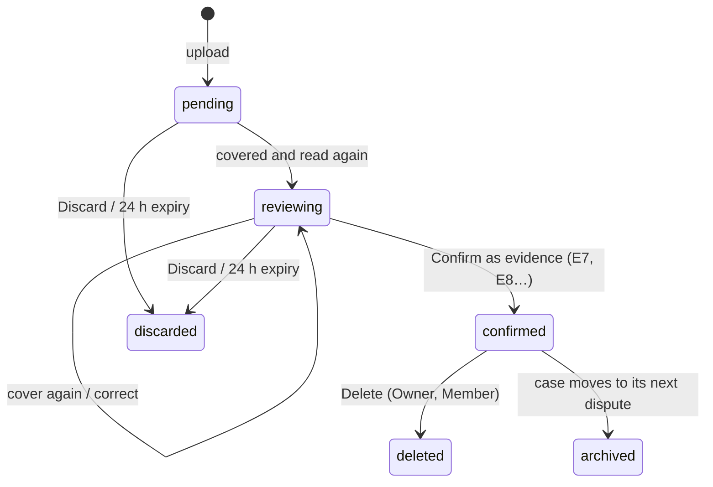

[English](functional-specification.md) | [Español](../es/product/functional-specification.md)

# Functional specification

What ResolveKit does, for whom, under which rules, as built at commit `fbe9621` (19/10/2026). The code is the
source of truth; where behaviour was only observed in the PayPal sandbox, this page says so. Status words: Designed ·
Implemented · Tested locally · Verified in sandbox · Deployed · Available to users · Pending.

Related: [Overview](overview.md) · [Limitations](limitations.md) · [HTTP API](../technical/http-api.md) ·
[Trust boundaries](../architecture/trust-boundaries.md).

## 1. Personas

| Persona | Goal | Environment today |
|---|---|---|
| **Visitor** | See what ResolveKit does without an account | Explore demo |
| **Merchant (Owner)** | Answer their own PayPal disputes with evidence | Waiting screen: their dispute connection is **Pending** |
| **Sandbox seller's Owner** | Run the sandbox evaluation; invite reviewers | Sandbox evaluation |
| **Member** | Work cases for the business: evidence, review, send | Sandbox evaluation (when invited by the sandbox seller's Owner) |
| **Reviewer / judge** | Evaluate the full flow on real sandbox disputes, within a time-limited access | Sandbox evaluation, through the reviewer link from the submission form |
| **Local operator** | Develop or demo on one machine | Local mode |
| **Buyer approving an agent budget** | Approve (or refuse) a budget in PayPal | PayPal sandbox checkout, with a sandbox **personal (buyer)** account (PayPal refused the seller's business account in the 19/10/2026 sandbox run; observed, not documented) |

## 2. Roles

| Role (as the UI shows it) | How one gets it | Limits |
|---|---|---|
| **Owner** | **Continue with PayPal**: the PayPal account that signs in owns the workspace of that account | One Owner per workspace; cannot be revoked |
| **Member** | Opens a member invite link and joins (passkey, or «Join for this browser only») | Revocable by the Owner |
| **Reviewer** | Opens a reviewer invite link and joins | As a Member, plus an access end date (`accessUntil`, at most 180 days); edits and discards only their own pending uploads; cannot delete uploads |
| **Local operator** | Runs the server locally | Acts as an Owner; no sign-in, no daily caps (`apps/server/src/app.ts:155`) |
| Signed-out visitor | — | Explore demo only; workspace routes redirect to **Sign in** |

A workspace is **connected for the sandbox evaluation** when its PayPal account is the seller on a bound sandbox
dispute, as read from PayPal (`apps/server/src/hosted.ts:174-196`). Every other workspace is «not connected» and
sees the waiting screen. Members and reviewers belong to the workspace whose invite they used.

## 3. Permissions

Hosted mode. «Seller workspace» = signed in to the workspace connected for the sandbox evaluation. Server checks are
in `apps/server/src/hosted.ts` (gate), `apps/server/src/app.ts`, `apps/server/src/uploads/permissions.ts`,
`apps/server/src/agent/routes.ts` and `apps/server/src/auth.ts`.

| Action | Owner | Member | Reviewer | Other signed-in workspace | Signed out | Local operator |
|---|---|---|---|---|---|---|
| Explore demo | yes | yes | yes | yes | yes | yes (`/demo`) |
| See the bound sandbox cases | yes | yes | yes | no (`UNKNOWN_CASE`) | no | fixtures + bound cases |
| Live AI analysis (**Re-run with AI**) | yes | yes | yes | no (`SELLER_WORKSPACE_ONLY`) | no (`SIGN_IN_REQUIRED`) | yes |
| Re-check an edited sentence | yes | yes | yes | no | no | yes |
| Add evidence (upload) | yes | yes | yes | no | no | yes |
| Review, cover, correct, confirm an upload | any | any | own only | — | — | yes |
| Discard a pending upload | any | any | own only | — | — | yes |
| Delete a confirmed upload | yes | yes | no | — | — | yes |
| Compose, approve, send a response | yes | yes | yes | refused (`NOT_THE_SELLER` / `SELLER_WORKSPACE_ONLY`) | no | yes |
| Read or approve someone else's intent | no (an intent belongs to the session that composed it; others get 404) | no | no | no | no | — |
| Members and invites (`/workspace`) | yes | no (`OWNER_ONLY`) | no | its own Owner only | no | not applicable (local mode has no accounts) |
| Start a buying-agent run | yes | yes | yes | no (`SELLER_WORKSPACE_ONLY`) | redirected to sign-in | yes |
| See own runs, Stop own running run | yes | yes | yes | — | — | yes |
| **Workspace runs** (everyone's runs, read-only) | yes (logged; approval link, order and session hidden) | no | no | — | — | no toggle |
| **Keep** a run | yes | no | no | — | — | yes |
| PayPal notifications in the inbox | seller workspace only | same | same | no | no | yes |
| Ops routes (`/api/ops/*`) | no — operator token only, not a role | | | | | |

Notes:
- The Stop route also accepts the Owner with `?scope=workspace`; the page shows **Stop** to the run's author only.
- Uploads not yet confirmed are visible in full only to those who can edit them; others see «pending · <name> ·
  uploaded by <person>» and get 404 for its files.

## 4. Use cases

| ID | Use case | Primary actor | Status |
|---|---|---|---|
| UC-01 | Explore the demo inbox and case files | Visitor | Implemented · Deployed · Available to users |
| UC-02 | Sign in with **Continue with PayPal** | Merchant | Implemented · Verified in sandbox · Deployed |
| UC-03 | Invite a member or reviewer; revoke | Owner | Implemented · Tested locally · Deployed |
| UC-04 | Join with an invite link (passkey or this browser only) | Member, Reviewer | Implemented · Deployed; «Join for this browser only» used by reviewers (17–18/10/2026); passkey on the deployed service **Pending** |
| UC-05 | Read a bound case from PayPal and its analysis | Seller workspace | Implemented · Verified in sandbox · Deployed |
| UC-06 | Resolve a contradiction (**Explain in response** or **Mark resolved…**) | Seller workspace | Implemented · Tested locally |
| UC-07 | Edit a sentence and have it re-checked | Seller workspace | Implemented · Verified in sandbox |
| UC-08 | Add an image, PDF or pasted text; cover; confirm | Seller workspace | Implemented · Tested locally · Deployed; image Verified in sandbox |
| UC-09 | Review what will be sent, approve, submit, read back | Seller workspace | Implemented · Verified in sandbox · Deployed |
| UC-10 | Run the buying agent; approve the budget; read steps and receipt | Seller workspace + buyer | Implemented · Verified in sandbox (two runs, 19/10/2026) · Deployed |
| UC-11 | Compare two runs; Keep a run; view Workspace runs | Author / Owner | Implemented · Tested locally · Verified in sandbox (Compare and Keep, 19/10/2026) |
| UC-12 | Stop a running agent run | Author | Implemented · Tested locally; in sandbox **Pending** |
| UC-13 | Connect a merchant's own PayPal disputes | Merchant | **Pending** (not in the app) |

## 5. States and business rules

### 5.1 Dispute (as read from PayPal)

ResolveKit shows PayPal's status and stage as PayPal returns them; it does not predict transitions.

| PayPal status | Shown as | Meaning shown |
|---|---|---|
| `WAITING_FOR_SELLER_RESPONSE` | Waiting for your response | PayPal is waiting for your response |
| `UNDER_REVIEW` | Under review by PayPal | PayPal is reviewing; no action needed now |
| `WAITING_FOR_BUYER_RESPONSE` | Waiting for buyer | PayPal waits for the buyer |
| `RESOLVED` | Resolved | PayPal has closed this dispute; the case file is read-only |
| `OPEN`, `OTHER` | Open / Other (see PayPal) | — |

Stages: `INQUIRY` «Inquiry», `CHARGEBACK` «Claim» (a PayPal stage, not a card chargeback), `PRE_ARBITRATION`,
`ARBITRATION`. The **Provide evidence** action is offered only when PayPal's dispute carries it.

Rules:
- A bound case reads PayPal through the server; the analyst's input reuses a PayPal read for up to 60 s.
- Hosted, only the seller workspace sees a bound case; any other case id opens its fictional twin under
  `/demo/cases/:id`.
- **Reserve rotation**: when a bound dispute is used (resolved, or seller evidence older than 15 min), the next read
  moves the case to the next dispute of its reserve, if one is left (`apps/server/src/app.ts:591-630`). As of
  19/10/2026 the standard case's reserve is empty, so it shows the recorded evidence and new sends on it are
  **Pending**.

### 5.2 Analysis

- Stored (cached or committed «golden») analyses are shown first; a live run happens only after boot or a binding
  change (warm-up, hosted) or on **Re-run with AI**.
- A sentence is **Supported**, **Needs review** or **Removed: no supporting evidence**. Removed sentences are never
  sent. A quote must be an exact substring of its document; numbers not in the quotes send the sentence to review.
- A contradiction is **Needs review** until **Explain in response** (the analyst's neutral sentence goes into the
  draft) or **Mark resolved…** with a note (saved to the audit log).
- An edited sentence (1–600 characters, no line breaks) is re-checked by the model on the server; if the re-check is
  impossible it becomes **Needs review** with «this edit was not re-checked».
- Limits: 6 live analyses and 30 re-checks per hour per server; 60 live analyses and 200 re-checks per day (hosted).

### 5.3 Upload

Rules: nothing of an upload is used, sent to a model or to PayPal before it is confirmed; confirm requires that the
sanitised file reviewed is the one stored (SHA-256); 10 uploads per case; Delete is refused while a send that uses
it is in flight and removes the analyses that read it. Discarded, deleted and archived uploads keep a record without
files or text. Details: [Cases and evidence](../user-guide/cases-and-evidence.md), [PDF review](../user-guide/pdf-review.md).

### 5.4 Submission intent

`proposed → approved → sending → sent | failed`. Composed by the server from its own documents and analysis
(supported sentences only, every contradiction resolved, an evidence type PayPal offers, notes ≤ 2,000 characters).
An approval binds the exact content by hash and is invalidated by an edit, a newer intent, a binding change or 30
minutes. Only the session that composed it can approve, send or cancel it. One send per dispute at a time; once PayPal
accepted one (persisted), no other intent for that dispute is sent. A failed send can be retried for 30 minutes.

### 5.5 Buying-agent run

| State while running | Shown as |
|---|---|
| `running` | Running |
| `awaiting_approval` | Waiting for approval in PayPal |

| Outcome | Shown as |
|---|---|
| `done` | Done |
| `cannot_do` | The tools cannot meet this goal |
| `out_of_budget` | Out of budget |
| `stopped` | Stopped: action limit (8) · time limit · model call limit · model token budget · the model gave invalid actions · PayPal approval timed out · the run could not be saved · MeterMCP did not open a budget · MeterMCP unreachable · internal error |
| `model_unavailable` | Model unavailable |
| `not_approved` | Not approved in PayPal |
| `interrupted` | Interrupted (stopped or server restart) |

Settlement is a separate field, taken only from MeterMCP's receipt: «Captured X USD · Y released», «Capture pending
at PayPal (not final)», «Voided: nothing charged», «Capture declined by PayPal: nothing charged», «Not approved in
PayPal: nothing charged», «Settlement failed: …; will be retried», «Not verified yet», «Budget open in PayPal (not
settled yet)», «Nothing opened in PayPal». A stopped or interrupted run is never called done.

Rules: goal 1–300 characters; cap 0.50–5.00 USD; one action per turn, checked by code; at most 8 actions, 12 model
calls, 180 s of agent time (approval wait excluded), 15 min to approve; one running run per person, 3 per server; 5
runs per person and 20 per server per UTC day. Runs are kept 30 days unless kept, unsettled, unsaved or bound as evidence.
Details: [Buying agent](../user-guide/buying-agent.md).

## 6. Flows

### 6.1 Normal flow: answer a bound dispute

1. A reviewer opens the reviewer link, types a name, joins; the inbox shows the bound cases.
2. They open a case; the header shows PayPal's amount, reason, stage, status, deadline and disputed transaction.
3. The analysis bar shows the stored analysis («cached» or «live») with model and time.
4. They resolve contradictions and sentences in **Needs review**; optionally add evidence and **Re-run with AI**.
5. **Review what will be sent →**: the server composes the intent; they check it and **Continue to confirm →**.
6. They tick «I'm <name> … and I approve submitting this evidence for the …» and **Submit evidence to PayPal**.
7. The server records the approval, re-reads PayPal, re-composes and compares, writes the audit event to disk, then
   sends `provide-evidence`.
8. The page reads the dispute back and shows **Recorded by PayPal** with «Sent versus recorded».

### 6.2 Alternative flows

| Situation | What happens |
|---|---|
| Explore demo | Same screens on the simulator; the approval is composed in the browser («Composed in this browser (simulator only)»); «Recorded» comes from the simulator |
| Evidence already recorded (by another reviewer) | **Evidence recorded by PayPal**, draft read-only; «Sent · read-only» |
| PayPal shows new seller evidence that does not match | «New seller evidence that doesn't match what we sent»; never reported as ours; no automatic retry |
| Request times out | Neither success nor failure: the dispute is read back; evidence is re-sent only if PayPal shows none recorded |
| A newer dispute in the reserve | The case moves to it on its next read (top bar shows the dispute id) |

### 6.3 Error flows

| Error (code) | Shown / meaning | Recovery |
|---|---|---|
| `SIGN_IN_REQUIRED` | Sign in to compose and approve responses | Sign in (PayPal or invite link) |
| `SELLER_WORKSPACE_ONLY` | The action is only for the seller's workspace | Use the seller workspace, or the Explore demo |
| `NOT_THE_SELLER` | «Only the seller's workspace can send this» | — |
| `INTENT_STALE`, `DOCUMENTS_CHANGED`, `UPLOAD_CHANGED`, `BINDING_CHANGED` | What would be sent differs from what was approved | Review again and approve the new content |
| `SELLER_EVIDENCE_EXISTS` | PayPal already has seller evidence; nothing more can be sent | Read the recorded evidence |
| `DISPUTE_BUSY` | Another send for this dispute is in progress | Wait and read back |
| `AUDIT_UNAVAILABLE` (503) | The send could not be recorded durably, so nothing was sent | Try again later |
| `DAILY_CAP` / `PERSON_CAP` (429) | A demo cap is used up; the answer says when it resets | Wait for the reset |
| `RATE_LIMITED` (429) | Too many requests from this address | Wait for `Retry-After` |
| `CAPS_UNAVAILABLE` (503) | The demo cannot record the use, so it is not done | Try again later |

More: [Troubleshooting](../user-guide/troubleshooting.md).

## 7. Differences between the environments

| Aspect | Explore demo | Sandbox evaluation | Merchant space | Local mode |
|---|---|---|---|---|
| Sign-in | none | invite link (reviewer/member) or the sandbox seller's PayPal | **Continue with PayPal** | none |
| Cases | all fictional cases | only bound sandbox cases | none (waiting screen) | fixtures; bound cases if `bindings.json` |
| PayPal | in-browser simulator | real sandbox via the server | not connected | sandbox if credentials, else simulator |
| AI analysis | committed golden analyses, no model call | stored + live (caps) | — | live with a model key |
| **+ Add evidence** | disabled with its reason | yes | — | yes, with the server |
| Submit | simulator only | `provide-evidence` to the sandbox | — | sandbox for bound cases |
| Buying agent | not in the demo area | `/agent` (seller workspace) | start refused | `/agent` as operator |
| Daily caps | — | yes | — | none |

## 8. Limits and unavailable functions

- Limits: see the constants in [Limitations](limitations.md) and [Configuration](../technical/configuration.md).
- Not available: connecting a merchant's own disputes; send message, accept claim, make offer, escalate, refunds
  through the product; the live (production) PayPal environment; account or workspace deletion by the user.
  See [Limitations](limitations.md).
