[English](overview.md) | [Español](../es/product/overview.md)

# Product overview

ResolveKit is an evidence-first workspace for answering PayPal disputes. For each dispute it builds a case file
(timeline and evidence), an AI analyst drafts a response in which every sentence cites the exact words of its
evidence, unsupported sentences are removed, and a person approves the exact content before anything is sent to
PayPal. After sending, ResolveKit reads the dispute back from PayPal and says **Recorded by PayPal** only when PayPal
lists new seller evidence that matches what was sent.

It also includes **MeterMCP**, a metered MCP server whose budgets are PayPal authorizations, and a **buying agent**
that spends such a budget, so that a disputed agent purchase arrives with a per-call receipt as its evidence.

ResolveKit prepares the response; PayPal decides the dispute. It is not affiliated with PayPal.

Facts on this page come from the code at commit `81c6242` (deployed 21/10/2026) unless a date says otherwise. Status words
follow one vocabulary: Designed · Implemented · Tested locally · Verified in sandbox · Deployed · Available to users ·
Pending.

## Who it is for

| Person | What they want from ResolveKit |
|---|---|
| A small merchant with PayPal disputes | One place to see what PayPal asks for, the evidence that answers it, and a response they can trust before sending it |
| A merchant's team member | To review cases, add evidence and send approved responses for the business |
| A hackathon judge or invited reviewer | To try the full flow on real PayPal sandbox disputes without touching real money |
| A merchant selling to AI agents | Evidence of what an agent bought, call by call, when its buyer disputes the charge |

Today ResolveKit serves only judges and invited reviewers, in the sandbox seller's workspace (members of that
workspace included). A merchant, a merchant's team, or a merchant selling to AI agents cannot use it on their own
disputes yet, because connecting a merchant's disputes is **Pending** (see [Limitations](limitations.md)). The
agent-purchase flow can be seen on the sandbox evaluation's agent case and in the Explore demo.

## The three environments

| Environment | Where | Who | What happens | Status |
|---|---|---|---|---|
| **Explore demo** | `/demo`, `/demo/cases/:id` | Everyone, no sign-in | Fictional cases on an in-browser PayPal simulator, with analyses committed with the code. Nothing is sent to PayPal and no model is called. **+ Add evidence** is disabled, with its reason | Implemented · Tested locally · Deployed · Available to users |
| **Sandbox evaluation** | `/cases`, `/cases/:id` | People invited into the workspace of the PayPal sandbox seller (reviewers, judges) | Only the cases bound to real PayPal **sandbox** disputes. Real reads, real AI analysis, real `provide-evidence` calls to the sandbox. No real money moves | Implemented · Tested locally · Verified in sandbox · Deployed · Available to users (invited reviewers only) |
| **Your merchant space** | `/cases` after **Continue with PayPal** | A merchant signed in with their own PayPal account | A waiting screen: «Connecting disputes for new merchants is being validated and isn't available yet.» ResolveKit cannot read that merchant's disputes or send responses for them | Waiting screen: Implemented · Deployed. Dispute connection: **Pending** (no code in the app) |

A fourth mode exists for developers: **local mode** (`npm run server` + `npm run dev` on one machine), with no
sign-in; the person at the machine is the merchant and acts as the Owner. See
[Getting started](../user-guide/getting-started.md) and [Local development](../technical/local-development.md).

The app bar always says which environment and which PayPal is behind a screen: «Explore demo · fictional cases,
nothing is sent», «Sandbox evaluation · <workspace> · PayPal sandbox», and per case **Simulated PayPal** or
**PayPal sandbox · live**. «live» means the case was just read live from a PayPal **sandbox** dispute; ResolveKit has
never run against the live (production) PayPal environment.

## What it does

| Capability | What the person sees | Status |
|---|---|---|
| Dispute inbox | A grid of disputes with due date, reason, buyer-declared item type, stage, PayPal status, readiness and next step; saved filters, search, multi-sort, a pinned «Totals at risk» row | Implemented · Tested locally · Deployed |
| Case file | Timeline, every document with its provenance, contradictions shown side by side, the evidence PayPal asks for, the actions PayPal allows now | Implemented · Tested locally · Verified in sandbox · Deployed |
| AI analysis | Facts quoted verbatim, a draft whose sentences each cite evidence, a verifier per sentence, a recommendation from rules; the analysis bar says which model made it and whether it is cached or live | Implemented · Tested locally · Deployed; evaluated on synthetic sets only ([Evaluations](../quality/evaluations.md)) |
| Merchant evidence | Upload a screenshot (PNG/JPEG), a PDF (up to 5 pages used) or pasted text; cover what must not be shared; read on the server (local OCR); confirm it as the next evidence number | Implemented · Tested locally · Deployed. Image sent to PayPal sandbox: Verified in sandbox. PDF and pasted text sent to PayPal: **Pending** |
| Review and submit | The server composes exactly what PayPal will receive; the person approves that content; the server re-checks on a fresh PayPal read and sends `provide-evidence` | Implemented · Tested locally · Verified in sandbox · Deployed |
| Read-back | **Recorded by PayPal** only for new matching seller evidence; what PayPal stored next to what was sent | Implemented · Tested locally · Verified in sandbox |
| Accounts | **Continue with PayPal** for the Owner; invite links (member or reviewer) with a passkey or «this browser only»; revoke; sign out of all devices | Implemented · Tested locally · Deployed. Passkey creation on the deployed sandbox service: **Pending** (no evidence) |
| Buying agent (`/agent`) | A model chooses MeterMCP's paid tools, one action at a time, within a budget approved in PayPal sandbox; steps, receipt, settlement, model usage | Implemented · Tested locally · Deployed · Verified in sandbox (two runs on 19/10/2026, examples only) |
| MeterMCP | A metered MCP server: budgets as PayPal Orders v2 authorizations, only successful calls captured, per-call receipts | Implemented · Tested locally · Verified in sandbox · Deployed |

Only one PayPal dispute action has been exercised end to end on the hosted service: **Provide evidence**. The case file
lists the actions PayPal allows (for example «Send message», «Accept claim»). The code for sending a message, accepting
a claim, making an offer and escalating is deployed (`81c6242`, 21/10/2026) and Verified in sandbox on a local run, but
those actions have not yet been exercised on the hosted service. ResolveKit creates no refund.

## What is real and what is synthetic

| Real | Synthetic |
|---|---|
| PayPal sandbox disputes, orders, authorizations and captures | The merchant's case documents (orders, labels, carrier records, notes) |
| `provide-evidence` submissions to the sandbox, read back afterwards | MeterMCP's tool outputs (quotes, reports, exports) |
| The AI analysis (Google Gemini, Groq as fallback) and its verifier | The Explore demo's cases, its simulator and its PayPal records |
| Sign-in through PayPal and invites (passkey creation on the deployed service: **Pending**) | The agent-purchase example of 1.37 of 5.00 USD (demo data, labelled **Demo data**) |
| The buying agent's model decisions and its sandbox budgets | — |
| What a person uploads (read, covered, cited and sent to the sandbox) | — |

The 1.37 USD agent example and the evaluation cases EV-11/EV-12 exercise the **analyst** on a disputed agent
purchase; they do not test the agent. The 1.37 figure matches a sandbox session made on 09/10/2026 by a **scripted**
MCP client, not by the model-driven agent.

## How a dispute moves through ResolveKit

```mermaid
flowchart LR
  A[PayPal dispute<br/>read from the API] --> B[Case file<br/>timeline + evidence]
  B --> C[AI analyst<br/>cited draft]
  C --> D[Verifier<br/>per sentence]
  D --> E[Person reviews<br/>and edits]
  E --> F[Server composes<br/>exact content]
  F --> G[Person approves<br/>content hash]
  G --> H[Fresh PayPal read<br/>and checks]
  H --> I[provide-evidence]
  I --> J[Read back:<br/>Recorded by PayPal?]
```

Details: [Functional specification](functional-specification.md), [Review and submit](../user-guide/review-and-submit.md),
[Architecture overview](../architecture/overview.md).

## Where to go next

- Try it: [Getting started](../user-guide/getting-started.md).
- Judges: [Review guide](../judges/review-guide.md) and [Demo walkthrough](../judges/demo-walkthrough.md).
- What does not work yet: [Limitations](limitations.md).
- How it is built: [Architecture](../architecture/overview.md), [AI pipeline](../technical/ai-pipeline.md),
  [PayPal integration](../technical/paypal-integration.md).
